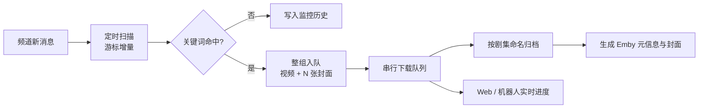
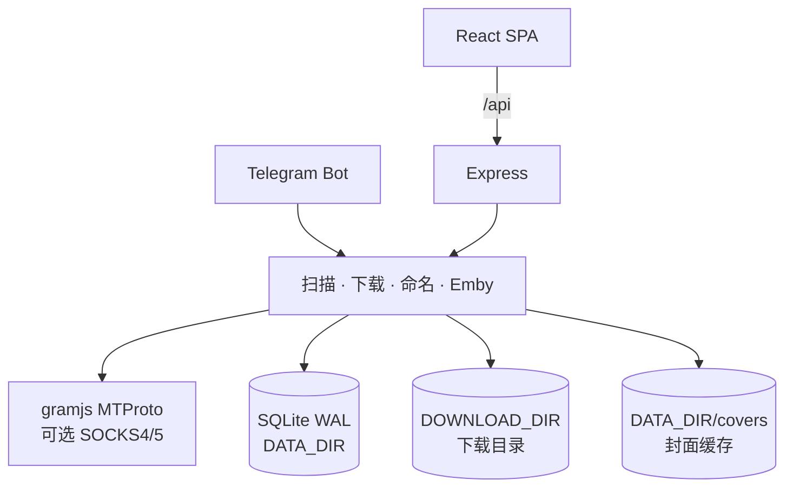

# tgsub 项目文档

> 这是 tgsub 的**完整技术文档**，涵盖功能细节、工作原理、全部配置项、HTTP 接口、开发自检与常见问题。
>
> 只想要「怎么部署起来用」→ 看 [README.md](README.md)，里面有精简版说明与开箱即用的
> Docker Compose 部署步骤（直接从 Docker Hub 拉镜像，无需 clone 仓库）。
>
> 本文档内容以 [README.md](README.md) 指向为准，两处若有出入，以 README 的部署章节为最新。

**Telegram 频道关键词订阅下载器** —— 定时扫描指定频道，命中关键词后把整条消息（含相册整组）的文件自动下载到本地，按剧集命名并生成 Emby 可直接读取的元信息。自带 Web 管理界面与 Telegram 机器人遥控，一条 `docker compose up -d` 即可长期运行。

<p>
  <a href="LICENSE"></a>
  
  
  
</p>

```
频道消息 ──▶ 定时扫描 ──▶ 关键词匹配 ──▶ 下载队列 ──▶ 剧集命名 + Emby 元信息 ──▶ 本地文件 + 管理界面
```

> 说明：本项目面向「订阅自己已加入的频道、把内容归档到本地媒体库」这一自用场景。请遵守 Telegram 服务条款与内容版权，不要用于传播违法内容。

---

## 目录

- [功能特性](#功能特性)
- [工作原理](#工作原理)
- [技术栈](#技术栈)
- [快速开始](#快速开始)
  - [方式一：Docker Compose 拉取 Docker Hub 镜像（推荐，免编译）](#方式一docker-compose-拉取-docker-hub-镜像推荐免编译)
  - [方式二：Docker Compose 本地构建](#方式二docker-compose-本地构建)
  - [方式三：本地运行](#方式三本地运行)
  - [首次配置](#首次配置)
- [配置说明](#配置说明)
- [第三方平台下载（B站 / 小红书 / YouTube）](#第三方平台下载b站--小红书--youtube105--124)
- [网页 / m3u8 视频下载](#网页--m3u8-视频下载130)
- [剧集改名与合并](#剧集改名与合并131)
- [手动下载提交记录](#手动下载提交记录131)
- [分来源下载目录](#分来源下载目录132)
- [管理界面登录](#管理界面登录132)
- [下载调度与完成通知](#下载调度与完成通知133)
- [概览页：环境与工具链总览](#概览页环境与工具链总览)
- [Telegram 机器人](#telegram-机器人)
- [HTTP 接口](#http-接口)
- [数据、备份与迁移](#数据备份与迁移)
- [目录结构](#目录结构)
- [开发与自检](#开发与自检)
- [常见问题](#常见问题)
- [已知限制](#已知限制)
- [安全提示](#安全提示)
- [License](#license)

---

## 功能特性

### 抓取与订阅

- **频道管理**：支持 `@username`、`t.me` 链接、频道数字 ID、`t.me/+` 邀请链接（尝试自动加入）。
- **关键词订阅**：一个订阅可含多个关键词，三种匹配方式（包含 / 完整词 / 正则），可限定只在指定频道生效。
- **定时扫描**：全局间隔（默认 15 分钟），基于每个频道的游标增量拉取，不会重复处理历史消息。
- **整条消息下载**：命中相册中任意一条，就把同一 `groupedId` 的所有文件一起下载——以「消息」为单位，不是以文件为单位。
- **监控历史**：每次扫描实际查看过的消息全部留痕（命中 / 过滤 / 未命中 / 空消息），可按频道、状态筛选、全文搜索，一键跳转原消息，用来排查「为什么这条没下载」。
  - 同一条消息重复扫到只累加「扫描次数」并刷新「最近扫描时间」，不堆重复行。
  - 增量不足时会回看频道最近 20 条（留痕不重复入队），频道安静时页面也不会空着。
- **按链接直接下载**：`手动下载`页粘贴 `t.me` 链接即可抓取（公开/私有频道、相册整组均可），私有频道的 `t.me/c/<内部ID>/<消息ID>` 链接同样支持；1.3.6 起支持帖子评论区的 `?comment=<评论ID>` 链接（见专门章节，一次可粘多条）；监控历史每条记录也有「下载」按钮，机器人收到链接同样立即开始。
- **网页 / m3u8 视频下载**：除了 Telegram 与平台分享口令，还能直接发**普通网页链接或 .m3u8 直链**——自动解析页面里的 `<video>`/`<source>`/JS 变量，挑不出再试 `playlist/index/live/hls.m3u8` 等常见播放器路径兜底，解析出 m3u8 后用 ffmpeg 合并下载（AES-128 加密会自动取 key）。防盗链靠自动带 `User-Agent` + **视频页原地址**作 `Referer` + `Origin`；页面内嵌地址会先还原 HTML 实体（`&amp;` 不还原会把签名参数写坏，CDN 直接 403），解析期间浏览器拿到的 Cookie（`cf_clearance`、登录态）也一并存进任务交给 ffmpeg，下载报 403 / 404 / 410 时还会用原链接重新解析一次换新签名。机器人发链接、Web 手动下载页粘贴链接都支持，落库为 `source=m3u8` 的独立任务，下载完同样生成 NFO 与封面。
  - **SPA / 签名接口站点（无头浏览器兜底）**：很多视频站是单页应用，m3u8 由页面 JS 向带签名的 API 请求得来，静态抓 HTML 根本看不到。此时自动用**无头 Chromium**把页面真正渲染出来、监听网络请求截获真实的 `.m3u8`（含 hls.js 经 fetch 喂给 MSE 的情况，按 `content-type` 识别），再交给 ffmpeg 下载。触发播放按钮、隐藏 `navigator.webdriver` 以降低被识别概率。`Chromium` 由镜像构建阶段 `playwright install chromium` 装好（默认路径 `/opt/playwright`，运行时靠 `PLAYWRIGHT_BROWSERS_PATH` 定位）；**本地开发若想测这条链路，需先 `npx playwright install chromium`**（约 170MB，受限网络可能很慢或下不下来，可只在能联网的部署上验证）。若 Chromium 没装，解析器会优雅降级为原来的报错文案，不会让服务崩溃。
    - **标题取渲染后的**：SPA 常常等数据回来才把真实剧名写进 `<title>`，所以标题在**截获 m3u8 之后**才取；过早取会拿到空壳的初始标题（如站点通用名），导致文件名和 NFO 剧名都不对。
    - **失败重试一次**：走代理时 `ERR_CONNECTION_CLOSED` / 超时很常见，单次失败就报错体验太差，故解析失败会换新 context 再试一次。
    - **空闲自动关浏览器**：Chromium 常驻约 150MB 内存，NAS 上不该一直占着，故空闲 3 分钟后自动关闭，下次用时再拉起。
  - **代理（`M3U8_BROWSER_PROXY`）**：网页解析与 ffmpeg 下载共用一个代理。`pickProxy()` 优先读 `M3U8_BROWSER_PROXY`，未设时回落到 `HTTPS_PROXY` / `HTTP_PROXY`（大小写都看），并**自动跳过 `127.0.0.1` / `localhost`** —— 这类是开发工具的内部代理，指向它们会让外网视频站访问失败。ffmpeg 的 http/https 协议读 `http_proxy` / `https_proxy` 环境变量，所以切片与 AES 密钥也一起走代理。
  - **ffmpeg 输出的坑（务必记住）**：ffmpeg 靠**输出文件扩展名**推断封装格式，写成 `xxx.mp4.part` 会直接报 `Invalid argument`（真实信息是 "Unable to find a suitable output format"）。因此 ffmpeg 先写到 `os.tmpdir()` 下**带 `.mp4` 扩展名**的临时文件（并显式 `-f mp4`），下载完成再 rename 到最终路径（node 的 rename 处理中文没问题；跨卷时回退 copy + 删源）。
- **提交记录（1.3.1）**：「手动下载」页最下面按时间倒序列出每一次提交 —— 链接、时间、状态（已入队 / 之前下过 / 没入队 / 失败 / 已取消）、来源平台、标题摘要、失败原因原文。记录由服务端在真正办事的接口里写，关掉页面、手机提交、脚本调接口都留痕；可筛选、搜索、单条删除、「再提交」、按范围清空。
- **分页与清空**：监控历史、下载记录都可切换每页条数（20 / 50 / 100 / 200，或手动输入 5–500，按页面记住上次选择），底部是「首页 / 上一页 / 页码跳转 / 下一页 / 末页」的翻页条（不是无限加载）；「清空」按钮带范围选择——监控历史可只清未命中、下载记录可只清已结束，还能顺带删除磁盘上的原文件。

### 下载与队列

- **两条下载车道，互不排队**：
  - **Telegram 车道**：媒体常位于独立数据中心，gramjs 每次下载都要「导出授权 + 切 DC」，并发会互相打断成 0 字节，因此 Telegram 下载固定**串行**（同连接上同时只跑 1 个）。
  - **外部车道（平台 + m3u8）**：B站 / 小红书 / YouTube 走独立 yt-dlp 子进程，m3u8 网页视频走独立 ffmpeg 子进程，都跟 Telegram 连接完全无关，因此放在同一条独立车道**并行**；并发数由「并发下载数」设置控制（默认 3），外部任务不再和 Telegram 排队，B站、小红书、YouTube、m3u8 之间也能同时下。
- **失败重试**：单任务自动重试一次，仍失败则标记失败；支持单条重试与「重试所有失败任务」。
- **进度明细**：每条任务显示总大小、已下载量、实时速度、剩余时间，以及开始/完成的具体日期时间（下载中每秒刷新，速度取 250ms 采样做指数平滑，数字不跳）。
- **队列管控**：每条任务带「暂停 / 停止 / 继续 / 插队」。
  - 暂停 / 停止会在下一个数据块写完后立即中断，已下载字节保留展示；
  - 继续把任务排到队首，当前任务下完即开始；
  - 插队提到队首，若有任务正在下载会先让它让位、稍后自动续上；
  - gramjs 不支持断点续传，继续/让位后都从 0 重新下载。
- **文件过滤**：可按最小 / 最大文件大小跳过不需要的内容；**视频不受过滤影响**（设了 30MB 上限也不会把整集正片挡掉）。
- **半截文件处理**：中断残留就地覆盖，不会产生 `xxx (2).mp4`；服务启动时清理 0 字节残留。

### 命名与 Emby 元信息

- **剧名与集数双来源**：先看正文，再看 Telegram 给的原始文件名。
  - 正文里有《剧名》就用它：`《美人局》第4集 …` → `美人局/美人局S01E04.mp4`；
  - 正文没有书名号，但写了集数（`妈妈我爱你 EP1-10`）时，把集数标记抹掉剩下的就是剧名；
  - 正文也认不出时，从原始文件名里推：`2048真实故事改编 - 妈妈我爱你 第1集 - AI短剧.mp4` → 剧名「妈妈我爱你」、第 1 集。
  - 抹完只剩「连载中 全系列完整版」这类宣传语时不当剧名用，退回兜底命名。
- **集数标记**：认得 `第4集`、`第1-10集`、`第1、2集`、`第一集`、`第十二集`（中文数字）、`EP1`、`EP1-10`、`S01E01`、`S01E01-E10`；
  优先级是「文件名自带集号 > 正文声明的集数按原文件名顺序对应 > 从首集顺延」。
- **一个链接多个视频按原文件名排序**：相册的消息顺序（id 递增）不一定等于作者上传的真实顺序，
  转发、补发、批量上传都会打乱。所以一条消息里有多个视频时，先看原始文件名里的序号
  （`01.mp4`、`2 - 片段.mp4`、`标题_03.mp4`），按它排出先后，再套正文声明的集数；
  正文没写集数时序号直接当集号（`01.mp4` → `S01E01`）。
  `2048真实故事.mp4`、`1080p.mp4`、`VID_20240101_1203.mp4` 这类数字不当序号；
  序号有缺失或重复时整体退回消息顺序，不猜一半留一半。
- **逐集编号**：相册里 10 条消息各带一集时，产出 `S01E01` ~ `S01E10`，
  剧集文件夹名只留剧名（`妈妈我爱你`），不再带 `EP1-10` 这类后缀。
- **一个文件含多集**：只有一条消息、一个视频，而正文或文件名声明了集数区间时，
  用范围名 `剧名S01E01-E10.mp4`，Emby 会认成第 1-10 集。
- **不重复加序号**：文件名里已经带出 `S01E01` 这类集号时不会再追加 `-01` 序号后缀（集号重复没意义），
  只有认不出集号、一条消息里塞了多个视频时才用 `剧名-01.mp4` 区分。
- **边下边生成元信息**：视频落盘后在剧集目录写出 Emby 可直接读取的文件，扫描即出海报、简介、集数。
- **历史文件自动改名**：升级后启动时会把旧的兜底命名（`妈妈我爱你 EP1-10-01.mp4`）改成剧集命名
  （`妈妈我爱你S01E01.mp4`），文件夹一并改名，NFO 里的季集与剧名同步重写。

- **认不出标题时一个链接一个文件夹**：正文里没有《剧名》这类标题、但带视频的消息，单独建一个文件夹，
  文件夹与文件同名（取正文首行，去掉链接 / @提及 / #标签，最长 50 字）；同一条消息多个视频加 `-01`、`-02`，
  两条不同链接撞名时后一条补 `-<消息id>`。纯文档 / 音乐 / 图片消息不受影响，仍走路径模板。
  可在设置里关掉。
- **封面与缩略图默认「模糊填充」**：比例和目标规格不一致时，画面完整居中保留，
  空出来的边角用同一张图的放大虚化版 + 压暗填满（见 `tg/coverimage.ts` 的 `writeBlurFill`），不黑边也不裁切。
  截帧仍用 ffmpeg 随机截 6 帧，为该集写 `<剧名S01E04>-thumb.jpg`（最长边不超 1280）再交给 `writeBlurFill` 出图；
  剧集目录的 poster / landscape / fanart 取自第一集、其余集只补缺不覆盖（1.2.0 起）。

```text
美人局/
  美人局S01E01.mp4        正片
  美人局S01E01.nfo        episodedetails：标题 / 季集 / 简介 / 标签 / 原消息链接
  美人局S01E01-thumb.jpg  这一集的随机截图（每集各不相同）
  美人局S01E02.mp4
  美人局S01E02-thumb.jpg
  tvshow.nfo              剧集信息（Emby 剧集库读这个）
  poster.jpg              竖版海报 1000×1500（取自第一集）
  landscape.jpg           横版图 1920×1080（取自第一集）
  fanart.jpg              背景图 1920×1080（取自第一集）
```

```text
妈妈我爱你/                       ← 相册 10 集，正文写「EP1-10」，文件名里写着「第N集」
  妈妈我爱你S01E01.mp4
  妈妈我爱你S01E02.mp4
  ...
  妈妈我爱你S01E10.mp4
  妈妈我爱你S01E01.nfo            每集一份
  tvshow.nfo
```

```text
妈妈我爱你/
  妈妈我爱你S01E01-E10.mp4        ← 单个视频本身就是 1-10 集的合集
```

```text
老板今天又发飙了，速看 完整版/          ← 认不出标题时，文件夹名就是正文
  老板今天又发飙了，速看 完整版.mp4
  老板今天又发飙了，速看 完整版.nfo
  tvshow.nfo
  poster.jpg  landscape.jpg  fanart.jpg  ← 由视频随机截帧生成
```

- 三张剧集封面用「模糊填充」出图：竖版槽位（poster 2:3）优先竖版帧、横版槽位（landscape / fanart 16:9）优先横版帧，朝向一致时虚化面积最小、观感最好；
  朝向一致就裁满，整段视频只有一种朝向时另一个朝向留黑边保住画面。
- 缩放依赖可选的 `sharp`，装不上时退化为原图复制，不影响下载。
- 监控历史里的悬停预览（`data/covers/`）只服务于界面回看，取自消息缩略图，与 Emby 封面无关。

### Emby 入库通知

下载完成的最后一件事是通知 Emby：把文件路径 POST 给 `/Library/Media/Updated`，Emby 只对这条路径做增量扫描，
新集几十秒内出现在媒体库里 —— 不必等它的定时任务，也不用去后台手点「扫描媒体库」。

- **配置位置**：设置页「Emby 媒体信息与入库通知」卡片，展开后第 2 节「入库通知」（1.3.5 起从独立页面收回设置页，1.3.17 起三节合成一张卡）。地址 / API Key / 路径映射与 Emby 自身的看板配置互不影响，关掉开关即完全停止。
- **路径映射必须有**：容器里是 `/downloads`，Emby 看到的是宿主目录（群晖 `/volume1/...`）。
  不映射时 Emby 照样返回 204，只是静默忽略 —— 媒体库里始终不出新集，这是最容易误判成「通知没生效」的情况。
- **合批**：相邻几集通常连着下完，攒 2.5 秒合并成一次请求（单次最多 50 条路径），只触发一次增量扫描。
- **失败不牵连下载**：网络抖动或 Emby 正在重启时重试一次并记 warn 日志，下载任务本身仍然标记成功。
- **兜底与补推**：页面上的「让 Emby 全库扫描」用于补历史文件；「补推路径」可对单个老剧集目录补一次通知。
- **密钥安全**：API Key 与 session / bot token 一样用 `SESSION_SECRET` 加密落盘，`/api/settings` 只回掩码与是否已配置。

### 媒体库（本地目录浏览与播放，1.3.5；界面 1.3.7 重做）

侧边栏第二位「**媒体库**」展示**你自己选的目录**（默认下载目录）里的剧集，点剧集看分集、点某一集直接播。
这一页**不依赖 Emby**：NFO、封面、视频全在本地磁盘上，Emby 没配也照样能看。
配置类的东西（媒体信息生成、入库通知、ffmpeg 路径）统一放在设置页「Emby 媒体信息与入库通知」——
1.3.17 起三块（媒体信息 / 入库通知 / Emby 端还要做三件事）合成**一张可折叠卡片**：
只有一个标题栏、一个展开箭头、一个汇总状态徽章（两项都开且入库配置齐全 = 已启用，只开一项 = 部分启用），
展开后三节用分隔线排开（`EmbySettingsPanel.tsx` 用一张 `CollapsibleCard` 兜住，
`EmbyNotifyPanel` 的 `embedded` 模式只输出内容、不再画自己的标题栏）。
徽章在卡片收起时也要准：`EmbySettingsPanel` 自己拉一次 `/api/settings` + `/api/emby/status` 兜底，
展开后再由 `EmbyNotifyPanel.onState` 回吐最新状态；收起时入库面板不挂载，也不会继续 8 秒轮询。

- **界面结构（1.3.7 重做，仿 SenPlayer / Hills / Infuse 那类现代播放器）**：
  - 目录页 = **沉浸式 Hero + 自适应海报墙 + 横向片架**。Hero 取「最近更新」的那部剧，
    有横版剧照（`landscape`）就用剧照铺底；**只有竖版海报时放大虚化当氛围底**，
    不要把 2:3 直接 `object-cover` 拉成横条（会把画面裁糊）；两样都没有才用网格底纹。
  - 海报墙用 `auto-fill`（`minmax(148px→166px, 1fr)`），窗口宽窄自己排，
    不要写死 `grid-cols-5 xl:grid-cols-6` —— 换个窗口宽度就会在右边留一片空洞。
  - 剧集页 = 背景主视觉（海报 + 标题 + 年份 / 集数 / 体积 / 类型 / 评分 + 简介）+ 选集，
    选集有**网格**（16:9 缩略图 + 集号 + 标题 + 简介 + 参数）和**列表**（信息密度高、适合几十集）两种视图，
    切换记在 `localStorage['tgsub.media.epview']`；网格同样用 `auto-fill`。
  - 播放是**影院式弹窗**（`max-w-6xl`），`[` / `]` 切上一集下一集、`Esc` 关闭，底部「下载」外链原文件。
  - 工具条：面包屑（相对下载根逐级，可点回上层）、搜索（`/` 聚焦）、排序（最近更新 / 名称）、
    「HEVC 试播」、选择目录、刷新。浏览位置 `tgsub.media.dir`、排序 `tgsub.media.sort` 都记在本机。
  - **Hero 是独立深色卡片**：浅色主题下也不变白，压在图上的文字必须写死 `text-[#fff]`
    （主题自适应的 `text-white` 在浅色主题下会变深色，压黑遮罩直接看不见）。
- **看的是哪个目录**：默认下载根，可以用「选择目录」逐层浏览切换，也接受设置里那 5 个来源目录与手动登记的外部来源。
  选择结果记在浏览器本地，刷新后还停在原处。只认「下载根内或已登记来源」，别的路径服务端直接 403。
- **一屏 = 这个目录下的剧集**：目录里每个「自己装了视频的文件夹」算一部剧（`collectSeriesDirs` 的同一套判定），
  卡片显示封面、集数角标、来源徽章、`年份 · 集数 · 体积`。排序可选「最近更新 / 名称」，同样记在本地。
- **目录里直接放的视频**（没归进任何剧集文件夹）不会消失，作为「单集」卡片一起列出来，点了直接播。
- **封面找法**（`findSeriesArt`）：`poster` → `folder` → `cover` → `show`（.jpg/.jpeg/.png/.webp），
  都没有就退回第一集的缩略图 `<base>-thumb.jpg`；再没有才显示占位。所以哪怕从没生成过海报，卡片也不是空白。
- **剧集页**：海报 + 标题、年份、集数、总大小、类型、评分、简介（全来自 `tvshow.nfo`，没有就退回目录名），
  下面一张分集表 —— 每集一张 16:9 缩略图（右下角压时长），旁边是集号、NFO 里的标题、**本集简介**、
  分辨率、大小、编码、更新时间，整行可点直接播。
- **单集缩略图**（`existingEpisodeThumb` / `generateEpisodeThumb`）：三级来源，从便宜到贵往下退：
  1. 下载时已经生成好的 `<base>-thumb.jpg`（还有同名 `.jpg/.png/.webp`）—— 直接发，不抽帧；
  2. `data/cache/episode-thumbs/` 里的抽帧缓存 —— key 是 `sha1(路径 + 大小 + mtime)`，文件被替换自动失效；
  3. 现场用 ffmpeg 抽一帧：跳过片头取 12% 处（不早于第 3 秒、不晚于结尾前 1 秒），不足 5 秒的短片取第 0 帧，
     首选时点抽不出画面时自动退回第 0 帧。抽完落缓存，同一文件不再重复抽。
  同一文件的并发请求合并成一次抽帧（海报墙滑过去会打好几个请求），抽不出来就 404，
  前端显示占位图标 —— 视频损坏也只是一格没图，不影响整页。
- **播放四种情况**（`playModeOf`）：
  - `direct`：mp4 / webm 且编码是 h264 / vp9 / av1，`/api/media/stream` 按 Range 直出，能拖进度条；
  - `remux`：mkv / ts / avi 这类容器，但编码能解 —— 服务端用 ffmpeg `-c copy` 换成 fragmented MP4 管道输出，
    能正常播；实时流没有总长度，前端自己画一条进度条，拖动就用 `start=` 重新起一路；
  - `transcode`：编码浏览器解不了（HEVC / H.265、ProRes、MPEG-2），但服务端有可用显卡 ——
    硬解 + 硬编成 H.264 实时串出去（见下面的「硬件解码 / 显卡转码」）；
  - `unsupported`：既不能直连、又没有显卡可转，列表标灰并说明，点了给「下载」引导，不假装能播。
  优先级是「能直出就直出（不占 GPU）→ HEVC 且用户要求直连就先直连 → 有显卡才转码」。
- **播放器控制条（1.3.14 自绘，不再用 `<video controls>`）**：`web/src/components/VideoPlayer.tsx`。
  原生控件在实时流上等于废的（fMP4 没有 `Content-Length`，`duration` 是 `Infinity`，
  原生进度条画不出来也拖不动），所以整套自绘，两种模式共用一条：
  - 按钮：播放/暂停、后退 10 秒、前进 10 秒、当前/总时长、**「跳到 00:00」输入框 + 跳转键**、
    音量（含滑杆）、倍速（0.5–2×，面板里带「连播」开关）、截图当前帧、画中画、上一集/下一集、全屏；
  - **跳转是「曲线」实现的**：`direct` 直接改 `video.currentTime`（瞬时、可随意拖）；
    `remux` / `transcode` 没法 seek —— 把目标秒数拼成 `?start=` **重开一路流**，服务端 `-ss` 输入侧 seek，
    ffmpeg 会从目标前一个关键帧解码并丢弃到目标点，所以落点是准的；
    重开有 **280ms 防抖**（连按快进只起一个 ffmpeg），期间 UI 用目标位置占位，第一帧到了再对真实位置。
  - 输入框接受 `83`（秒）/ `1:23` / `01:02:03` 三种写法（`parseSeekText`），回车或点跳转键生效；
    没探测到时长时进度条禁用，但输入框仍可用（知道要看第几秒就够）。
  - 快捷键：`空格`/`k` 播放暂停、`←`/`→` ±5 秒（`Shift` ±30）、`↑`/`↓` 音量、`m` 静音、`f` 全屏、
    `Home`/`End` 首尾、`0`–`9` 跳到 10%–90%、`[`/`]` 切集、`Esc` 关闭；单击画面播放暂停，双击全屏。
  - 全屏是给 `.player-stage` 整体加 `:fullscreen`（样式在 `index.css`），控制条是它的绝对定位子元素，
    全屏后依旧贴底；视频在全屏里 `object-fit: contain`（不再受 `aspect-video` 限制）。
  - 控制条 2.8 秒无操作自动淡出（播放中才隐藏），鼠标移回、暂停、重开流时自动出现。
    压黑底的文字一律写死 `text-[#fff]`，浅色主题下才看得见。
- **换封装 / 转码只在真出数据后才发响应头**：ffmpeg 一个字节都没出就退出（文件损坏、编码不认识、显卡没权限）时
  返回 500 + 最后一行 stderr，而不是「200 + 空白」，播放器不会对着空流转圈。
  客户端关页面 / 拖动重开时子进程立刻 `SIGKILL`，不留僵尸 ffmpeg。
- **探测缓存**：`ffmpeg -i` 的解析结果按 `路径 + 大小 + mtime` 缓存，最多 800 条，
  并发上限 4 —— 一季几十集不会同时把机器打满，二次进入秒开。
- **可播边界说明**：浏览器解码能力由浏览器决定；服务端只会「换封装」或「显卡转码」，不做软件转码（那会把 CPU 烧穿）。
- **HEVC 直连（`hevc=1`）**：工具条上的开关，本质是「我这台浏览器能自己解 HEVC，别占用显卡」。
  Safari、装了 HEVC 扩展的 Edge、带硬解的机器确实能放，多数 Windows / Linux 上的 Chrome 不能。
  这件事**按浏览器存 localStorage**（`tgsub.media.hevc`），不跟着账号走：
  - **没存过时按浏览器能力自动决定**：`canPlayType('video/mp4; codecs="hvc1…"')` 有值就默认直连，否则默认关（走转码）；
  - 打开后 `/library`、`/series` 带上 `hevc=1`，HEVC 按容器判成 `direct`（mp4/m4v）或 `remux`（mkv/ts 等），
    分集标「试播」角标；换封装时额外加 `-tag:v hvc1`，不加的话 Apple 系只认 `hev1`，会判成解不了；
  - 关掉后 HEVC 交给显卡转码，分集标「显卡转码」；解不出来时播放弹窗直说原因，而不是一直转圈。
- **直连与转码互斥**：`trial` 只在 `direct` / `remux` 时才是真（“靠直连才可播”），
  转码的集不会再叠一个「试播」角标 —— 两个角标叠在同一位置会互相压住（踩过）。

### 硬件解码 / 显卡转码（N100 这类带核显的 NAS）

浏览器普遍不解 HEVC，但 NAS 上的 Intel 核显（N100 / N305 / 群晖带 iGPU 的机型）能硬解。
本版把这条路打通：**能直出就直出，编码不兼容才用显卡实时转码**，CPU 基本不烧。

- **能力探测**（`tg/hwdecode.ts` 纯逻辑 + `tg/ffmpeg.ts` 的 `hwCapability()`）：三步，任何一步不过都如实说原因：
  1. `ffmpeg -hwaccels` 里有 `vaapi` / `qsv`，且 `-encoders` 里有 `h264_vaapi` / `h264_qsv`；
  2. VAAPI 需要 `/dev/dri/renderD128`（依次试 128/129/130）——容器必须映射显卡设备；
  3. **真编一帧黑底视频**验证驱动可用（`-f lavfi color=… -c:v h264_vaapi -f null -`）。
     只查参数不试，容器里少驱动时会误报可用，播放时才 500。
  结果缓存 10 分钟（容器加显卡要重启才生效），`HW_ACCEL=auto|none|vaapi|qsv|software` 可强制指定。
- **转码参数**（`buildTranscodeArgs()`）：**只把解码交给显卡，滤镜留在 CPU**。
  强制 `-hwaccel_output_format vaapi` 的话，遇到 vaapi 解不了的编码 ffmpeg 会退回软解，
  帧变成系统内存格式，后面的 `*_vaapi` 滤镜直接报错；不强制输出格式就是「能硬解就硬解、不能自动软解」。
  - VAAPI：`-hwaccel vaapi -hwaccel_device D -vaapi_device D -vf scale=-2:H,format=nv12,hwupload -c:v h264_vaapi`；
  - QSV：`-hwaccel qsv [-hwaccel_device D] -vf scale=-2:H,format=nv12 -c:v h264_qsv`（qsv 编码器吃系统内存帧，不用 hwupload）；
  - `software`：`libx264 -preset veryfast -crf 22`，只在显式 `HW_ACCEL=software` 时用（无显卡环境 / 自测）；
  - 目标高度 `min(1080, 源高)` 取偶数、不放大；码率按高度分档 6M / 3.5M / 1.8M / 1M；
    音频统一 AAC 160k 双声道（浏览器对 AC3 / DTS 支持很差）；输出 `frag_keyframe+empty_moov+default_base_moof` 的 fMP4 管道。
- **拖动进度条**：实时流没有 Content-Length，`<video>` 原生进度条是废的。
  `/api/media/stream?mode=transcode|remux&start=秒` 用**输入侧 seek**（`-ss` 在 `-i` 之前）重新起一路流，
  前端按 `durationSec` 自绘进度条，松手就带着 `start` 重挂播放器，转码约等 1~3 秒。
- **部署**（docker-compose.yml 里已写好注释，取消注释即可）：
  ```yaml
  devices:
    - /dev/dri:/dev/dri
  ```
  **只映射设备就够，不要写 `group_add`。** Docker 的 `group_add` 是按**宿主机 `/etc/group` 的组名**
  解析的，而群晖 / 威联通 / 绿联的组文件里只有 `video`、没有 `render`，写 `group_add: ["video","render"]`
  会直接报 `unable to find group render: no matching entries in group file`，容器**创建**阶段就失败
  （不是启动失败，是根本建不出来）。入口脚本改为在容器内 `stat -c %g /dev/dri/renderD128` 读出设备真实属组，
  降权时用 `setpriv --groups=<gid>` 加进补充组，所以任何 NAS 都不用配。
  镜像里装的是 Debian 的 `ffmpeg` + `libva2` + `libva-drm2` + `intel-media-va-driver`（Gen12 的 iHD 驱动），
  并用 `FFMPEG_PATH=/usr/bin/ffmpeg` 指过去 —— npm 里的静态 ffmpeg 在部分平台没编入 VAAPI，不能只靠它。
  默认不设 `LIBVA_DRIVER_NAME`，让 libva 自己挑驱动（Intel 选 iHD、AMD 选 radeonsi）；
  老平台 / 异常时可在 compose 里加 `LIBVA_DRIVER_NAME: iHD` 强制指定。
  宿主机没有 `/dev/dri`（ARM NAS / VPS）时不要放开这段，否则容器会因找不到设备起不来。
- **怎么看有没有生效**：媒体库工具条右侧的绿色「硬解 · VAAPI」徽章（没有则是灰色「无硬解」，悬停看原因）；
  概览页工具链里也多了一项「硬件解码」，显示编码器与设备节点或失败原因。

### 元数据编辑

### 元数据编辑

- **像文件管理器一样读取下载目录**：元数据页以**文件系统为准**聚合——递归扫描下载根下所有视频文件，
  按剧集文件夹分组、规范化显示（剧名 / 季 / 集、大小、时间、来源都由文件名与物理路径推导），
  **无论这些文件是不是 tgsub 下载的**：手动拷进来的、或别的工具下的视频也会像其它条目一样出现，
  不用先在 downloads 表里登记。命中的下载记录会 enrich 出频道名、来源平台等元数据；没命中的标为「外部」来源。
  扫描结果带 5 秒 TTL 缓存，刷新元数据页不会每次都全盘重扫（下载根扫描是纯路径动作，不动磁盘）。
- **按文件夹聚合的目录树**：一个文件夹 = 一条记录，首级显示剧集信息（`tvshow.nfo` + 剧集封面），
  点左侧箭头展开后，子级逐条列出该目录里的每个视频（单集信息）。文件夹 / 单集两种层级都能编辑、
  换图、生成 NFO，点顶部「单集 / 剧集(tvshow)」可切换编辑目标。
- **不只是下载的文件**：元数据页支持「手动添加」服务器上的本地视频文件或视频目录（服务端目录浏览），
  登记后与项目下载的文件共用同一套编辑逻辑，同样能生成 NFO、抽帧做封面。
  路径写入 `media_sources` 表，允许操作的范围限定在下载目录与已登记来源内，其它路径一律拒绝。
- **手动目录按剧集文件夹展开**：添加一个上级目录（如 `D:\短剧`）时，会自动遍历并按里面的剧集文件夹拆开显示，
  每一剧各成一条，而不是把所有视频平铺成一条；`剧名/Season 01/` 这种季目录结构会归到剧名目录下。
  剧集条目下方标注了「来自 xxx」的来源路径。
- **手动来源可删除**：手动来源的剧集条目右侧有删除按钮，点开二次确认后移除登记，
  只移除登记关系，磁盘上的视频、NFO 与封面都不会被删除。
- **每一项都能隐藏 / 删除（1.3.4 拆成两个按钮）**：目录树的剧集目录行、展开后的单集视频行各有两个按钮；
  勾选多个后底部浮条同样有「隐藏 / 删除」两个按钮，支持批量。
  - **隐藏**：只从列表移除、**磁盘文件原封不动**，写一条 `media_excluded` 隐藏登记，**刷新后也不会再出现**
    （文件仍被上级目录来源覆盖也不会冒出来，因为登记按前缀匹配）。隐藏的条目**不在「添加」对话框里**，
    而是集中在工具栏的「**已隐藏 (N)**」面板单独查看，可一键恢复显示。
  - **删除**：连磁盘文件一起删——视频 + 它的 NFO + `<base>-*.jpg` 缩略图 + 剧集级 `tvshow.nfo` 与五张封面；
    删空了的目录（含季目录）一并收走，字幕等其它文件保留并在预览里单独列出。需二次确认看清会删哪些文件才执行。
  - 两种操作都会同步清掉指向这些文件的 `downloads` 记录、以及落在范围内的 `media_sources` 来源登记。
  - 删除会通知 Emby（`UpdateType=Deleted`），让 Emby 把这一条从库里摘掉；隐藏不会动 Emby。
  - 删除 / 隐藏范围受 `isAllowedPath` 约束：只有下载目录内、或已登记来源（含其子目录）里的路径能操作，其余一律 403 拒绝。
- **一键生成**：选中文件夹或视频点「一键生成」，自动按文件名解析剧名 / 季 / 集，为每个视频写单集 NFO、
  补一份 `tvshow.nfo`，目录里没有封面时用 ffmpeg 随机截帧补齐横版 / 竖版封面。
- **自动生成 NFO 保留原文件名与来源（1.3.4）**：下载落盘自动写、以及「一键生成」补写的 NFO 都会带上
  追溯字段 —— `<originalfilename>`（Telegram 取消息原始文件名、平台 / 网页取视频页链接里的文件名、外部目录取磁盘名）
  与 `<source>`（来源文字 + 原链接，如 `B站 https://www.bilibili.com/video/BV…`；Telegram 含频道名与消息链接）。
  两个字段都进编辑表单（「原文件名」「来源」两栏），可读可改。重新生成时不会覆盖已写过的追溯字段：
  生成结果只刷新模板字段（title/season/episode/plot…），`<originalfilename>` / `<source>` / 自定义标签 / 嵌套块原样保留，
  仅当原文里完全没有或该标签为空时才由生成结果补写；NFO 解析不出来时生成**不动原文**，避免整份覆盖。
- **表单改 NFO 不破坏手写内容**：保存时只替换目标标签，`<uniqueid>`、注释、自定义标签原样保留。
  解析器用标签栈处理 `<actor>` / `<fileinfo>` 这类嵌套块（含注释、CDATA 里的尖括号），
  嵌套块整体保留、不会再吞掉它后面的字段；只有「可编辑字段自身含子标签」或 NFO 压根解析不出来时
  才禁用表单并引导改用「NFO 原文」。文件存在但解析失败时 `PUT /api/metadata/meta` 直接拒绝，
  **不会**用表单值整份覆盖原文（1.3.4 修复）。
  > 历史坑：旧解析器用单个 `open + depth`，遇到 `<actor><name>…</name></actor>` 时 `</name>`
  > 因名字不匹配外层而被忽略，depth 永远归零不了，导致嵌套块之后的 `showtitle` / `season` / `aired`
  > 全读不出来 —— 填了剧名保存后 NFO 里多出一个重复的 `<showtitle>`，重开页面仍是空的。
  > 同名标量标签现在优先显示第一个非空值，保存时收敛成一个。
- **ffmpeg 截帧当封面**：播放器拖到任意时间点截图，或一键抽 8 张候选帧挑选；目标尺寸按图片类型自动缩放，
  缩放方式可选「留黑边（默认）/ 裁剪铺满 / 拉伸」——比例不对时默认补黑边保住整张图，不裁掉画面。
  ffmpeg 来自内置的静态二进制，也可在设置里指定自己的路径；设置页会显示实际生效的路径、来源与版本号。
- **手动框选画面**：换封面时（上传图片 / 视频截帧 / 消息原图）都能在画面上拖框，选框比例锁定该图片类型的比例，
  框外用半透明遮罩标出「会被裁掉的部分」，支持拖角缩放与整体移动；也可以一键「用整张图」。
  服务端按原图尺寸换算成像素再裁剪，不经过浏览器压缩。
- **图片来源四种**：视频截帧、上传本地图片、消息原图（下载时用的那 3 张）、复制目录里已有的图；
  剧集级与单集级（`剧名S01E04-poster.jpg`）都能设置，改完在 Emby 里「刷新元数据 → 替换现有图片」即可生效。

- **剧集改名与跨文件夹合并（1.3.1）**：剧集详情页工具栏「重命名文件」可把整部剧的文件一起改名
  （视频、`.nfo`、缩略图、`tvshow.nfo` 与五张封面，NFO 里的 season/episode 同步更新）；
  勾选多个视频（可跨文件夹）后点「合并为剧集」，集号按原序号重排成连续的 E01…EN。
  两者都先出预览表再执行，重命名走两阶段（先临时名再落最终名）避免互相覆盖，失败按当前实际位置回滚。

- **保存元数据时同步改名（1.3.5）**：在「基本信息」里改了剧名（剧集层是 `title`，单集层是 `showtitle`），
  保存条上会出现「同时把磁盘上的名字改成「新剧名」」的勾选，**默认勾选**：
  - 剧集目录：文件夹名、每集文件名（`新剧名S01E0N.ext`）、`tvshow.nfo` 与各集 `.nfo` 里的剧名/季/集号
    一起改；单集 `.nfo` 与 `-thumb.jpg` 跟着视频改名。
  - 单集：文件名里的剧名前缀一起改；所在文件夹名等于原剧名时文件夹也一起改，否则只改文件名。
  - 数据库同步：`downloads.file_path / save_name / save_dir`、`media_sources.path`、`media_excluded.path`
    一并换到新位置；结束后给 Emby 发 `UpdateType=Modified`。
  - **保护**：目录名不等于原剧名时（平台目录 `telegram` / `B站`、用户自己的 `D:\影片`）一律不动目录 ——
    否则一次改名会把上层结构整个搬走。这种位置只改文件名，且文件名的剧名前缀仍会更新。
  - 取消勾选则只写 NFO，磁盘上的文件夹与文件名保持原样（适合只想改显示名的场景）。
  - 改名失败不影响已保存的 NFO：接口把失败原因放在 `rename.error` 里返回，界面提示「文件未改名：…」，
    用户处理完冲突（目标目录已存在同名剧）再保存一次即可。

- **按来源分区 + 批量搬运（1.3.3）**：左侧列表顶部一排来源标签（`Telegram` / `B站` / `小红书` / `YouTube` /
  `网页·m3u8` / `外部目录`），带各自条目数；选「全部」时按来源分组、每组一个吸顶标题，点某个标签就只看这一组。
  来源判定 = `downloads.source` + 文件相对下载根的第一段目录（目录名取设置里的 5 个 `dir_*`，改名后仍能认出）。
  勾选剧集目录或单集后底部浮出「合并 / 移动 / 复制 / 隐藏 / 删除」。
  - **移动**：整目录搬走（含 NFO 与封面），`downloads.file_path`、`media_sources.path`、`media_excluded.path`
    一起换成新前缀；Emby 收到「旧路径已删 + 新路径已加」两条通知。跨盘时自动退化成「复制 + 删源」。
  - **复制**：副本落下后自动登记一条 `media_sources`，否则它不在 `downloads` 里、列表根本看不见。
  - **重名一律跳过不覆盖**，同一批内部重名也只搬第一个。
  - **合并**只在勾的全是视频时可用（勾了目录会禁用）。
- **排列方式（1.3.3）**：来源标签下面一行「排列」= 4 挡 × 升降序，记在 `localStorage`
  （`tgsub:metadata:sort`）。纯逻辑在 `tg/mediasort.ts` 的 `sortFolders()` / `sortFiles()`。
  - 目录四挡：`name`（自然序）/ `updated`（目录 mtime 与文件 mtime 取最大）/ `size`（`totalSize`）/ `episodes`（`fileCount`）；
  - 分集四挡：`name` / `updated` / `size` / `episodes`（这一挡对文件是**集号**）；
  - 同值时次级键固定名称升序（降序也不反转），避免同体积条目每次刷新顺序跳动；
  - 认不出集号的文件（花絮、预告）在「集数」挡**永远垫底**，升降序都一样；
  - 来源分区的先后固定，排列只在分区内部生效（先排好序，再按 `originRank` 稳定排序一次）；
  - 接口取值非法（`sort=xxx`）直接回落名称升序，不报错。
- **残留记录可清理（1.3.3）**：`downloads` / `media_sources` 里还有、但磁盘上已经找不到的条目，
  列表与详情会标 `磁盘缺失`，删除不再被 404 挡住 —— 预览写明「本次只清理数据库里的记录」并列出将清除的
  下载记录条数，按钮变成「清理记录」。若该位置仍被上级来源目录覆盖，会补一条 `media_excluded` 隐藏登记，
  否则下次展开上级目录那个空壳又会冒出来。

### 亮色 / 暗色主题

- 顶部工具栏有「亮色 / 暗色」切换按钮，选择记在浏览器 `localStorage`，刷新后保持。
- 首次打开跟随系统（`prefers-color-scheme`），并在 React 挂载前用内联脚本定好主题，避免刷新时闪一下默认深色。
- 全部配色走 CSS 变量（`web/src/index.css` 的 `:root` / `html.dark` 两套），Tailwind 侧用 `darkMode: "class"`，
  颜色写成 `rgb(var(--x) / <alpha-value>)` 形式，`/10`、`/50` 这类透明度修饰符照常可用。
  语义约定：数字越小越显眼（`slate-100` 最强 → `slate-700` 最弱），`white` 是主题自适应的对比色
  （深色主题=纯白，浅色主题=深色文字），`ok / warn / err / info` 是状态色。

### 管理界面

概览统计、频道列表、订阅关键词、监控历史、手动下载、下载记录、**日志**、设置（含在线登录 Telegram）。
React 18 + Vite + TailwindCSS，无 UI 框架，玻璃质感 + 亮色/暗色双主题，桌面与移动端均可用。

1.3.2 起界面本身也要登录：首次访问强制设置管理员账号，之后凭账号密码进入（见[管理界面登录](#管理界面登录132)）。
登录页是独立的一套固定浅色视觉（浅灰底 + 居中白卡），**不跟随应用主题**；
页面上没有任何图片资源，只有文字、输入框与按钮。

### 日志页面

服务运行日志内置在 Web 界面的「日志」页，排障时不必 SSH 进容器：

- **级别筛选**：全部 / 错误 / 警告 / 信息 / 调试 / 追踪，每级带计数。
- **关键词搜索**：同时匹配日志正文与结构化附加字段（`err.code`、`dcId`、`dc` 等）。
- **自动刷新**：5 秒一次，仅第一页生效；**下载 / 清空**（二次确认）/ **详情展开**（查看完整字段与堆栈）。
- **三路输出**：`stdout`（`docker compose logs`）、磁盘 `data/logs/app.log`（10MB 轮转）、内存环形缓冲（最近 2000 条，重启后从文件尾部回灌）。
- 后端实现见 `server/src/lib/logstore.ts`（环形缓冲 + 落盘 + 查询）与 `server/src/routes/logs.ts`（查询 / 统计 / 下载 / 清空 / 回灌）。

### 概览页：环境与工具链总览

1.3.4 起，概览页不只是下载统计，还把「这台机器现在到底是什么状态」摊开摆明，排障不用再翻设置页与日志：

- **健康总览**：所有探针汇总成 `正常 / 留意 / 异常 / 未启用` 四档，最需要处理的几条直接列成警告条；
  「复制诊断」把版本、工具、服务、目录拼成纯文本，贴给维护者即可定位问题。
- **服务状态**（9 项）：Telegram 账号、机器人、自动扫描、下载队列、Emby 入库、网络代理、
  网页下载线路、管理界面登录、第三方平台；点卡片直达对应页面。
- **工具链**（8 个组件）：Node.js、ffmpeg、硬件解码（VAAPI / QSV 能力探测）、yt-dlp、Chromium（Playwright）、sharp、
  SQLite / better-sqlite3、Telegram SDK，逐项给出**版本 / 状态 / 绝对路径 / 来源 / 用途**，点路径可复制。
  - 路径口径与设置页一致（设置指定 → 环境变量 → 内置包 → PATH），显示的是**实际生效**的那个；
  - Chromium 版本优先取 `playwright-core/browsers.json` 的 `browserVersion`：
    Windows 上 `chrome.exe --version` 只会吐 crashpad 错误日志，不能当主来源；
    浏览器真正在跑时才用 `browser.version()` 覆盖。**绝不为了展示而启动浏览器**（常驻约 150MB）。
  - 可选组件（sharp / Chromium）缺失只标「留意」而非「异常」，因为它们都有降级方案；
    「未启用」的功能不计入待处理列表，避免天天误报。
- **存储与目录**：下载磁盘占用进度条、数据 / 下载 / 数据库三个路径的大小与可写状态，
  以及 5 个分来源目录的相对与绝对路径、待创建 / 可写 / 配置有误。
- **运行时**：应用版本、Node、系统与架构、CPU、系统与进程内存、PID、运行时长、启动时间、时区、容器与否。

数据来源是单个接口 `GET /api/overview`（`?refresh=1` 强制重新探测 ffmpeg / yt-dlp / Chromium）。
采集层 `server/src/system/overview.ts` 带 30 秒缓存与并发复用，
Telegram 登录探测另加 2.5 秒超时兜底（超时退回本地 session 状态），不会因为连不上 Telegram 就把整页拖死；
状态判定纯函数放在 `server/src/system/overviewFormat.ts`（不 import db/env，自检直接调）；
前端面板在 `web/src/components/OverviewPanels.tsx`，自己 30 秒轮询，失败只影响这一块、不拖累统计与扫描记录。

诊断脚本：`npx tsx scripts/probe-overview.ts`（命令行打印采集结果）、
`npx tsx scripts/shot-overview.ts`（浅色 / 暗色截图，检查面板齐全与控制台报错）。

## Telegram 机器人

配一个自己的 bot，手机上发消息就能扫描、加频道、改订阅、看队列、按链接下载；定时扫描发现新内容还会主动推送摘要。
机器人用独立 bot token 授权，与账号 session 互不影响。

### 运维与安全

- **扫码登录**：手机 Telegram 扫一下即可，**无需申请 api_id / api_hash**（内置 tdl 自建应用凭证 15055931，设备指纹自动对齐）。
- **session 加密落盘**：AES-256-GCM 加密后存 SQLite，重启进程/重建容器无需重新登录。
- **单实例锁**：同一机器重复启动会被拒绝，避免同一 authKey 双连导致 `AUTH_KEY_DUPLICATED` 作废。
- **登录失效自愈**：`AUTH_KEY_UNREGISTERED` 等「服务器已作废」类错误不再做无谓重试，界面直接给出「彻底重置并重新登录」入口（`POST /api/auth/reset`，只清 session，不动频道/订阅/下载记录）。
- **重连节流加固**：gramjs 的 `_switchDC()` 会重建 `_sender` 对象，节流回调随之丢失、退化成 1 秒激进重连，进而双连触发 `AUTH_KEY_DUPLICATED`。项目对该方法做了包装，切换后重新装上退避节流（`hardenDcSwitch`）。
- **扫码前清理 + 落库后验证**：开始扫码前先 `resetSessionForRelogin()` 清空旧 session 与备份；扫码落库后用新 session 独立重连验证一次，验证失败即标记失效而不是留下半残状态。
- **生产就绪**：Docker 多阶段构建、入口脚本自动修正挂载目录属主后降权运行、健康检查、数据卷持久化、可选 HTTP Basic 认证、结构化日志（pino）。

---

## 工作原理





关键设计：

1. **增量为王**：每个频道记录 `last_scanned_id`，只拉新消息；首轮回溯条数可配（默认 40）。
2. **以消息为单位**：相册按 `groupedId` 聚合，代表 ID 取组内最小 `message_id`（`t.me/<频道>/<id>` 打开就是第一条），跨批次被游标切开时沿用已有记录。
3. **去重键**：频道内按 `message_id + 文件名`，另有「目标路径」去重，避免两个任务抢写同一个文件。
4. **Telegram 串行的理由**：并发实测会把相册里 2/3 张图打断成 0 字节，串行总耗时几乎相同但不会留坏文件；Telegram 车道内下载分「先封面、后正片」两个阶段，避免切 DC 干扰小图。平台（B站/小红书/YouTube）与 m3u8 网页视频走独立子进程（yt-dlp / ffmpeg），不受此约束，可并行。
5. **限流退避**：遇到 `FLOOD_WAIT` 自动按 1 → 2 → 4 … 分钟退避（上限 30 分钟）后重试，不中断长期任务。

---

## 技术栈

| 层 | 选型 |
| --- | --- |
| 后端 | Node.js 22 + TypeScript + Express 4 |
| Telegram | [gramjs](https://github.com/gram-js/gramjs)（MTProto，支持 SOCKS4/5 代理、扫码登录、bot 双模式） |
| 存储 | SQLite（better-sqlite3，WAL 模式） |
| 前端 | React 18 + Vite 6 + TailwindCSS 3（无 UI 框架） |
| 图像 / 视频 | sharp（可选，封面裁剪）、内置 ffmpeg 静态二进制（截帧、换封装、媒体信息探测） |
| 日志 | pino（结构化 JSON） |
| 部署 | Docker 多阶段构建 + docker compose（单容器，Express 同时托管前端） |

---

## 快速开始

### 前置要求

- 一台能（通过代理）访问 Telegram 的机器：Linux / macOS / Windows 均可
- Docker 部署：Docker 20.10+ 与 docker compose v2
- 本地运行：Node.js ≥ 20（推荐 22）、Python 3 与 C++ 构建工具（`better-sqlite3` 原生模块）

### 方式一：Docker Compose 拉取 Docker Hub 镜像（推荐，免编译）

> **只想部署起来用？** [README.md](README.md) 的「快速部署」章节给了一份**开箱即用、不需要 clone 仓库**
> 的精简流程：只要一个 `docker-compose.yml` 文件 + `docker compose up -d`，镜像直接从
> `rdevils7/tgsub:latest` 拉取。本节是同一套方案的完整版（含配置项对照、镜像标签、
> 迁移步骤与 docker run 备选）。

项目每次推送到 `main` 或打 `v*` 标签，GitHub Actions 会自动构建 **amd64 + arm64** 双架构镜像并发布到
**Docker Hub**（`rdevils7/tgsub`）与 GitHub Container Registry（`ghcr.io/rdevils7/tgsub`）。
服务器上不用装 Node、不用编译，也**不需要 clone 仓库**——
把仓库里的 `docker-compose.yml` 内容复制到服务器（或用 `curl` 从 raw.githubusercontent.com 下载同一份文件）即可。

> 两个仓库内容完全一致，**国内优先用 Docker Hub**，拉不动再换 GHCR。

> compose 文件里**全部使用真实值，不做 `${}` 变量插值**，也**不读取 `.env`**。
> 要改镜像版本、端口、目录、认证，直接编辑 compose 里对应的那一行。

**持久化目录（compose 里已配好，两个目录可分别指向不同磁盘）**

| 宿主机目录 | 容器内路径 | 存放内容 | 说明 |
| --- | --- | --- | --- |
| `./data` | `/data` | SQLite 数据库 `tgsub.db`、加密后的 Telegram session、会话密钥 `.session-secret`、封面缓存 `covers/`、临时截图 `frames/`、运行日志 | **数据持久化目录**。换容器、重装镜像都不丢；备份它即可恢复全部配置与记录 |
| `./downloads` | `/downloads` | 实际下载的媒体文件：视频 / 图片 / nfo / 封面，按 `{date}/{channel}/{name}` 归档 | **下载目录**。体积大，可单独挂到另一块大容量磁盘 |

想换位置，直接改 compose 里 `volumes:` 的两条：

```yaml
    volumes:
      - /opt/tgsub/data:/data        # 数据持久化目录
      - /mnt/nas/tgsub:/downloads     # 下载目录（可指向 NAS / 大容量盘）
```

**部署步骤（不需要 clone 仓库）**

```bash
mkdir -p tgsub && cd tgsub

# 建目录；属主问题由镜像入口脚本自动修正（见下方「挂载目录权限」）
mkdir -p data downloads

# 准备 compose 文件：把仓库里的 docker-compose.yml 复制过来即可
curl -fsSL -o docker-compose.yml \
  https://raw.githubusercontent.com/RDevils7/tgsub/main/docker-compose.yml
# 网络受限的环境：直接照抄 README.md「快速部署」章节里的 yaml 内容新建文件

docker compose up -d                # 默认就是拉 rdevils7/tgsub:latest
docker compose logs -f
```

启动后访问 `http://<服务器IP>:6789`。

### 挂载目录权限（NAS 反复重启的根因）

容器内应用以 `node`(1000) 运行，需要往 `/data`、`/downloads` 里写文件。而 NAS 的 Docker 面板
（包括群晖 Container Manager、威联通 Container Station 等）创建绑定挂载时，宿主机目录会被
自动建为 `root:root` —— 于是第一次写 `/data/.session-secret` 就 `EACCES`，进程崩溃、
被 `restart: unless-stopped` 反复拉起，表现为容器不停重启。

三道防线：

| 层 | 做法 |
| --- | --- |
| 镜像 | `docker-entrypoint.sh`：容器以 root 启动时把两个目录属主改成 `PUID:PGID`，再 `setpriv` 降权运行 node |
| 应用 | `env.ts`：启动前用探针文件实测目录可写性，不通就打印「哪个目录不可写 / 当前 uid / 怎么改」的指引，而不是抛裸 `EACCES` 堆栈 |
| 运维 | `PUID`/`PGID` 环境变量（默认 `1000:1000`）可指定运行账号；NAS 上改成自己账号的 uid/gid，下载的文件就直接属于该账号 |

补充说明：

- 入口脚本默认只改目录本身的属主（秒级完成）；历史文件属主不对时设 `CHOWN_RECURSE=1` 递归修正。
- 属主改不动（SMB/CIFS 共享、只读挂载）时脚本退回以 root 运行，保证「能启动」优先。
- compose 里**不要**加 `init: true`：镜像 ENTRYPOINT 已用 tini 做 PID 1，叠加会出现
  「Tini is not running as PID 1」警告。

常用运维命令：

```bash
docker compose pull                 # 拉取最新镜像
docker compose up -d                # 用新镜像重建容器（数据保留）
docker compose logs -f --tail=200
docker compose down                 # 停止容器，数据保留在 ./data 与 ./downloads
```

> 如果不用 compose，也可以直接 `docker run`：
>
> ```bash
> docker pull rdevils7/tgsub:latest
> docker run -d --name tgsub -p 6789:6789 \
>   -v "$(pwd)/data:/data" \
>   -v "$(pwd)/downloads:/downloads" \
>   -e DATA_DIR=/data -e DOWNLOAD_DIR=/downloads -e TZ=Asia/Shanghai \
>   --restart unless-stopped rdevils7/tgsub:latest
> ```

**可用标签**

| 标签 | 含义 |
| --- | --- |
| `latest` | 最新一次 `v*` 发布构建的镜像 |
| `v1.3.3` | 打 `v1.3.3` 标签时产生的固定版本（建议生产环境锁定） |

> 只发布 `latest` 与 `v<版本号>` 两个标签：push 到 `main` 只跑测试、不推镜像，
> 不再产生 `main` / `sha-xxx` / `1.0` / `1.0.4` 等派生标签。

```bash
# 锁定版本部署：把 compose 里 image: 一行改成 rdevils7/tgsub:v1.3.3
docker compose up -d
```

> **镜像仓库是公开的**，任何人都能 `docker pull`；如果你的 fork 想保持私有，需要在
> GitHub 仓库 `Settings → Packages` 里把可见性改成 Private，拉取前先
> `docker login ghcr.io -u <用户名>`（密码用 PAT，勾选 `read:packages`）。

### 方式二：Docker Compose 本地构建

想改代码、或需要自定义镜像时用这个（会在本机跑一遍依赖安装 + 前端打包，耗时较长）。
compose 文件是 `docker-compose.build.yml`，持久化目录与方式一完全一致：

```bash
git clone https://github.com/RDevils7/tgsub.git
cd tgsub

mkdir -p data downloads
sudo chown -R 1000:1000 data downloads   # Linux 必需：容器内以 node(1000) 运行

docker compose -f docker-compose.build.yml up -d --build
docker compose -f docker-compose.build.yml logs -f
```

打开 `http://<服务器IP>:6789` 即可。容器内数据目录固定为 `/data`，下载目录固定为 `/downloads`，
分别映射到宿主机 `./data` 与 `./downloads`（可在 `.env` 里改）。

> 国内构建慢：把 `docker-compose.build.yml` 里 `build.args.NPM_REGISTRY` 改成 `https://registry.npmmirror.com`。
> 若 `better-sqlite3` 预编译包下载失败，Dockerfile 会自动回退源码编译（镜像内置工具链）。

常用命令：

```bash
docker compose ps
docker compose restart          # 优雅重启（SIGTERM，会先断开 Telegram）
docker compose logs -f --tail=200
docker compose down             # 停止，数据保留在 ./data 与 ./downloads
```

### 方式三：本地运行

```bash
npm install                     # 工作区安装 server + web 依赖
npm run build                   # 构建前端静态资源与后端 dist
npm start                       # 生产模式，默认 http://127.0.0.1:6789
```

开发模式（前后端热更新，Vite 在 5173 自动代理 `/api`）：

```bash
npm run dev
```

本地运行时数据默认写入 `./data`（下载文件在 `./data/downloads`），可用 `DATA_DIR`、`DOWNLOAD_DIR`、`DB_FILE` 覆盖。

> **Windows 用户注意**：直接关终端或 `taskkill` 不会触发 SIGTERM，Telegram 连接被硬切断可能让 session 失效。
> 请用内置优雅退出接口，等端口释放后再启动新进程：
>
> ```bash
> curl -X POST http://127.0.0.1:6789/api/shutdown
> node server/dist/index.js
> ```

### 首次配置

#### 1. 配置代理

国内网络直连不上 Telegram，先在「设置 → 网络与代理」填代理（支持 SOCKS4 / SOCKS5 / SOCKS5H / HTTP / HTTPS），点「联网测试」确认 Telegram API 那一行是通的：

| 部署形态 | 代理地址写法 | 说明 |
| --- | --- | --- |
| 本机直接跑 `node server/dist/index.js` | `socks5://127.0.0.1:7890` | 代理在本机 |
| 代理在局域网另一台机器 / 旁路由 | `socks5://192.168.5.2:7890` | 填局域网 IP |
| Docker 容器访问宿主机代理 | `socks5://host.docker.internal:7890` | Linux 需在 compose 加 `extra_hosts: ["host.docker.internal:host-gateway"]` |

两个常见坑：

1. **端口别猜**：Clash 混合端口通常是 **7890**（同时支持 HTTP 与 SOCKS5），V2Ray 是 1080 / 10808。
   填之前先验证：`curl -x socks5h://IP:PORT https://api.telegram.org -o /dev/null -w "%{http_code}"`，有响应即通。
2. **容器里的 `127.0.0.1` 是容器自己**，不是宿主机；必须用局域网 IP 或 `host.docker.internal`。

#### 2. 扫码登录（推荐，完全不需要 api_id / api_hash）

「设置 → Telegram 账号 → 扫码登录」，用手机扫描二维码：

> 手机 Telegram → 设置 → 设备 → 链接桌面设备 → 扫描

二维码每 30 秒自动刷新，手机确认后自动完成登录；若账号开启两步验证，页面会提示输入密码。
session 用 AES-256-GCM 加密后写入数据库，重启无需重新登录。

内置凭证是 **tdl 自建应用标识**（`api_id=15055931`，与 [tdl](https://github.com/iyear/tdl) 使用的 AppBuiltin 一致），
不需要访问 my.telegram.org，也不会把账号信息交给任何第三方。

> `1.0.1` 起默认不再使用 Telegram Desktop 官方客户端凭证（`api_id=2040`）——
> 那等于冒充官方桌面客户端做自动化，会招致账号级处置（全部会话被重置、机器人被冻结）。
> 老版本升级时 `builtin_app` 会被自动迁移到 tdl（一次性迁移，之后手动改回不会被覆盖）。

#### 3. 可选：切换为自建应用凭证

能正常访问 my.telegram.org 时，建议在「API 凭证与网络」切换为**自定义 API**，填入自己的 `api_id` / `api_hash`，
账号信任度高于公开内置凭证：

> my.telegram.org → API development tools → 创建应用。
> 登录用手机号 + 验证码，**验证码发到你已登录的 Telegram 客户端里，不是短信**。

#### 4. 添加频道与订阅

- **添加频道**：「频道」页粘贴 `@channel` 或 `https://t.me/channel`；私有频道可以粘贴 `https://t.me/c/<内部ID>/<消息ID>` 链接或直接填数字 ID（需账号已加入该频道），也可用 `t.me/+` 邀请链接。
- **创建订阅**：「订阅关键词」页填关键词、选匹配方式与生效频道；名称可留空，保存时用第一个关键词命名。
- **等待或手动扫描**：默认每 15 分钟自动扫描，也可在概览页点「立即扫描」。

#### 5. 可选：接入 Telegram 机器人

见 [Telegram 机器人](#telegram-机器人)。

---

## 配置说明

### 环境变量

| 变量 | 默认值 | 说明 |
| --- | --- | --- |
| `PORT` | `6789` | 监听端口 |
| `HOST` | `0.0.0.0` | 监听地址 |
| `DATA_DIR` | `./data` | 数据目录（数据库、session、封面缓存、密钥）；Docker 里为 `/data` |
| `DOWNLOAD_DIR` | `$DATA_DIR/downloads` | 下载根目录；Docker 里为 `/downloads`，与数据目录分开挂载 |
| `DB_FILE` | `$DATA_DIR/tgsub.db` | SQLite 文件路径 |
| `WEB_DIST` | `./web/dist` | 前端静态资源目录 |
| `SESSION_SECRET` | 自动生成 | 加密 session 的密钥（≥16 位）；更换后需重新登录 |
| `BASIC_AUTH_USER` / `BASIC_AUTH_PASS` | 空 | 同时设置后启用 HTTP Basic 认证 |
| `LOG_LEVEL` | `info` | `debug` / `info` / `warn` / `error` |
| `TZ` | `Asia/Shanghai` | 时区，影响日志与按天分目录 |
| `M3U8_BROWSER_PROXY` | 空 | 网页 / m3u8 下载链路的代理，如 `http://192.168.5.2:7890`；未设时回落到 `HTTPS_PROXY` / `HTTP_PROXY`（`127.0.0.1` / `localhost` 会被自动忽略，避免误用工具内部代理）。**无头浏览器解析与 ffmpeg 下载共用**，只作用于 m3u8 链路，不影响 Telegram |

> **compose 不读 `.env`** —— 仓库里的两份 compose 全部使用真实值，不做变量插值。
> 要改镜像版本、宿主机端口、两个持久化目录、认证信息，直接编辑 compose 对应的那一行。
> `.env` 只在本地直接运行 `node server/dist/index.js` 时生效（程序用 dotenv 自动加载根目录的 `.env`）。

### 界面设置项

以下配置存在数据库里，可在「设置」页修改，无需重启：

| 项 | 默认 | 说明 |
| --- | --- | --- |
| 凭证模式 | 内置 | 内置官方凭证 / 自定义 `api_id` + `api_hash` |
| 代理地址 | 空 | `socks5://`、`http://`、`socks4://` |
| 扫描间隔 | 15 分钟 | 自动扫描周期 |
| 首次回溯条数 | 40 | 新频道首轮回看多少条 |
| 单批拉取条数 | 100 | 每次请求的 messages 数量 |
| 并发下载数 | 3 | Telegram 始终串行；此值控制 B站/小红书/YouTube 等平台下载的**并行数** |
| 最小 / 最大文件大小 | 0 / 0 | 0 表示不限制；视频不受此限制 |
| 自动扫描 | 开 | 关闭后只能手动扫描 |
| 存储路径模板 | `{date}/{channel}/{name}` | 见下 |
| 生成 Emby 元信息 | 开 | 写出 nfo 与三张封面 |
| 认不出标题一链接一文件夹 | 开 | 没有《剧名》的视频按正文首行建文件夹 |
| 视频截帧生成封面 | 开 | 每集随机截帧生成缩略图，剧集封面取自第一集 |
| Emby 入库通知 | 关 | 下载完成后提交 `/Library/Media/Updated`，Emby 立刻增量扫描 |
| Emby 地址 | 空 | 例如 `http://192.168.1.10:8096`，不写协议按 http，末尾 `/web` 自动去掉 |
| Emby API Key | 空 | 管理员密钥，AES 加密落盘，接口只回末四位掩码 |
| Emby 路径映射 | 空 | 每行「本机路径=Emby 路径」，如 `/downloads=/volume1/media/tgsub` |
| 缓存上限 | 512 MB | `data/covers` + `data/frames` 超过它就自动清理最旧的；0 = 不清理 |
| 代理地址 | 空 | `socks5://host:port`（也可 socks4 / socks5h / http / https），留空直连；Telegram 只支持 SOCKS |
| ffmpeg 路径 | 空 | 截帧用；留空自动查找内置二进制或系统 PATH。下方实时显示实际生效的路径、来源与版本 |
| 机器人 | 关 | Bot Token、允许用户、扫描通知 |
| 第三方平台 | 关 | B站 / 小红书 / YouTube 下载开关；清晰度（默认「最高（原画）」）、是否写 nfo；存放目录统一在「下载设置 → 分来源保存目录」里改；三个平台的 Cookie 加密保存（平台名后的 `?` 悬停看分步取法）；「第三方平台代理」与其下的「国内平台也走代理」（默认关） |
| 第三方平台代理 | 空 | 只给 yt-dlp 用（`--proxy`），与上面 Telegram 的代理互相独立；YouTube 与检查更新必须填 |
| yt-dlp 自动更新 | 开 | 到点去 GitHub 看新版，有就下到 `data/bin` 并切过去（先 `--version` 校验，失败回滚） |
| yt-dlp 检查间隔 | 24 | 单位小时，1–720 |
| yt-dlp 路径 | 空 | 留空自动查找（`data/bin` → 镜像内置 `/usr/local/bin/yt-dlp` → PATH）；卡片上显示实际路径、来源、版本与最新版本 |

路径模板变量：`{date}`（按天分目录）、`{channel}`、`{name}`、`{id}`。
带《剧名》的剧集不走模板，直接落在 `<下载根>/<剧名>/`。

---

## 第三方平台下载（B站 / 小红书 / YouTube，1.0.5 – 1.2.4）

**为什么用 yt-dlp 而不是自己写接口**：这几个平台的播放地址都要签名（B站 `w_rid`、
小红书 `x-s`、YouTube `nsig`），算法是逆向出来的，平台一改就失效。yt-dlp 有社区持续跟版，
我们只负责喂 Cookie、读进度，并让它自己保持最新。

**抖音为什么被摘掉（1.2.1）**：yt-dlp 的 `DouyinIE` 调 `aweme/v1/web/aweme/detail/`，
接口要 `a_bogus` / `X-Bogus` / `msToken` / `__ac_signature` 一整套签名，yt-dlp 生成不出来
（源码留有 TODO「Run verification challenge code to generate signature cookies」）。
它那句 `Fresh cookies (not necessarily logged in) are needed` 是**误导性文案** ——
源码只在接口没返回 `aweme_detail` 时抛这句，**压根不检查 Cookie**；
实测带完整 Cookie 与完全不带 Cookie，报错一模一样。把签名链路全部走通
（`abogus` + `signWebUrl` + `__ac_signature`）之后，抖音返回 HTTP 200 但 body 为空，
响应头带 `x-vc-bdturing-parameters`（解出 `code:100000, type:verify, subtype:slide`）= 要求
**滑动验证码**，脚本过不去。留着这个平台只会让人以为是 Cookie 的问题反复重填，
所以整块移除：链接不再被识别、Cookie 加密数据由迁移清掉、队列里的遗留任务作废。

**代码结构**

| 文件 | 职责 |
| --- | --- |
| `server/src/platform/detect.ts` | 纯函数：`extractUrls`（从 App 分享口令里捞链接，兼容 `<https://…>`、紧贴中文、裸域名）→ 域名识别、ID 提取（BV / av / ep、小红书 explore、YouTube `v`/`shorts`/`embed`/`youtu.be`）、批量拆链接、去重键 |
| `server/src/platform/ytdlp.ts` | 定位二进制（手填 → `data/bin` → 镜像内置 → PATH）、`--version` 探测、Cookie → Netscape、`probePlatform`（`--dump-single-json`）、`downloadPlatform`（spawn + 进度模板 + `--print-to-file after_move:filepath`）、代理参数、YouTube JS runtime 判断、错误中文化、`withRawDetail`（把 yt-dlp 原始报错附在中文提示后面） |
| `server/src/platform/cookie.ts` | 纯函数：`parseCookiePairs` / `summarizeCookie` / `describeCookie` / `humanAge`，给「状态可见」用 |
| `server/src/platform/updater.ts` | GitHub Release 查询、按平台选资产、流式下载、`--version` 校验后原子替换、`data/bin` 优先、定时检查 |
| `server/src/platform/jobs.ts` | 解析后写 `downloads`（`source='platform'`）、目录规划、去重与失败复用、合集展开与「只下第一个 / 全部下载」的令牌 |
| `server/src/platform/cover.ts` | 下载平台官方封面 → 按 Emby 规格裁成 `poster.jpg` / `landscape.jpg` / `fanart.jpg` / `<标题>-thumb.jpg` |
| `server/src/lib/netprobe.ts` | `downloadFile()`：走同一套代理握手，跟随 3xx，body 流式落盘（更新二进制用） |
| `server/src/routes/platform.ts` | `GET /api/platform/status`、`POST /probe`、`POST /task`、`POST /refresh`、`POST /update` |
| `server/src/tg/downloader.ts` | `run()` 开头按 `row.source` 分流到 `runPlatform()`，其余（暂停/停止/重试/收尾）完全复用 |

**关键决策**

- **任务复用 downloads 表**：`channel_id` 指向保留频道「第三方链接」（`ensurePlatformChannel()`，`enabled=0` 不参与扫描），
  列表、统计、暂停/停止/重试、Emby 收尾全部现成。
- **进度**：`--progress-template "download:@@TGSUB %(progress.downloaded_bytes)s %(progress.total_bytes)s %(progress.total_bytes_estimate)s %(progress.speed)s"`，
  yt-dlp 自带进度条格式随版本变，自定义模板才稳定。
- **中断**：暂停/停止调用 `AbortController.abort()` → SIGTERM，2 秒后 SIGKILL；随后清理 `.part` / `.ytdl` 残片。
- **Cookie**：与 session 同级加密（`setPlatformCookie` / `getPlatformCookie`），不进 AppSettings，
  接口只回「N 项，首项 <name>」。传空字符串 = 清除，传掩码 = 不变。
  `normalizeCookie`（1.1.2）先把四种粘法统一成 `k=v; k2=v2`：普通串 / `Cookie:` 前缀 / JSON 导出
  （Cookie-Editor 的 `[{name,value}]` 或 `{k:v}`）/ Netscape cookies.txt（`#HttpOnly_` 前缀剥掉），
  空值丢弃。前端 `PlatformPanel.tsx` 里有一份等价实现（两边没有共享模块，改一处必须改两处）。
  `cookieToNetscape` 按平台写多个域名：YouTube `.youtube.com` + `.google.com`
  （`SID` / `SAPISID` 实际种在 google.com），漏域名的典型表现是「Cookie 填了却仍要求登录」。
  `COOKIE_REQUIRED` 现在只剩三组：B站 `SESSDATA` + `bili_jct`、小红书 `web_session` + `a1`、
  YouTube `SID` / `SAPISID` 系列。
- **扩展名**：由 yt-dlp 决定（mkv/webm 都可能），下载完成后回填 `save_name` / `file_name`。
- **目录**：`<平台目录>/<作者>/<标题> [ID]/`（平台目录默认 `B站` / `小红书` / `youtube`，可改），
  每条视频一个目录，避免 `tvshow.nfo` 互相覆盖。
- **分享口令**：不能用「按空白切词」——App 复制出来的是整段文案，链接常被 `<>` 包着、紧贴中文。
  `URL_RE` 按「域名 + 路径允许字符集」扫，中文天然成为边界，末尾标点由 `cleanUrlText` 剥掉；
  小红书短链同时支持 `xhslink.com` 与 `xhslink.cn`（App 现在默认给后者）。
- **入口一致**：手动下载页（前端 `splitLinks`，同一套正则）、`POST /api/platform/task|probe`、
  机器人私聊（`splitPlatformLinks` + `enqueuePlatformLinks`，一次最多 5 条）三条路都吃整段口令。
- **默认画质**：`platform_quality` 默认 `best`（`bv*+ba/b`，视频音频分离后合并）。
  老库里若存过旧默认值 `1080`，启动时由 `migration_platform_quality_v106` 迁成 `best`，用户自选的 720/480 不动。
- **代理分离**：`platform_proxy` 只传给 yt-dlp 子进程（`--proxy`），不动 Telegram 的 `proxy_url`；
  `parseProxy` 解析失败时**不加参数**，避免脏值把下载搞挂。
- **国内平台默认直连（1.1.2）**：B站 的 upos CDN 把海外代理 IP 判成 `HTTP Error 567`
  （解析成功、只有传分片被拒），所以 `platformArgs()` 只对 YouTube 追加 `--proxy`；
  新增 `platform_proxy_domestic`（默认 false），服务器在海外又要下国内平台时才打开。
  `platformUsesProxy()` 供报错文案判断「这次到底带没带代理」，567 的提示据此分两种说法，
  避免让用户去关一个根本没开的开关。前端「第三方平台代理」下面多了同名复选框，状态接口回 `proxyDomestic`。
- **下载与合并的稳定性（1.1.1）**：`--retries` / `--fragment-retries` 由 3 提到 10，
  加 `--retry-sleep 3`，`--socket-timeout` 提到 30 —— 代理掐长连接时报
  `[SSL: UNEXPECTED_EOF_WHILE_READING] ... Giving up after 3 retries` 的主因是重试预算太小。
  合并容器由写死的 `mp4` 改成 `mp4/mkv`（`MERGE_CONTAINERS`）：YouTube 的 VP9/AV1 + Opus 组合
  塞不进 mp4（ffmpeg: `Could not find tag for codec opus`），交给 yt-dlp 按编码挑，
  不兼容自动落 mkv；能 mp4 时仍优先 mp4。`explainYtdlpError` 新增 TLS 中断、ffmpeg 合并失败
  （从 ffmpeg 输出里挑 `Could not find tag` 等关键行，指出具体编码）、磁盘满、无写权限四类翻译，
  不再把 `Postprocessing: Stream #1:0 -> #0:1 (copy)` 当错误抛给用户。
- **元数据（1.1.0）**：`--dump-single-json` 里的字段直接映射到 nfo —— 标题、简介（`plot`）、UP主（`studio` + `tag`）、
  发布日期（`aired` / `premiered` / `year`）、原链接（`uniqueid type="platform"`）、分区（`categories` → `genre`）、
  时长（`duration` → `runtime`）、播放量与点赞（Emby 没有对应字段，追加在简介尾部的「播放 12.3 万 · 点赞 4567 · 时长 12:34」一行）。
  小红书常常没有正文，此时用「标题，来自 UP主」兜底，避免 Emby 详情页一片空白。
  `uniqueid type="tgsub"` 保证 Emby 不会拿「UP主+标题」去联网乱刮。
- **官方封面 + 模糊填充（1.1.0 / 1.2.0）**：`probePlatform` 拿到的 `thumbnail` 存进 `emby_json.cover`，下载完成后由 `cover.ts` 取回；
  图床要 Referer（按平台给主页地址），走 `platform_proxy` 同一个代理。官方图宽 < 640px 撑不起海报时直接判「没有图」回退截帧；
  其余情况按 Emby 规格重裁，比例不符用 `writeBlurFill` 模糊填充（不黑边不裁切）。裁剪用 sharp（镜像里没有就原图落地）。
- **合集 / 多P（1.1.0）**：探测用 `--flat-playlist --playlist-end 200`，单条视频时它不改变结果，
  只有多P / 播放列表才返回 `_type: playlist`，因此**一次解析就能判断要不要问用户**。
  未指定 `mode` 时 `POST /api/platform/task` 不下任务，返回 `{ needsChoice: true, choice: { token, count, firstTitle … } }`；
  前端弹窗、机器人发两个内联按钮（`cmd:pg <token> one|all`），二次提交带 `mode` 或 `token`。
  展开时第一条复用已解析的完整信息，其余用 flat 条目（标题/作者/封面）直接入队，不再逐条解析 —— 200 条也不会卡住。
  超过 200 条只取前 200，界面上会写明。
- **YouTube 的 JS 运行时**：`--js-runtimes node` 是 yt-dlp 2025.10.22 才有的参数，老版本传了会直接报未知参数，
  所以先用 `versionRank()` 比较版本，够了才加；镜像自带 Node，不需要额外装 deno。
- **原始报错附带（1.2.1）**：`withRawDetail(message, raw)` 把 yt-dlp 原始 stderr 里的关键行
  （挑含 error / failed / forbidden / required / not found 的片段，截断 220 字）附在中文提示后面，
  界面上既有人话又有原始证据，排查时不用再去翻日志。

**自更新设计（1.0.6）**

| 环节 | 做法 |
| --- | --- |
| 查版本 | `GET api.github.com/repos/yt-dlp/yt-dlp/releases/latest` 取 `tag_name`，JSON 解析失败时退化成正则 |
| 选资产 | `yt-dlp.exe` / `yt-dlp_linux_aarch64` / `yt-dlp_linux_armv7l` / `yt-dlp_macos` / `yt-dlp` |
| 下载 | `downloadFile()` 流式写 `data/bin/yt-dlp.download`，超时 45s（空闲计时）、上限 128MB |
| 校验 | 先 `--version`，拿不到版本号就删除临时文件、**保留旧版本** |
| 替换 | 旧文件改名 `.bak` → 新文件改名到位 → chmod 755 → 删 `.bak`；任一步失败自动回滚 |
| 生效 | `clearYtdlpCache()` 后重新探测；`data/bin` 在候选列表里排在内置二进制之前 |
| 定时 | `startYtdlpAutoUpdate()`：启动 90s 后首检，之后每小时 tick 判断是否到 `ytdlp_check_hours` |
| 状态 | `ytdlp_check_at` / `ytdlp_latest` / `ytdlp_updated_at` / `ytdlp_check_error` 落库，重启后界面仍有记录 |

**镜像**：`Dockerfile` 按 `TARGETARCH` 下载 `yt-dlp_linux` / `yt-dlp_linux_aarch64` 到 `/usr/local/bin/yt-dlp`，
用 node 的 fetch 下载（不额外装 curl），失败即构建失败；`--build-arg INSTALL_YTDLP=0` 可跳过。
镜像里的那份是「兜底」，实际生效的可能是 `data/bin` 里自动更新下来的那份。

**自检**：`platformChecks()` 38 项（真实分享口令、链接识别含 YouTube 四种形态、冒充域名、中文标点、
去重、Cookie 四种粘法与体检、Cookie 文件多域名、画质映射、错误文案（YouTube 两类 + TLS 中断 + ffmpeg 合并 +
B站 567 两种说法 + 缺登录态提示）、抖音链接不再被识别、版本比较、资产名、代理参数），
全部是纯函数，不依赖网络与二进制。

---

## 网页 / m3u8 视频下载（1.3.0）

### 入口

- **Web**：「手动下载」页粘普通网页链接或 `.m3u8` 直链；
- **机器人**：把链接直接发给机器人；
- 两者都落到同一张 `downloads` 表（`source='m3u8'`，`channel_id=0`），复用外部并行车道、进度、暂停/停止、Emby 收尾。

### 解析流程（逐级兜底）

| 级| 做法 | 能覆盖 |
| --- | --- | --- |
| 1 | 直接识别 `.m3u8` | 直链 |
| 2 | 静态抓 HTML，正则找 `<video>` / `<source>` / JS 变量里的 m3u8 | 普通服务端渲染页 |
| 3 | 试 `playlist.m3u8` / `index.m3u8` / `live.m3u8` / `hls.m3u8` | 路径固定的播放器 |
| 4 | **无头 Chromium 真正渲染页面**，监听网络响应截获 m3u8 | SPA / 签名接口 / 加密接口（短视频站、短剧站） |

第 4 级的实现要点：

- `server/src/tg/m3u8Browser.ts` 复用单个 Chromium 进程，每���请求只开 context/page，空闲 3 分钟自动关掉释放内存；
- `navigator.webdriver` 置false，并尝试点 `.vjs-big-play-button` / `button.play` 等播放按钮触发懒加载；
- **标题在截获 m3u8 之后才取** —— SPA 往往等数据回来后才把真实标题写进 `<title>`，太早取只会拿到空壳标题；
- 失败会换新 context 重试一次（代理抖动 / 站点限流时偶发 `ERR_CONNECTION_CLOSED`）。

### 下载

- `ffmpeg -headers "UA + Referer + Origin" -i <m3u8> -c copy -bsf:a aac_adtstoasc -f mp4`；
- **输出必须先写 ASCII 临时文件**：ffmpeg 的 Windows 静态版打不开含中文的输出路径（报 `Invalid argument`），
  且 `.part` 不是合法封装格式；故写到 `os.tmpdir()` 下的 `*.mp4`，成功后再 rename（跨卷回退 copy）；
- AES-128 切片由 ffmpeg 自己取 key 解密（日志里能看到 `crypto+https://...`）；
- 下载完成后按 `emby_json` 生成 nfo + 封面，可通知 Emby 入库。

### 网络线路：直连优先（1.3.0）

**目标：能不用代理的地方尽量直连。** 直连少一跳、延迟低，也不怕代理抽风。

| 环节 | 做法 |
| --- | --- |
| 代理来源 | 设置项 `m3u8_proxy` → 环境变量 `M3U8_BROWSER_PROXY` → `HTTPS_PROXY` / `HTTP_PROXY`；自动跳过 `127.0.0.1` / `localhost` / `::1`（工具自带的内部代理，指向它们外网必挂） |
| 线路策略 | `auto`（直连优先，默认）/ `always`（强制代理）/ `off`（只直连） |
| 尝试顺序 | `auto` 下是 **直连 → 代理**；某域名上次走代理才通的，下次直接先用代理（`rememberedRoute`，10 分钟有效） |
| 换线路条件 | **正式下载阶段：直连失败一律再试一次代理（1.3.4）**，用户取消 / 地址丢失除外；解析阶段仍只认网络类错误与 403 / 429 / 5xx，避免无谓重试 |
| 失败记忆 | 某域名直连失败后记 30 分钟，之后不再浪费时间重试直连 |
| 落库 | `downloads.net_route` 记 `direct` / `proxy` / `auto`，下载中实时更新；`downloads.route_note` 记「因直连下载失败，使用代理进行下载」，Web 下载页用告警色单独显示一行（不是 `error`，任务可能靠代理下完了）。Web 下载页与机器人 `/tasks` 显示「直连 / 代理 / 自动」徽章 |

**为什么改成「失败就换」（1.3.4）**：`downloadM3u8To` 抛出的错误会先经 `parseFfmpegError()`
翻译成中文（「网络拉取失败…」「无法解析该 m3u8…」），而 `shouldRetryRoute()` 原来只认英文正则与
403 / 429 / 5xx —— 大多数真实失败一个都匹配不上，于是「直连优先」常常卡在第一次失败上，
用户明明配了代理也不会自动试。现在下载阶段除「下载已取消 / 找不到 m3u8 地址」这类本地问题外，
**直连失败就换代理再下一次**；两条线路都失败才判任务失败。403 / 404 / 410 且来自网页链接时，
仍会先用原始链接重新解析换新的签名与 Cookie（见下一节），两者不冲突。
每次任务开始时清空 `route_note`，重试成功后不会留着上一轮的旧提示。

**SOCKS 代理怎么喂给 ffmpeg**：ffmpeg 的 http 协议只认 `http_proxy` / `https_proxy`，**不支持 socks**，
Chromium 也不支持 socks4、且 socks5 由浏览器本地解析域名。因此 `server/src/tg/proxyBridge.ts` 起一个
本地 HTTP 代理（`127.0.0.1:<随机端口>`），把 CONNECT 隧道转给 SOCKS 代理 —— 两种客户端都能用
`socks4 / socks5 / socks5h`，且域名交给代理解析。桥按代理地址缓存复用，引用归零后空闲 60 秒关闭。

**直连时必须清掉环境里的代理变量**：ffmpeg 会读 `http_proxy` / `https_proxy`，容器或宿主机上若存在
`http_proxy=http://127.0.0.1:xxxx`，「直连优先」就名存实亡，故直连线路显式删除这些变量。

### 反爬、人机验证与登录态（1.3.1）

三个真实故障促成的改动，都属于「能解析、却下不动」：

| 现象 | 根因 | 处理 |
| --- | --- | --- |
| 短剧站解析成功，下载 1 秒就报 403 | 网页 HTML 里内嵌的 m3u8 写作 `...&amp;v=3&amp;time=0`，**没还原 HTML 实体**；CDN 收到的签名参数变成 `amp;v`，判签名非法 | 抽地址时先 `decodeHtmlEntities()`；下载前再 `normalizeMediaUrl()` 兜一次底（老库里存着的坏地址也能救回） |
| Cloudflare 护着的站，直连 / 代理都报「抓取失败：HTTP 403」 | 普通 HTTP 客户端一律拿不到正文，只有真浏览器跑完非交互挑战才拿得到 `cf_clearance` | 静态抓取 403 **不再直接放弃**，继续走无头浏览器；浏览器先等人机验证跑完（上限 45 秒），再等播放请求 |
| 浏览器能播，ffmpeg 一下载就 403 | 解析与下载不是一个客户端，Cookie（`cf_clearance`、登录态）没传下去 | 解析时把 context 里的 Cookie 按域名挑出来，存进 `emby_json.m3u8.cookies`，下载时作为 `Cookie:` 头带给 ffmpeg |

配套细节：

- **Referer 用视频页原地址**，不再退化成源站根目录 —— 按 Referer 判外链的防盗链（短剧站很常见）看到根目录会直接拒；
- 下载报 `403 / 404 / 410` 且任务来自「网页链接」时，**用原始链接重新解析一次**，换到新的 `auth_key` 与 Cookie 再试 —— 隔天点「继续 / 重试」也能过，不用重新粘链接；
- 页面根本没打开（`ERR_CONNECTION_TIMED_OUT`）时不再空等 30 秒播放请求，直接换线路；
- ffmpeg 失败把 stderr 尾部写进日志：只报一句「403」看不出是播放列表、key 还是分片被拒；
- **`isNetworkError` 补上中文文案**：`netprobe` 抛的是「连接超时 / 网络不可达 / 目标拒绝连接」，原先只认英文，导致「直连优先」在超时这一步就断了 —— 该回退代理的地方直接报错。

> Cloudflare 的非交互挑战靠浏览器指纹 + 少量 JS，无头 Chromium 实测 15~30 秒能过；
> 但校验**按出口 IP 绑定**：解析与下载必须走同一条线路，否则 `cf_clearance` 立刻失效。
> 代理池轮换出口 IP 的部署，这类站会时好时坏，属预期。

#### 403 一直修不好：Cookie 与出口 IP 都丢了（1.3.15）

用户截图里同一条短剧地址连着提交两次，都是「解析成功 → 直连 403 → 换代理 403」；
旧红色提示却写着「重新提交原始网页链接会自动换取新的地址与 Cookie」，让人以为再粘一次就能好 ——
其实程序**已经自动重解析过了**。三处根因：

| # | 根因 | 修复 |
| --- | --- | --- |
| 1 | 静态抓 HTML 只取 `body`，**响应头里的 `Set-Cookie` 全丢**。页面把 m3u8 写在 `<video src>` 里，但播放地址绑的是抓页面时才下发的会话 Cookie；ffmpeg 不带它必然 403。带 Cookie 的无头浏览器路径只在「静态解析不出地址」时才走，根本没机会 | `httpRequest()` 新增 `setCookies?: string[]`（`headers` 是 `Record<string,string>`，多个同名头会互相覆盖，必须单独收集）；`requestText()` 沿重定向累积并回带 Cookie；静态解析与浏览器解析的 Cookie 用 `mergeCookieHeaders()` 合并，一起写进 `emby_json.m3u8.cookies` |
| 2 | `M3u8Target.route`（解析走通的线路）在 `enqueueM3u8()` 和 403 重解析时都被丢掉，下载仍从直连开始。带 `auth_key` / `cf_clearance` 的地址绑出口 IP，换线路就是 403 | `emby_json.m3u8` 存 `route`；`plannedRoutes(url, preferred)` 经 `preferRoute()` 把解析线路排首位（策略不允许时原样忽略）；403 重解析按**最后失败的那条线路** `resolveM3u8Input(original, retryRoute)`，新 route 一并写回库，下次「继续 / 重试」沿用 |
| 3 | 失败文案误导，直链 / 网页不分 | `describeSignatureFailure()` 分三种说法：直链 → 回视频页重新复制；网页且已自动重解析 → 说明已带 Cookie 并重试过，多半要登录态或出口 IP 被拦；404 不套 403 的建议 |

`route_note` 现在同时保留「因直连下载失败，使用代理进行下载」与「已自动重新解析网页地址」，
截图里一眼能看出跑到哪一步。自检新增 4 项（Cookie 拼接 / 合并、线路优先、失败文案），
另用本地 HTTP 服务实测：两条 `Set-Cookie` 能原样走到 `resolveM3u8Input()` 的返回值。
纯 m3u8 直链没有网页可重解析，程序不会白跑一趟，但仍需**发版后**用户重新粘贴新鲜地址。

### 代码位置

| 文件 | 职责 |
| --- | --- |
| `server/src/tg/netroute.ts` | 线路决策的纯逻辑：策略枚举、代理挑选（跳过内部代理）、网络类错误判定、直连失败记忆、线路记忆 |
| `server/src/tg/m3u8.ts` | 解析与下载：按线路抓页面、无头浏览器兜底、ffmpeg 下载（直连时清代理变量） |
| `server/src/tg/m3u8Browser.ts` | 无头 Chromium 渲染与截获，按指定线路挂代理 |
| `server/src/tg/proxyBridge.ts` | 本地 HTTP → SOCKS 桥 |
| `server/src/lib/netprobe.ts` | 自研 HTTP 客户端（直连 + SOCKS4/4a/5/5h + HTTP/HTTPS CONNECT），`readAll()` 支持无 Content-Length 的响应 |

### 自检

`netRouteChecks()` 7 项：内部代理识别、候选代理挑选、三种策略的线路顺序、线路记忆排序、
直连失败记忆、网络类错误判定、host 与文案；`m3u8ParseChecks()` 8 项覆盖 HTML 实体还原、
地址归一化、从 HTML 抽地址、标题去站名后缀、签名失效与换线路判定。合计 269 项，全部不依赖网络。

---

## 剧集改名与合并（1.3.1）

元数据页除了改 NFO，还能直接整理磁盘上的文件结构。两个入口：

### 一、剧集改名（把整部剧的文件一起改）

剧集详情页工具栏 →「重命名文件」。填新剧名，确认预览后执行：

- **目录名**改成新剧名（同一父目录下），旧目录清空后自动删除
- **每一集**改成 `<剧名>S01E01.mp4`，集号按原顺序重排成连续的 E01…EN
- **单集副产物**跟着改名：`<base>.nfo`、`<base>-thumb.jpg`
- **剧集级文件**原样搬过去：`tvshow.nfo` 与 poster / landscape / fanart / thumb / banner 五张封面
  （这些文件名是 Emby 认死的槽位，不随剧名变，但目录变了必须一起搬）
- **NFO 内容同步**：`tvshow.nfo` 的 title、单集 nfo 的 showtitle / season / episode；
  「第10集」这类纯序号标题也会换成新编号，自定义标题不动
- 结束后通知 Emby 重新识别该目录

> 只改 NFO 不改文件名是不够的 —— Emby 以文件名里的 `SxxExx` 为准，
> 文件还叫旧名的话，界面上看到的仍是旧的排序与标题。

### 二、合并（把散在不同文件夹的分集并成一部剧）

左侧列表每个视频前有复选框，可**跨文件夹勾选**；勾选后底部浮出操作条「合并为剧集」。
填剧名即出预览，确认后执行：

- 顺序：按文件名里解析出的**集号升序**；解析不出来的排在后面，按文件名自然序
  （`第2集` 在 `第10集` 前面 —— 不是按字符比较）
- 编号：一律重排成连续的 E01…EN
- 位置：默认建在勾选文件的**公共上级目录**下（全在同一目录时就是把这个目录改名）；
  跨盘没有公共祖先，会提示手动指定
- 目标目录里已有的视频也会纳入排序，避免新文件从 E01 开始把老集覆盖掉
- 搬完把搬空的源目录删掉

### 三、移动时「更新为当前剧集信息」（1.3.5）

左侧勾选视频 → 底部「移动」→ 选目标剧集目录，勾上「更新为当前剧集信息」：

- 剧名默认取目标目录 `tvshow.nfo` 的 title / showtitle，没有就退回目录名，可改；
- 弹出**排序确认**：搬进去的视频 + 目标目录里已有的视频一起列出，按集号自动排，
  每行右侧的 ↑↓ 可调整；顺序决定 E01…EN，确认前能看到每个文件最终叫什么；
- 确认后执行：视频搬进目标目录并改名，单集 NFO / 缩略图跟着改名，
  目标已存在的集顺延编号，剧集级 `tvshow.nfo` 与封面保住；更新 `downloads` 记录并通知 Emby；
- **安全前提**：源目录里若还有本次不搬的视频（说明那还是一部在用的剧），
  不会把它的 `tvshow.nfo` / 封面搬走，避免把另一部剧的元数据偷到目标目录。

> 只有勾选的全是**视频**时才有这个开关（勾了剧集目录走普通移动）。
> 这条路径复用「合并」的执行链（`buildRenamePlan` + `executeRenamePlan`），
> 只是多传一个 `order`（用户确认的绝对路径顺序），后端据此编号而不是按集号自动排。

### 顺序为什么不会乱：两阶段重命名

把 `A.mp4` 排到第 1、`B.mp4` 排到第 2 时，B 的新名字可能正好等于 A 的旧名字，
一刀 rename 到底必然撞车。所以执行时：

1. 先把所有文件挪到各自目录下的临时名 `.tgsub-rn-<n>.<ext>`
2. 再统一落到最终名

中途失败会**尽量回滚**：把已经动过的文件按当前实际位置放回原处，不在目录里留一堆临时文件。

### 代码位置

| 文件 | 职责 |
| --- | --- |
| `server/src/tg/renameplan.ts` | 纯逻辑：集号排序（集号 → 自然序 → 路径兜底）、按用户确认顺序（`applyOrder`）重排、新文件名生成、临时名规划、目标冲突检测。不碰磁盘与数据库 |
| `server/src/tg/seriesrename.ts` | 执行：两阶段重命名、副产物与剧集级封面跟随、跨盘 copy+unlink、更新 `downloads.file_path/save_name`、清理空目录、通知 Emby；源目录仍有未搬视频时不搬走它的剧集级封面 |
| `server/src/routes/metadata.ts` | `POST /metadata/rename-series`、`POST /metadata/merge`（都支持 `dryRun` 出预览，`merge` 还接受 `order`）、`GET /metadata/series-info`（移动时取目标剧集名） |

### 自检

`renamePlanChecks()` 16 项：自然排序、有集号优先、集号重复按文件名序、编号连续、
按用户确认顺序（`applyOrder`）重排 / 未覆盖文件垫尾 / `buildRenamePlan` 按 `order` 编号、
扩展名保留、剧名清洗、临时名唯一且在同目录、冲突检测（含「目标是本次要移动的文件本身」）、
集号重复/缺集号/多季混用的提醒、单集命名、`samePath` 大小写规则。
另外 `hwDecodeChecks()` 9 项覆盖硬件转码的纯逻辑（`-hwaccels` / `-encoders` 解析、加速方式选择、
目标高度与码率分档、VAAPI / QSV / libx264 三套参数、拖动时 `-ss` 必须在 `-i` 之前）。合计 344 项。

`originChecks()` 10 项：默认目录、空值回落、用户改过的目录名、Telegram / m3u8 / 三个平台目录、
认不出归「其它」、手动来源在根内与根外的区别、反斜杠路径、多来源合成 mixed；
`transferPlanChecks()` 7 项：正常搬运、目标重名跳过、同批重名、原地搬运、移进自己、`isUnder`、路径前缀替换。
`sortChecks()` 8 项：取值非法回落、名称自然序（第2集在前）、最近更新升降序、体积与集数、
同值时名称次级键不被降序反转、分集按集号且无集号永远垫底、分集体积与更新时间、不改入参。

`embyViewChecks()` 5 项：Emby 条目转卡片时的评分四舍五入、缺字段给 null（不显示成 0）、
`RunTimeTicks` → 分钟、季集号与已看进度按秒、容器与分辨率取第一个媒体源里的视频轨。

`mediaLibChecks()` 13 项：封面槽位优先级、无海报回退第一集缩略图、都没有给 null、
mp4/h264 直出、mkv/ts/avi 换封装、HEVC 默认判为不支持、HEVC 强制尝试后按容器分直出/换封装、
试播开关只放行 HEVC 别的怪编码照拦、`isTrialCodec` 只认 hevc/h265、探测不到编码时按容器兜底且大小写不敏感、
单集图优先用 `-thumb`、没有 `-thumb` 才退同名图（再没有给 null）、抽帧时点跳过片头且短片退回第 0 帧。

---


## 帖子评论区链接下载（1.3.6 / 1.3.10 免加群）

手动下载 / 机器人现在能接 **帖子评论区里的单条评论链接**：

```
https://t.me/MMWYX1/3516?comment=55488
https://t.me/MMWYX1/3516?comment=55499
https://t.me/c/1234567890/3516?comment=55488
```

### 之前为什么下不了

`parseTelegramLink()` 的正则只取路径里的第一个数字，**没有锚定结尾**，`?comment=55488` 被当成普通查询串静默丢掉：
系统去下载帖子 `3516`，纯文本帖报「这条消息没有可下载的媒体文件（纯文本）」，有媒体的帖则下回来帖子的文件而不是评论的。
更根本的是，评论**不在频道里**——帖子开了评论后 Telegram 会把它转发进关联的 megagroup（讨论组），
`?comment=55488` 的 55488 是**讨论组内部**的消息 ID，用频道当 peer 永远取不到。

### 修复分层

| 文件 | 职责 |
| --- | --- |
| `tg/link.ts`（纯函数） | 解析 `?comment=`：`postId` = 路径里的帖子 ID、`commentId` = 评论 ID；`isCommentLink()`、`extractTelegramLinks()` 原样保留 query。不 import db/env，自检可直接调 |
| `tg/discussionplan.ts`（纯函数） | `pickDiscussionGroup()` 从 `messages.GetDiscussionMessage` 的返回里挑讨论组：优先 `messages[0].peerId`，若指向频道自身则回退到 chats 里的 megagroup；同时带出该 chat 的 **`accessHash`**（`hashString()` 归一化成十进制串）。`postReplyInfo()` 读帖子自己的 `replies.comments` / `replies.channel_id`；`chatInfoOf()` 按裸 ID 从上任意带 `chats` 的返回里取 hash/username；`groupsFromChats()` 摊开对话框列表；`threadGroupId()` 取线程首条消息的 peer；`validId()` 把 `0` 当空。`discussionEntityKey()` 有 username 用 username，否则 `-100<id>` |
| `tg/discussion.ts` | `resolveDiscussionGroup()` **六条路依次兜底**（见下），把定位结果连同 access_hash 一起返回；RPC 错误翻成中文并附诊断串 |
| `tg/direct.ts` | `downloadFromLink()` 遇评论链接 → `resolveCommentTarget()` → `enqueueFromTarget(target, commentId)` |

**为什么把讨论组 ID 存进 downloads 表**：`fetchMessageGroup()`、`enqueueGroup()` 和
`downloader.run()` 都按 `channel_id → channelEntityKey(channel)` 重新取 peer（下载阶段会再查一次消息）。
把讨论组登记成一行 `enabled=0` 的频道（标题带「（评论区）」），三段自动统一指向讨论组，
不用给 downloads 加列、不用改下载器；`channelMessageLink()` 生成的
`t.me/c/<讨论组ID>/<评论ID>` 也正好是能打开的评论直链。

**为什么只靠 `GetDiscussionMessage` 不行（1.3.8 复盘）**：1.3.7 里这条链只有一条路。实际对这个账号，
它**稳定返回空**（`messages: []`、`chats: []`），界面就报「这个帖子没有开启评论，或当前账号不在关联讨论组里」，
三条链接全挂。所以 1.3.8 改成五条路（1.3.10 又补了 `getFullChannel` 这条最该先走的路，共六条），任何一条通就能下：

| # | 策略 | 拿到的信息 |
| --- | --- | --- |
| 0 | **`channels.getFullChannel(频道)`** → `ChannelFull.linked_chat_id`（1.3.10 新增，最先走） | 讨论组 ID +（`chats` 里带的）access_hash |
| 1 | `messages.getDiscussionMessage`（官方说明无需加群），**空结果重试一次**（FLOOD_WAIT 会等） | 讨论组 ID + access_hash |
| 2 | 帖子自己的 `replies.channel_id`（`getMessages` 取帖子即可，不看讨论组） | 讨论组 ID |
| 3 | `messages.getReplies(peer=频道, msg_id=帖子)` —— 客户端拉评论走的就是它 | 线程消息 + 讨论组 ID + **chats 里的 access_hash** |
| 4 | 对话框列表（`messages.getDialogs`，命中才缓存 10 分钟）—— 账号其实加过群时 hash 就在里面 | access_hash |
| 5 | `getEntity("-100<id>")` —— 进程内缓存 / 公开组 | access_hash |

**为什么把 `getFullChannel` 排到第 0 位（1.3.10 复盘）**：`linked_chat_id` 是**频道级设置**，
写死在 `ChannelFull` 里，公开频道对任何已登录账号都可读 —— 不需要加入讨论组，也不依赖
`getDiscussionMessage` 对「私密群 + 非成员」返回空的那种行为。1.3.9 的报错只留下
「getDiscussionMessage 两次返回空」，后面的路做了什么完全看不见；1.3.10 同时把每一步的诊断补齐
（帖子 `replies` 有没有 `channel_id`、`getReplies` 返回了几条消息几个 chat、`getFullChannel`
有没有关联讨论组），失败时能直接分辨是「没开评论」「频道没关联讨论组」还是「私密群 + 不在群里」。

### 为什么六条路都「看起来没数据」（1.3.11 根因：BigInteger）

失败时的诊断最诡异的一句是：`帖子 replies 无 channel_id（comments=true, 90 条）`，
同时 `getReplies 未返回讨论组（messages=1, chats=1）` —— 数据明明都回来了，只是**一个 ID 都没解析出来**。

原因：gramjs 的 `long` **不是** JS 原生 `bigint`，而是 `big-integer` 的 BigInteger 实例
（`node_modules/telegram/tl/api.d.ts` 里 `type long = BigInteger`）。它 `typeof` 是 `"object"`、
身上没有 `channelId` / `id` 字段，只有 `toString()`。`idString()` 早先只认 `bigint | number | string`，
于是 `replies.channelId`、`peerId.channelId`、`chat.id`、`linkedChatId` 全被解析成 `null`：

- 路径 2 → 误判「有评论但没给 channel_id」；
- 路径 3 → 拿到 1 条消息 1 个 chat，却既挑不出 peerId 也过滤掉了 chats；
- 路径 0 → 误判「该频道没有关联讨论组」。

现在 `idString()` 先钻进 `channelId / chatId / userId / id`，再兜底 `String(obj)` 并校验是整数串
（`"[object Object]"` 会被过滤掉）。自检补了两条用**真** `big-integer` 造数据的用例 ——
之前只用原生 `BigInt` 测，正好绕开了这个 bug（345 → 347 项）。

任一策略拿到 ID 但没 hash 时，后面的策略只补 hash，不会覆盖已确认的 ID。**全部失败**才报错，
报错文案先写结论再附「诊断：…」，把每一步的 RPC 结果都列出来（前端提交记录只留 300 字，所以结论在前）。
`CHANNEL_PRIVATE` 单独识别成「私密讨论组、账号不在群里」，不再笼统说「请加群」。

**不加入群组也能下载（1.3.8）**：`messages.getDiscussionMessage` 的官方说明就是
「show it on top of the comment section, **without actually joining the group**」，
所以整条链路**没有任何 join 调用**。真正的坑在取消息这一步：讨论组大多是私密 megagroup，
**没有公开用户名**，`getEntity("-100<id>")` 在 gramjs 里解析不出来（没有 access_hash 拼不出
InputChannel），报错还容易让人误以为是「没加群」。

1.3.8 起把讨论组返回里的 `accessHash` 一起存进 `channels.access_hash`（`ensureColumn` 补列，
老库自动升级），取消息改走 `channels.getMessages(InputChannel)` / `messages.getHistory(InputPeerChannel)`
（`tg/media.ts` 的 `inputChannelOf()` / `inputPeerOf()` / `fetchMessagesById()`）。这条路
**不需要 username、也不需要加入群组**；hash 失效（换账号、被移出、服务器轮换）时自动退回
`getEntity` 再试一次，不让一条过期 hash 卡死下载。

### 「重启之后同一个频道全下不了」（1.3.13 根因）

**现象**：评论区链接能解析、能入队，下载却全报
`Could not find the input entity for {"channelId":"3887627346","className":"PeerChannel"}`；
重启容器之前同一个频道是好的。

**根因**：`tg/downloader.ts` 取频道的那条 SQL 写的是
`SELECT username, tg_id, title FROM channels WHERE id = ?`，而 TS 类型里声明了 `access_hash` ——
**类型有、SQL 没查**，运行时永远是 `undefined`。于是下载阶段永远拼不出 `InputChannel`，
一律退回 `getEntity("-100<id>")`；而 `getEntity` 依赖 gramjs **进程内**的实体缓存
（不落盘），没缓存的私有频道/讨论组就解析不出来。长跑的进程里缓存有这条实体，
所以一直「看起来能下」；一重启缓存空了，**同一个频道立刻全挂**。

**修法**：

1. 查询改成 `SELECT * FROM channels WHERE id = ?`（类型直接标 `Channel`）——以后再加列也不会漏；
2. 新增 `recoverAccessHash()`：hash 缺失或失效时去对话框列表按 `id` 捞一次，捞到就写回
   `channels.access_hash`（纯逻辑 `discussionplan.entityAccessHash()`，注意 `id` 是
   BigInteger 不是原生 `bigint`）；
3. 仍失败时的报错改成能指导操作的一句话，而不是裸的 gramjs 报错。

> 教训：**TS 类型只是声明，不会校验 SQL 的投影**。凡是把行当成 `Channel` 用、又要读新增字段的
> 地方，一律 `SELECT *`；出问题时的第一反应应该是「这行数据到底有没有查出来」，
> 而不是怀疑 Telegram 不认这个账号。

### 限制

- **公开讨论组不需要加入**：有 access_hash 就能按消息 ID 读评论（1.3.8 起）。
- **私密讨论组仍然要加入**：服务器直接拒（`CHANNEL_PRIVATE`），任何 API 路径都读不到，
  只能用已加入该群的账号；这种情况下界面的报错会写清楚是「私密讨论组」而不是笼统的「请加群」。
- 频道本身要可读：公开频道不订阅通常也能读，私密频道需先加入频道（注意别和讨论组搞混）。
- 一条链接 = 一条评论；手动下载页可以一次粘多条，逐条解析入队。
- **不支持**「粘主帖链接自动下整个评论区」，主帖链接行为不变（下主帖的媒体）。
- 评论里的相册组照常按 `grouped_id` 整组抓取，命名 / NFO / Emby 通知与普通消息一致。
  **1.3.12 修过一次「6 个视频只下来 1 个」**：`fetchMessageGroup()` 原来只走
  `messages.getHistory({ offsetId: 0, minId, maxId })` —— `offset_id` 是**游标位置**，
  给 0 服务器从最新一条开始取，我们想要的窗口被整个跳过，于是只返回手头那一条。
  现在先用 `channels.getMessages` **点名取 `messageId ± 9`**（一条相册最多 10 条、ID 连续），
  区间查询降为兜底，且 `offsetId` 改成窗口上界（游标正好落在区间顶部）。

### 自检

`telegramLinkChecks()` 22 项：公开 / 私有链接、评论链接的帖子与评论 ID、多参数 + fragment、
`?single` 不算评论、非法 comment 值、省略协议 / telegram.me、非消息链接返回 null、
提取链接保留 query 并去重、`idString` 兼容 bigint / `-100` / PeerChannel、
讨论组挑选（peerId 优先 / 频道自身回退 / 空数据返回 null）、entityKey 形式、
`accessHash` 带出与归一化（脏值一律 null）、帖子 `replies` 读出讨论组与评论开关、
`channelId=0` 不当作合法 ID、`validId` 把 0 当空、`chatInfoOf` 从 chats 取 hash、
`threadGroupId` 取线程 peer、对话框列表排除频道自身与用户。合计 **344** 项。

---

## 手动下载提交记录（1.3.1）

「手动下载」页最下面加了「提交记录」：每提交一条链接就留一行，**链接、时间、类型、结果、失败原因**全在，
刷新页面 / 换浏览器 / 关掉页面都不会丢。1.3.0 之前只有页面上那份「本次解析」列表，刷新一下就没了。

### 记什么

| 字段 | 说明 |
| --- | --- |
| `link` | 用户提交时的原始链接（网页 / m3u8 这类解析出真实地址的，也记原始输入） |
| `kind` | `telegram` / `platform` / `web` |
| `platform` | 第三方平台落 `bilibili` / `xiaohongshu` / `youtube`，界面显示成「B站 / 小红书 / YouTube」 |
| `status` | `ok` 已入队 · `existing` 之前下过 · `empty` 没有可下内容 · `error` 失败 · `cancel` 合集取消 |
| `title` / `note` | 视频标题 + 一行摘要（频道·#消息号·文件数 / UP主·时长·大小 / 保存目录） |
| `queued` / `existing` / `skipped` | 这次入队 / 之前下过 / 被大小限制过滤的数量 |
| `error` | 失败原因原文（截断 2000 字） |
| `created_at` | 毫秒时间戳；列表里一小时以内显示「刚刚 / N 分钟前」，更早显示「11-03 20:41」，悬停看完整时间 |

按 `id` 倒序翻页，最多留 2000 条（每写 100 条顺手扫一次旧行，不给库堆垃圾）。

### 谁写这条记录

**写在服务端真正办事的两个接口里**，所以关掉页面、手机提交、脚本调接口都会留痕：

| 接口 | 写入时机 |
| --- | --- |
| `POST /api/downloads/link` | Telegram 消息链接 / 网页 / m3u8：成功写结果，失败在 `catch` 里写 `error` |
| `POST /api/platform/task` | 第三方平台：真入队了写一条；遇到合集先回 `needsChoice` **不写**，等用户选完的第二次请求再写 |
| `POST /api/manual/history` | 只给界面补记用：合集弹窗点「取消」时服务端并不知道，由前端补一条 `status=cancel` |

> 监控历史页点「下载」走的是 `channelId + messageId` 分支，**不记** —— 那是补下载，不算手动提交。
> 机器人提交也不进这张表（机器人有自己的 `/tasks` 回执）。

### 界面

- 筛选：全部 / 成功（`ok` + `existing`）/ 失败（`error`）/ 未入队（`empty` + `cancel`），可搜链接与标题；
- 一行一条：时间 + 状态徽章 + 类型徽章 + 可点开的链接 + 标题 + 摘要 + 失败原因；
- 悬停行尾出现「再提交」（把链接填回上面的输入框）与删除单条；
- 「清空」弹窗两个选项：只清失败与未入队 / 全部清空。**只删这份历史**，不动下载队列和磁盘文件。

### 代码位置

| 文件 | 职责 |
| --- | --- |
| `server/src/manual/note.ts` | 纯逻辑：状态判定、链接归类、一行摘要、报错压缩。不 import db，自检直接调 |
| `server/src/manual/history.ts` | 落库与查询：`recordManual` / `listManual`（多状态筛选 + 关键词 + 分页）/ `clearManual` / `deleteManual` |
| `server/src/routes/manual.ts` | `GET/POST /api/manual/history`、`DELETE /api/manual/history[?scope=]`、`DELETE /api/manual/history/:id` |
| `web/src/components/ManualHistory.tsx` | 列表卡片：筛选、搜索、分页、单条删除、清空确认 |

### 自检

`manualNoteChecks()` 8 项：状态优先级（入队 > 之前下过 > 没入队）、`t.me` 与网页的归类、
两种 Telegram 摘要、合集与非合集的平台摘要、网页摘要用保存目录、报错压成一行并截断。合计 269 项。

---

## 分来源下载目录（1.3.2）

每条下载链路在下载根下各占一个目录，互不打扰：

```
<下载根>/telegram/<剧名>/剧名S01E04.mp4
<下载根>/B站/<UP主>/<标题 [BV1xx]>/
<下载根>/小红书/<博主>/<标题 [id]>/
<下载根>/youtube/<频道>/<标题 [id]>/
<下载根>/m3u8/<标题>/
```

设置 → 下载设置 → 「分来源保存目录」可逐项改：

| 填什么 | 落到哪 | 说明 |
| --- | --- | --- |
| `telegram` | `<根>/telegram/...` | 默认值，普通相对路径 |
| `影视/B站` | `<根>/影视/B站/...` | 可以加层级（最多 6 层） |
| `/downloads/B站` | `<根>/B站/...` | 粘了绝对路径且落在下载根内时，自动转成相对 |
| 留空 | `<根>/...` | 直接放在下载根下 |

**只接受下载根内的相对路径**。`..`、下载根外的绝对路径、`<>:"|?*` 这类字符一律 400 拒绝 ——
元数据页的目录树、删除校验（`isAllowedPath`）、Emby 路径映射都建立在「下载根之下」这个前提上，
允许越界会让一半功能失灵。真要把内容放别的盘：改 `DOWNLOAD_DIR`，或在元数据页把那个目录登记成来源。

### 换了目录之后，老文件怎么办

**不自动搬迁**。老任务的 `file_path` 已经写死在库里，下载 / 预览 / 删除都按它走，原地不动就仍然可用；
只有新下载才落在新结构里。所以升级后可能同时看到 `downloads/美人局/`（旧的）与
`downloads/telegram/美人局/`（新的）。

想归拢的话：在元数据页勾选老视频用「合并为剧集」，目标目录改成新的来源目录；或者自己在文件系统里
`mv` 之后到元数据页「添加目录」重新登记。

### 兼容

- 老设置项 `platform_dir`（第三方平台总目录，默认「第三方」）在 1.3.2 停用。用户如果改过这个名字，
  启动时会按 `<旧根>/B站`、`<旧根>/小红书`、`<旧根>/youtube` 代入三个平台目录，
  目录结构与升级前完全一致；没改过就按新默认值走。
- 老记录的 `save_dir` 没有来源前缀，读路径时仍按 `downloadDir/save_dir` 拼，照常下载、删除、改名。
- 历史改名迁移（`legacy.ts`）识别前缀，不会把整个 `telegram` 目录当成一部剧改名。

### 代码位置

| 文件 | 职责 |
| --- | --- |
| `server/src/tg/mediadir.ts` | 纯逻辑：默认值、`joinRel`、逐段清洗、`parseDirSetting`（绝对路径 / `..` / 非法字符 / 层级上限） |
| `server/src/tg/enqueue.ts` | Telegram：`save_dir = <telegram 目录>/<剧名>`；NFO 里的剧名仍是纯剧名 |
| `server/src/tg/direct.ts` | m3u8：`save_dir = <m3u8 目录>/<标题>` |
| `server/src/platform/jobs.ts` | 平台：`<该平台目录>/<作者>/<标题 [ID]>`，不再多套一层平台名 |
| `server/src/routes/settings.ts` | `PUT /api/settings` 校验 5 个目录，越界直接 400 |
| `web/src/pages/Settings.tsx` | 「下载设置」里的分来源目录表格：输入框 + 实时绝对路径预览 |

> 为什么单独抽一层：目录名要能被用户改（换名字、加一层「影视」、改成英文），而落盘路径散在
> Telegram 入队、m3u8 入队、第三方入队三处 —— 各自拼字符串早晚会不一致。

### 自检

`mediaDirChecks()` 11 项：默认值、平台 id 映射、拼接规则（空段 / 反斜杠 / 重复斜杠）、
逐段清洗、下载根内绝对路径自动转相对、`..` 与非法字符与超深层级拒绝。合计 269 项。

---

## 管理界面登录（1.3.2）

管理界面从「打开就能用」变成「先登录」。这是单账号系统：一台机器、一个下载器、一个主人，
不做用户表、不做角色、不做注册 —— 只存一组账号密码。

#### 流程

```
第一次打开 ──▶ GET /api/session/state
                 ├─ configured=false ──▶ 初始化页（强制设置用户名 + 密码，无跳过入口）
                 ├─ configured=true  ──▶ 登录页
                 └─ 已带有效 cookie  ──▶ 主界面
```

初始化成功后服务端直接下发 cookie，用户不用再输一遍。`setup` 接口**只认第一次**，
之后任何人不带 cookie 调它都是 409。

#### 数据模型

| 位置 | 内容 |
| --- | --- |
| `settings` 表 `login_user` / `login_hash` / `login_since` | 用户名、`scrypt$N$r$p$salt$hash`、设置时间 |
| `login_sessions` 表 | `token_hash`（主键）、`username`、`created_at`、`expires_at`、`last_seen`、`ip`、`ua` |

三个安全决定：

1. **cookie 只存随机串，库里存它的 sha256**。库文件被拿走也换不出可用凭据。
2. **会话落库而非内存**。升级镜像等于容器重建，内存会话会让所有人重登一次，
   而「升级就要重新登录」正是最招人烦的那种小摩擦。
3. **哈希用 Node 自带 scrypt**（RFC 7914，`N=16384, r=8, p=1`，单次约 60ms）。
   不引 bcrypt / argon2：镜像已经背着 better-sqlite3 与 playwright，为存一个密码再加原生依赖不划算。
   参数随哈希一起落盘，将来调高强度时老密码仍能校验。

#### Cookie 与有效期

| 场景 | cookie |
| --- | --- |
| 勾「保持登录（30 天）」 | `Max-Age=2592000`，库里有效期 30 天 |
| 不勾 | 浏览器会话 cookie（关浏览器即失效），库里有效期 12 小时 |
| 请求走 HTTPS（含 `X-Forwarded-Proto: https`） | 自动加 `Secure` |

统一 `HttpOnly` + `SameSite=Lax` + `Path=/`。库里的 `expires_at` 是真正的门槛 ——
就算有人手工改 cookie 的 `Max-Age`，过期行也查不出来。

#### 凭据兜底：cookie 之外还有请求头（1.3.5）

有些环境根本存不住 cookie：浏览器隐私设置拦掉、页面嵌在沙箱 iframe（opaque origin）里、
反向代理把 `Set-Cookie` 吞掉。表现就是**「点登录没反应，一直回登录页」**——
日志里能看到一长串「管理界面登录成功」，可前端永远拿不到登录态。

所以登录类接口（`setup` / `login` / `PUT account`）除写 cookie 外，**响应体里也带 `token`**；
前端把它存进 `localStorage`（`tgsub.session`），此后每个请求都带 `X-Tgsub-Session` 头。
服务端 `currentSession()` 两种都认：先看 cookie，再逐个试同名 cookie，最后看请求头。

- 同名 cookie 可能有**多个**（换过访问地址、旧版本写过一份），浏览器先发哪个不由我们定 ——
  所以 `parseCookies()` 把同名的全解出来挨个校验，任一对得上就认，不再「只取第一个」；
- 登录页提交成功后会**当场核对一次** `state`，万一还是未登录，直接提示
  「浏览器没有保存登录状态」而不是把人弹回登录页反复点；
- `GET /api/session/state` 一律 `Cache-Control: no-store`，避免浏览器拿到登录前的旧状态；
- 退出登录时 cookie 与本地 token 一起清，不会出现「退出了又自动登录」。

#### 防爆破

同一 IP 连续失败 5 次锁 5 分钟（`TOO_MANY_ATTEMPTS`），提示里带剩余次数。
计数放内存 Map，进程重启即清空 —— 这个场景够用，不值得为它建表。
用户名错与密码错返回**同一句话**（「用户名或密码不正确」），免得免费告诉爆破者哪一半猜对了。

#### 忘记密码（唯一出口）

单账号系统没有「发邮件重置」。所以必须留一把备用钥匙：

```yaml
environment:
  AUTH_DISABLED: "1"     # 临时关闭登录，用完立刻删掉
```

- 打开后 `requireLogin` 直接放行，前端也跳过登录页（**但账号未设置时仍会走初始化**，
  否则逃生模式下永远没机会创建账号）。
- 此时 `PUT /api/session/account` **不校验当前密码** —— 忘了密码的人当然不知道旧密码。
  反正登录已经关了，跳过校验不会多开一道口子。
- 完整步骤：加开关 → 重启 → 设置页重设密码 → 删开关 → 再重启。

#### 代码位置

| 文件 | 职责 |
| --- | --- |
| `server/src/auth/password.ts` | 纯逻辑：scrypt 哈希 / 校验、用户名与密码规则、二次确认 |
| `server/src/auth/cookie.ts` | 纯逻辑：手写 cookie 解析（同名子串、引号、URL 编码、同名多值 `parseCookies`） |
| `server/src/auth/service.ts` | 账号读写、会话增删查、失败限流、`requireLogin` 中间件 |
| `server/src/routes/login.ts` | `/api/session/*` 接口 |
| `web/src/pages/Login.tsx` | 登录页 / 初始化页（浅灰底 + 居中白卡，配色写死不跟随主题，不含图片） |
| `web/src/components/AccountPanel.tsx` | 设置页「账号与安全」：改名字、改密码、下线其它设备 |

挂载顺序在 `index.ts` 里是有讲究的：

```ts
app.use("/api/session", sessionRouter);  // 先挂自己的接口
app.use("/api", requireLogin);           // 再把后面所有 /api 拦在登录之后
app.use("/api/auth", authRouter);        // ...
```

`/api/auth/*` 是**登录 Telegram 账号**，`/api/session/*` 是**登录 tgsub 自己**，两条链路互不相干：
前者未登录只影响能不能下载，后者未登录连界面都看不到。

#### 前端门禁

`App.tsx` 的三分支 + 一个全局事件：

```tsx
if (!state.configured || (!state.authDisabled && !state.authenticated)) return <Login … />;
```

`api.ts` 收到 401 且 code 为 `LOGIN_REQUIRED` / `SETUP_REQUIRED` 时派发 `tgsub:unauthorized`，
外层重新拉状态 → 自然回到登录页。**不用每个页面各写一遍错误处理**。

> 登录页刻意不用项目的主题变量：`tailwind.config.js` 把 `white` / `slate-*` 重映射成了
> 「浅色主题=深色值」的反转色，用 `bg-white` 做白卡在浅色主题下会变成一块黑板。
> 这页的颜色一律写字面色值。

#### 自检

`loginChecks()` 9 项：哈希格式与不含明文、正确/错误密码、盐随机（同密码两次结果不同）、
坏数据与超参数哈希只判失败不抛错、用户名规则、密码规则、二次确认、cookie 解析（含同名多值）。合计 344 项。

---

## 下载调度与完成通知（1.3.3）

### 队列在内存里，数据库才是事实

`DownloadQueue` 维护一个 `queue: number[]`（任务 id），另有 `active` 集合占车道。
这套状态全在内存，数据库里的 `downloads.status` 才是长期事实。两者一旦不同步，
就会出现「界面显示排队中，但引擎根本没这条任务」——用户只能点「插队」，
因为 `jump()` 会顺手把它重新塞进队列。

1.3.3 起每轮调度先对账（`reconcile()`）：**内存队列空且没有活跃任务**时，回数据库
捞一次 `status='queued'` 的 id 重新载入，最多 3 秒发现。空表时只是一次带索引的查询。

### 调度算法是纯函数

`server/src/tg/queueplan.ts` 的 `pickNext()` 只吃 `{ queue, active, tgSlots, platformSlots }`，
不碰 db / env / 定时器，`scripts/selftest.ts` 直接覆盖。

- 两条车道互不排队：Telegram 串行（`tgSlots = 1`），外部（platform / m3u8）并发（默认 3）
- 插队任务按自身类别占车道，并且跳过下面的分阶段限制
- Telegram 车道分三阶段：封面图下载期间不启正片（同连接会把它打断成 0 字节），
  正片下载期间不插封面图，空闲时优先封面图
- 空闲时若「找不到可跑的封面图」，必须能落到正片 —— 早期写法
  `(kind === "art") === hasArtWaiting()` 在封面图任务自己跑不起来时会挡住整条车道

### 卡死看门狗

gramjs 偶发「连接还在但一个字节都不来」，`downloadMedia()` 的 Promise 永不 resolve，
车道被它占死，后面全排队。看门狗按 `live.lastAt` 判断：5 分钟没有数据回传就先设
`cancelIntent = "preempt"` 让它让位（有零星数据时能被打断）；再等 2 分钟仍无进展，
直接判失败并释放车道，用户可点重试。总比永远排队强。

### 完成通知

| 来源 | 聚合方式 | 说明 |
| --- | --- | --- |
| Telegram | `channel_id` + `COALESCE(grouped_id, message_id)` | 相册整组、同一条消息的多个文件一起推 |
| platform / m3u8 | `save_dir` | 一个合集展开的多集只推一张卡片，不刷屏 |

**踩过的坑（重要）**：`grouped_id` 是 `TEXT`、`message_id` 是 `INTEGER`。写成
`COALESCE(grouped_id, message_id) = ?` 再传字符串时，单条消息（`grouped_id IS NULL`）
取到的是整数，SQLite 不做类型转换，条件永远不成立 → 查不到行 → `done.length === 0`
→ 直接 return。**1.3.2 及以前「Telegram 下载完成没有通知」就是这个 bug**，不是没开关。
现在统一写成 `COALESCE(NULLIF(grouped_id, ''), CAST(message_id AS TEXT)) = ?`。

开关仍是设置里的 `bot_notify`，关掉就全都不推。

### 通知里带着名字（1.3.12）

定时扫描以前只推一句「新入队 3 个文件」：看不出**下的是什么**、**哪条订阅触发的**、**来自哪个频道**，
还得回网页翻。现在两处都带名字：

- **定时推送**：`📡 自动扫描完成` + 汇总句（`新入队 6 个文件 · 订阅命中 1 条`）+ 每条明细
  `· 美人局 · 6 个文件 · 🏷 短剧4K · 📡 某频道`；超过 8 条折成「…还有 N 条」。
- **完成卡片**：命中订阅的那条多一行 `🏷 订阅：短剧4K（关键词 4K）`；关键词直取（没有订阅）时是
  `🏷 关键词：4K`；手动链接两者都没有，就不加这行。

明细来源：`enqueueGroup()` 的结果新增 `title`（剧名 / 兜底文件夹名 / 文件原名）、`subName`、`keyword`，
扫描器攒成 `ScanHit[]` 塞进 `ScanResult.hits`（只收 `queued > 0` 的，命中但被大小限制过滤掉的不进通知）；
完成卡片按 `(channel_id, COALESCE(NULLIF(grouped_id,''), CAST(message_id AS TEXT)))` 反查
`message_logs.subscription_name / matched_keyword` —— 订阅后来被删了，当时的名字也还留着。
文案纯函数在 `tg/hitplan.ts`（`hitSummaryLine` / `hitLine` / `hitLines`），HTML 转义统一用 `utils.escapeHtml`，
频道名带 `<` `>` 也不会把整条消息的 HTML 解析搞坏。

### 自检

`queuePlanChecks()` 11 项：空闲只排正片、封面优先、脏数据不挡正片、正片期间不插封面、
多车道下只接非封面、封面期间不启正片、插队优先、第三方与 Telegram 互不排队、
双车道占满、空队列。机器人测试补 1 项：`/tasks` 不列已完成任务。合计 269 项。

---

## Telegram 机器人

在「设置 → Telegram 机器人」里配置，之后用手机就能遥控，不用开网页：

1. Telegram 里找 [@BotFather](https://t.me/BotFather)，发 `/newbot`，按提示起名，拿到 `9184902176:AAH...` 形式的 token；
2. 把 token 填进「Bot Token」，勾选「启用机器人控制」，点「保存并连接」——状态显示「在线 · @你的bot」即成功；
3. 给机器人发 `/id`，它回复你的数字 ID；把这个 ID 填进「允许的用户」（逗号分隔可加多个），再保存一次；
4. 之后直接发命令：

| 命令 | 作用 |
| --- | --- |
| `/status` | 运行状态，附带「立即扫描 / 频道 / 订阅 / 暂停」按钮 |
| `/scan`、`/scan 美人局` | 扫描全部频道，或只扫指定频道（也可跟频道 ID） |
| `/channels`、`/addch @xxx`、`/rmch 3` | 查看、添加、删除频道 |
| `/subs`、`/sub 关键词1,关键词2`、`/rmsub 4` | 查看、新建、删除订阅 |
| `/dl https://t.me/频道名/123` | 按链接直接下载这条消息（直接发链接也可以；`/dl` 同样接受平台口令） |
| `/dl https://t.me/频道名/123?comment=456` | 下载帖子评论区里指定的那条评论（需已加入关联讨论组） |
| `/tasks`、`/queue`、`/retry [all]` | 进行中的任务（已完成的会推完成卡片，不在列表中）、下载队列、重试失败任务 |
| `/pause`、`/resume` | 暂停 / 恢复自动扫描 |
| `/stats`、`/help` | 累计统计、命令说明 |

除了 Telegram 消息链接，**把 App 里「复制链接」的整段分享口令直接发过来也会开始下载**（B站 `<>` 包裹、
小红书长文案与 `xhslink.cn` 都认），一次最多 5 条；全部失败且原因相同时只回一条，避免刷屏。

**1.2.2 起机器人更好用：**
- **转发即下载**：把频道消息**转发**给机器人，它会从 `fwd_from` 取原始频道与消息 ID 直接下载；来源频道不在列表里会自动加入（默认停用，不参与定时扫描）。
- **图片下载开关（默认关）**：默认只下视频 / 文件，纯图片消息不下；菜单点「🖼 图片下载」或发 `/imagedl` 开启后，链接 / 转发里的纯图片也一起下。开关按用户分别记忆。
- **完成卡片通知**：一条消息（含相册多集）全部落盘后弹一张完成卡片（频道名 + 订阅名 + 文件预览，用 t.me 链接渲染成频道帖子样式），多视频只通知一次；订阅命中与主动发起（链接 / 转发）的下载都会通知。
- 主按钮区新增「📥 下载列表」，图片开关切换按钮也在常用按钮里。

**1.2.3 修复转发相册重复下载**：转发一条相册消息（含多条视频/图）时，旧版会对相册里每一条各跑一次下载、连发一堆「正在解析」并把整组重复拉取。1.2.3 按「频道:相册ID」去重，一条转发只解析下载一次（`fetchMessageGroup` 本就会把整组一次性捞回，所以一条转发 = 一次完整下载）。

安全设计：白名单为空时机器人对所有人只回复「你的 ID 是多少」，不执行任何操作；指令仅在私聊生效，被拉进群也不响应。

---

## HTTP 接口

前端与机器人共用同一套 REST 接口。1.3.2 起除 `/api/health` 与 `/api/session/*` 外
**全部需要登录**（未带有效 cookie 返回 401 + `LOGIN_REQUIRED`）；公网部署仍建议再套反代 + HTTPS。

> 元数据接口用 `key` 定位目标，而不是数据库 ID —— `key` 是绝对路径的 base64url 编码。
> 这样「项目下载的文件」与「手动添加的本地文件 / 目录」可以共用同一套编辑逻辑。
> `key` 可操作的范围限定在下载目录与已登记的媒体来源内，越界路径一律返回 403。

| 方法 | 路径 | 说明 |
| --- | --- | --- |
| GET | `/api/health` | 健康检查（容器健康探针用，**免登录**） |
| GET | `/api/overview` | 概览聚合：运行时 / 存储 / 工具链 / 服务状态；`?refresh=1` 强制重新探测工具版本 |
| GET | `/api/session/state` | 界面登录状态：`configured` / `authenticated` / `authDisabled` / 用户名 / 会话数 |
| POST | `/api/session/setup` | 首次初始化（只能调一次，已设置则 409），成功后直接下发 cookie |
| POST | `/api/session/login` | 用户名 + 密码 + `remember`；连错 5 次 429 |
| POST | `/api/session/logout` | 退出当前设备（清库里的会话 + 清 cookie） |
| PUT | `/api/session/account` | 改用户名 / 密码（需当前密码；改完其它会话全部失效） |
| POST | `/api/session/logout-others` | 下线除当前设备外的所有会话 |
| GET | `/api/auth/state` | 登录状态 / 账号信息 |
| POST | `/api/auth/qr/start`、`/api/auth/qr/password`、`/api/auth/qr/cancel` | 扫码登录：开始、两步验证密码、取消 |
| GET | `/api/auth/qr/state` | 轮询扫码状态（二维码、已扫描、成功） |
| POST | `/api/auth/send-code`、`/api/auth/sign-in`、`/api/auth/password` | 手机号 + 验证码登录（备选方式） |
| POST | `/api/auth/session`、`/api/auth/logout`、`/api/auth/retry` | 导入 StringSession、退出、重试连接 |
| POST | `/api/auth/reset` | 彻底重置登录状态（清 session 与备份，可直接重新扫码；不影响其他数据） |
| GET / POST | `/api/channels` | 频道列表 / 添加频道 |
| DELETE | `/api/channels/:id` | 删除频道 |
| POST | `/api/channels/:id/scan` | 立即扫描单个频道 |
| GET / POST / DELETE | `/api/subscriptions`、`/api/subscriptions/:id` | 订阅规则增删查 |
| GET | `/api/downloads` | 下载列表（`status`、`channelId`、`q`、`limit`、`offset`） |
| POST | `/api/downloads/link` | 按 `t.me` 链接（含 `?comment=` 评论链接）或 `channelId + messageId` 直接下载 |
| POST | `/api/downloads/:id/retry`、`/api/downloads/retry-failed` | 重试单条 / 全部失败 |
| POST | `/api/downloads/:id/pause`、`stop`、`resume`、`jump` | 队列管控：暂停 / 停止 / 继续 / 插队 |
| GET | `/api/downloads/:id/meta` | 单条任务的实时进度（含速度、剩余时间） |
| GET | `/api/downloads/:id/file` | 下载文件（仅已完成任务） |
| DELETE | `/api/downloads/:id?purge=1` | 删除单条记录，`purge=1` 同时删除文件 |
| DELETE | `/api/downloads?scope=finished\|all&purge=1` | 批量清空：`finished` 只清已结束的，`all` 保留正在下载的任务 |
| GET | `/api/messages` | 监控历史（`kind`、`channelId`、`q`、`limit`/`offset`，`limit` 上限 1000） |
| GET | `/api/messages/:id/preview` | 悬停预览：完整正文 + 3 张封面 |
| GET | `/api/messages/cover/:file` | 封面图（带文件名白名单校验，防目录穿越） |
| DELETE | `/api/messages?scope=all\|miss` | 清空监控历史，`scope=miss` 只清未命中的记录 |
| GET | `/api/metadata/items` | 可编辑的媒体列表，按**文件夹**聚合（`q`、`limit`、`offset`、`origin` 来源分区、`sort` + `order` 排列方式）；返回 `origins` 分区统计，条目带 `origin`、`missing` 与 `updatedAt` |
| GET | `/api/metadata/sources`、POST、`DELETE /:id` | 手动添加的媒体来源（本地视频文件 / 视频目录） |
| GET | `/api/metadata/delete/preview?key=&mode=` | 删除预览：会删哪些文件、保留哪些、会连带清掉哪些记录（`mode=purge\|unlink`） |
| POST | `/api/metadata/delete` | 执行删除（body：`key` + `mode`）；`purge` 连磁盘文件一起删，`unlink` 只移出列表；目标已不存在时只清记录（`targetExists: false`） |
| POST | `/api/metadata/transfer` | 批量移动 / 复制（body：`keys[]` + `action=move\|copy` + `dest`）；移动会同步 `downloads`/`media_sources`/`media_excluded` 路径 |
| GET | `/api/metadata/excluded`、POST `/excluded/restore` | 被「仅从列表移除」隐藏的条目 / 取消隐藏 |
| GET | `/api/metadata/browse?path=` | 服务端目录浏览（列子目录与视频文件，供「手动添加」对话框用） |
| GET | `/api/metadata/detail?key=` | 元数据详情：NFO 字段、图片清单、视频探测信息、ffmpeg 状态 |
| POST | `/api/metadata/generate/nfo` | 一键生成 NFO：按当前目标写单集 NFO + `tvshow.nfo`（tgsub 下载的记录复用 `emby_json` 补全，尽量不空着） |
| POST | `/api/metadata/generate/images` | 一键生成图片：缺封面时用 ffmpeg 随机截帧生成横版/竖版封面 |
| PUT | `/api/metadata/meta` | 按表单保存单集 / 剧集 NFO（只替换目标标签） |
| GET / PUT | `/api/metadata/nfo` | 读取 / 覆盖 NFO 原文（`key` + `kind=episode\|show`） |
| POST | `/api/metadata/frame` | 用 ffmpeg 截取 `at` 秒那一帧写成指定图片（可带 `crop` 归一化框选） |
| POST | `/api/metadata/frame/preview` | 取 `at` 秒的原始画面，供页面框选用 |
| POST | `/api/metadata/frames` | 均匀抽一组候选帧，供页面挑选 |
| POST | `/api/metadata/image` | 上传图片（二进制 body，`key` / `name` / `scope` / `fit` / `crop` 查询参数） |
| POST | `/api/metadata/image/copy`、`image/from-cover` | 复制已有图片 / 用消息原图替换 |
| DELETE | `/api/metadata/image?key=&scope=&name=` | 删除某张图片 |
| GET | `/api/metadata/video?key=` | 视频流（支持 Range，供页面拖进度条选帧） |
| GET | `/api/metadata/extras?key=&file=` | 目录里的其它图片（只读，带后缀白名单） |
| GET | `/api/metadata/tools/status` | ffmpeg / sharp 可用性（`refresh=1` 强制重新探测） |
| POST | `/api/metadata/rename-series` | 改剧集名并把剧内所有文件一起重命名（`dryRun=1` 只出预览） |
| POST | `/api/metadata/merge` | 把勾选的视频合并成一部剧，按原序号重排成连续集号（`dryRun=1` 只出预览） |
| GET | `/api/manual/history` | 手动下载提交记录（`status` 可逗号多选、`kind`、`q`、`limit`/`offset`） |
| POST | `/api/manual/history` | 客户端补记一条（合集弹窗点「取消」用；正常提交由服务端自动写） |
| DELETE | `/api/manual/history?scope=all\|error\|older`、`/api/manual/history/:id` | 清空记录 / 删单条 |
| GET / PUT | `/api/settings` | 读取 / 保存界面设置 |
| GET | `/api/emby/status` | Emby 入库状态：是否启用、配置是否完整、最近通知记录 |
| POST | `/api/emby/test` | 测试 Emby 连接（可带未保存的 `url` / `apiKey`，返回服务器名与版本） |
| POST | `/api/emby/refresh` | 让 Emby 立刻全库扫描（兜底用） |
| POST | `/api/emby/notify` | 手动补推一个路径（相对路径按下载目录解析） |
| GET | `/api/media/library` | 列目录里的剧集（`dir` 可省，默认下载根；`hevc=1` 表示「浏览器能自己解 HEVC，优先直连」）：`series` / `loose` / `roots` / `isSeries`，另带 `hw`（显卡能力：`available` / `accel` / `label` / `reason`） |
| GET | `/api/media/series` | 一部剧的详情与全部分集（`dir` 必填，可选 `hevc=1`），每集带 `plot`（单集 NFO 简介）、`playMode`（`direct` / `remux` / `transcode` / `unsupported`）、`trial`（靠直连才可播）、可塞进 `<video>` 的 `streamUrl` 和 `thumbUrl`；同样带 `hw` |
| GET | `/api/media/art` | 剧集封面（`dir` + `kind=poster\|landscape`），服务端按固定槽位查找，只回图片 |
| GET | `/api/media/thumb` | 单集缩略图（`path` = 视频路径，必须过 `isVideoFile` + 允许路径）：有现成 `-thumb` 图直接发，没有就抽帧并缓存；抽不出来回 404 + 原因 |
| GET | `/api/media/stream` | 播放本地视频：直出透传 `Range` / `206`；`mode=remux` 换封装成 fMP4（HEVC 自动加 `-tag:v hvc1`）；`mode=transcode` 用显卡硬解 + 硬编 H.264 实时转码；`start=秒` 从指定位置重开一路流（拖进度条用） |
| GET | `/api/media/roots` | 可切换的库位置（下载根 + 各平台目录 + 已登记来源） |
| POST | `/api/media/roots` | 「选择目录」选中下载根之外的目录时，先登记成媒体来源（`body: { dir }`，返回 `created`）；已在允许范围内则直接返回 `created=false`，不写垃圾记录。系统目录 / 数据目录及其上级一律拒绝 |
| GET | `/api/emby/library` | 媒体库分区列表；没配置时返回 `ok:false` + `error`（不抛 4xx） |
| GET | `/api/emby/items` | 条目列表：`libraryId` / `parentId`（剧集分集）/ `search` / `types` / `start` / `limit` |
| GET | `/api/emby/items/:id` | 单条详情（含最新已看进度） |
| GET | `/api/emby/play/:id` | 播放信息：返回本站可直接播放的代理地址（含 `MediaSourceId`） |
| GET | `/api/emby/stream/:id` | 视频流代理，透传 `Range` / `206` / `Content-Range` |
| GET | `/api/emby/image/:id` | 海报代理（`type` / `tag` / `maxWidth`），带内存缓存 |
| GET | `/api/network` | 当前代理解析结果、支持的协议、可供探测的站点 |
| POST | `/api/network/test` | 联网测试：经当前（或传入的）代理探测 Telegram / Google / GitHub / 百度，返回状态码与耗时 |
| GET | `/api/ffmpeg` | ffmpeg 实际路径、来源与版本（`?refresh=1` 强制重新检测） |
| POST | `/api/bot/test` | 用 Bot API 的 `getMe` 校验 token（可传未保存的 `token` 与 `proxyUrl`） |
| GET | `/api/cache/status` | 缓存占用：covers / frames 各自的字节数与文件数、上限、超限字节、上次清理 |
| POST | `/api/cache/trim` | 按当前上限立刻清理一次（忽略「最近 10 分钟不动」的保护） |
| POST | `/api/cache/clear` | 一键清空 covers 与 frames，返回删除数、释放空间与剩余占用 |
| GET | `/api/settings/stats` | 概览统计（总数、今日、队列、频道数等） |
| GET | `/api/scan/state`、POST `/api/scan` | 扫描状态 / 触发扫描 |
| GET | `/api/bot`、POST `/api/bot/start`、`stop`、`restart` | 机器人状态与开关 |
| GET | `/api/logs` | 日志查询（`level`、`q` 关键词、`limit`、`offset`；返回 `items` / `total` / `counts` / `fileSize`） |
| GET | `/api/logs/stats` | 各级别日志条数与日志文件大小 |
| GET | `/api/logs/download` | 下载完整日志文件（`tgsub-<时间戳>.log`） |
| GET | `/api/logs/files` | 日志目录文件清单 |
| DELETE | `/api/logs` | 清空内存缓冲并截断日志文件 |
| POST | `/api/logs/reload` | 从磁盘文件重新回灌到内存缓冲 |
| POST | `/api/shutdown` | 优雅退出（先断开 Telegram 再退出进程） |

---

## 数据、备份与迁移

Docker 部署时目录被拆成两处（可在 `.env` 里改）：

| 宿主机目录（compose 默认） | 容器内路径 | 内容 |
| --- | --- | --- |
| `./data` | `/data` | `tgsub.db`（+ `-wal`/`-shm`）：频道、订阅、下载记录、监控历史、设置、加密 session；`.session-secret` 自动生成的密钥；`covers/` 悬停预览与下载共用的封面缓存；`frames/` 截帧临时文件；`app.log` 运行日志 |
| `./downloads` | `/downloads` | 实际下载的文件（按 `{date}/{channel}/{name}` 模板或剧集目录归档），含视频、图片、nfo、封面 |

本地运行时两者都在 `data/` 下：`data/` 为数据目录，`data/downloads/` 为下载目录（由 `DOWNLOAD_DIR` 控制）。

- **备份**：打包数据目录（Docker 部署即 `./data`）即可恢复全部配置与记录；下载文件在 `./downloads`，可按需单独备份。建议先 `POST /api/shutdown` 或 `docker compose stop`，让 SQLite 的 WAL 落盘。
- **恢复**：还原数据目录并保持 `SESSION_SECRET`（或 `.session-secret`）不变，否则 session 解不开，需要重新扫码。
- **容量**：单个 4K 影片可能几十 GB，下载目录务必放在空间充足的分区；Docker 部署时把 compose 里 `volumes:` 的下载目录那一项指向大容量磁盘（甚至 NAS）即可，数据目录单独留在本机。
- **迁移到新目录布局**（从旧版 `./data/downloads` 改成独立下载目录）：
  ```bash
  docker compose down
  mkdir -p downloads && mv data/downloads/* downloads/ && rmdir data/downloads
  sudo chown -R 1000:1000 data downloads
  docker compose up -d
  ```

---

## 目录结构

```text
tgsub/
├── server/
│   ├── src/
│   │   ├── index.ts            # 启动、中间件、静态资源、优雅关闭、单实例锁
│   │   ├── env.ts              # 环境变量与数据目录
│   │   ├── db.ts               # schema、迁移、设置读写、session 加解密
│   │   ├── logger.ts           # pino 初始化（stdout + 文件 + 内存缓冲三路输出）
│   │   ├── lib/logstore.ts     # 日志环形缓冲（2000 条）+ 落盘轮转（10MB）+ 查询解析
│   │   ├── match.ts            # 关键词匹配引擎（包含 / 完整词 / 正则）
│   │   ├── manual/             # 「手动下载」提交记录
│   │   │   ├── note.ts         # 状态判定与一行摘要（纯函数，自检直接调）
│   │   │   └── history.ts      # 落库 / 查询 / 清空，超过 2000 条自动清旧行
│   │   ├── types.ts            # 共享类型与默认设置
│   │   ├── tg/
│   │   │   ├── client.ts       # MTProto 客户端、扫码登录、频道解析、重连退避
│   │   │   ├── scanner.ts      # 增量扫描、相册聚合、消息留痕
│   │   │   ├── enqueue.ts      # 命中后按组入队（命名、去重、Emby 元信息）
│   │   │   ├── downloader.ts   # 串行下载队列、实时进度、重试、暂停/停止/插队
│   │   │   ├── direct.ts       # 按链接 / 频道+消息 ID 直接下载
│   │   │   ├── m3u8.ts         # 网页 / m3u8 解析（静态 + 兜底）与 ffmpeg 合并下载
│   │   │   ├── m3u8Browser.ts  # 无头 Chromium 渲染页面截获真实 m3u8（SPA / 签名接口兜底）
│   │   │   ├── media.ts        # 媒体信息解析、路径生成
│   │   │   ├── entity.ts       # 频道实体标识（-100 标记形式）与消息链接
│   │   │   ├── link.ts         # Telegram 消息 / 评论链接解析（纯函数，不碰 db）
│   │   │   ├── discussionplan.ts # 从 GetDiscussionMessage 返回里挑讨论组、生成 entityKey（纯函数）
│   │   │   ├── discussion.ts   # 调 messages.GetDiscussionMessage 定位帖子关联讨论组
│   │   │   ├── naming.ts       # 剧集命名策略（剧名 / 季集 / 封面挑图）
│   │   │   ├── legacy.ts       # 历史剧集文件名修正（去掉多余的 -NN 序号）
│   │   │   ├── mediatree.ts    # 媒体目录树：下载文件 + 手动来源按文件夹聚合
│   │   │   ├── mediapath.ts    # 媒体路径纯函数：视频后缀、递归找视频、副产物命名（不碰数据库）
│   │   │   ├── mediamanage.ts  # 删除管理：生成删除计划（视频+NFO+封面）、执行删除并同步数据库
│   │   │   ├── origin.ts       # 来源归档：按 source + 相对下载根首段目录判定 telegram/B站/小红书/YouTube/m3u8/外部（纯函数）
│   │   │   ├── mediasort.ts    # 排列方式：名称/最近更新/体积/集数 × 升降序，目录与分集各一套（纯函数）
│   │   │   ├── medialib.ts     # 本地媒体库：列剧集 / 列分集（含单集简介）/ 找封面 / 单集缩略图 / 判定怎么播；探测与抽帧都带缓存（不依赖 Emby）
│   │   │   ├── transferplan.ts # 移动/复制规划：目标冲突、移进自己、路径前缀替换（纯函数）
│   │   │   ├── transfer.ts     # 移动/复制执行：落盘 + 同步 downloads / media_sources / media_excluded
│   │   │   ├── covers.ts       # 封面缓存（预览与下载共用同一组图）
│   │   │   ├── emby.ts         # nfo 生成、三张封面裁剪合成
│   │   │   ├── nfo.ts          # NFO 解析与就地改写（只替换目标标签）
│   │   │   ├── ffmpeg.ts       # ffmpeg 定位、媒体探测（ffmpeg -i 解析）、截帧
│   │   │   ├── bot.ts          # Telegram 机器人命令层与推送
│   │   │   └── notify.ts       # 通知
│   │   └── routes/             # auth / channels / subscriptions / downloads / messages / metadata / media / manual / emby / logs / settings / system
│   └── dist/                   # 构建产物（不提交）
├── web/
│   └── src/
│       ├── pages/              # 概览、媒体库、频道、订阅、监控历史、手动下载、下载记录、元数据、日志、设置
│       ├── components/         # UI 基础组件、图标、Toast
│       ├── hooks/useTheme.ts   # 亮色 / 暗色主题（localStorage 持久化）
│       ├── api.ts / types.ts / utils.ts
│       └── index.css           # 主题 CSS 变量（:root 浅色 / html.dark 深色）
├── scripts/                    # 自检与诊断脚本（见下）
├── data/                       # 运行时数据（不提交）：数据库、session、封面缓存、日志
├── downloads/                  # 运行时下载目录（不提交）：视频 / 图片 / nfo / 封面
├── .github/workflows/docker.yml # CI：构建镜像并发布到 GHCR + Docker Hub
├── Dockerfile                  # 四阶段构建
├── docker-compose.yml          # 拉取 Docker Hub 镜像部署（默认，数据 / 下载目录分开挂载）
├── docker-compose.build.yml    # 本地构建镜像后部署
├── .env.example
├── README.md                   # 精简版说明与快速部署（面向使用者）
└── PROJECT_DOC.md              # 本文档：完整技术文档（面向开发者）
```

---

## 响应速度（1.3.15 优化）

针对「设置页、媒体库、点播放都慢」，按「**等什么 → 为什么慢 → 怎么改**」逐项处理，
不要靠盲目加缓存掩盖串行 I/O。

| 现象 | 根因 | 处理 |
| --- | --- | --- |
| 所有页面 / 接口都肉 | Express 从没开响应压缩，517 KB 主包与几百条 JSON 原样传 | `server/src/index.ts` 挂 `compression`（`threshold: 1024`），**`/api/media/stream`、`/art`、`/thumb` 必须排除**：压缩会把无 Content-Length 的 fMP4 实时流改写成 chunked 并缓冲首包，直接拖慢出画面 |
| 进设置页白屏几秒 | `load()` 四个接口 `Promise.all`，最慢的 `auth/state` 要走代理做一次 MTProto 探测、`cache/status` 要递归 stat 上千个缓存文件，整页等它们 | 首屏只等 `/api/settings`（纯 DB 读），其余三项后台补；账号卡片用 `authLoading` 骨架，刷新时保留旧状态不闪 |
| 进出设置页反复慢 | ① `/api/settings` 每次附带 `platformSnapshot()`（要探 yt-dlp），但前端**根本不读**这个字段，`PlatformPanel` 自己走 `/api/platform/status`；② `cacheStats()` 无缓存；③ `getAuthState()` 的探测缓存只有 8 秒 | 删掉两处 `platformSnapshot`；`cacheStats` 30 秒 TTL（trim/clear 后主动失效）；登录探测缓存 8s → 30s |
| 第一次进媒体库特别慢（尤其刚重启） | 探测缓存 `PROBE_CACHE` 只在内存，重启全空 → 每集起一次 `ffmpeg -i` | 新增 `media_probes` 表（path 主键 + size/mtime + JSON payload），`probeFile` 变「内存 → 库 → ffmpeg」三级；探测失败的 `null` 也存，损坏文件不会反复重试；表超 1 万行按 `probed_at` 淘汰最旧 2000 行 |
| 剧集列表 / 分集列表慢 | `listLibrary` / `seriesDetail` 是 `for (...) await buildXxx()`，几十集串行排队；`probeFile` 明明限了 4 并发，调用方却只给它 1 个槽 | 新增纯函数 `lib/async.ts` 的 `mapLimit(items, 6, fn)`，两条链全部并行；`buildSeries` 复用已扫到的 `files` 算来源，不再 `scanVideoFiles` 第二次 |
| 海报墙滑过去整机卡、连播放都卡 | `/thumb` 只合并了「同一文件」的并发请求，不同文件一次起十几个 ffmpeg 抽帧 | 全局 `THUMB_CONCURRENCY = 2` 排队，同文件仍共用一个 job |
| 点播放到出画面有延迟 | `/stream` 无条件 `await probeFile()` + `hwCapability()`，直出 MP4 根本不需要 | 列表算好的播放模式回传 `mode=direct`，服务端跳过探测与硬解判定直接 Range 直出；硬解能力在启动 500ms 后后台预热（真编一帧 1~3 秒），别压在用户点击那一刻 |

**验收（本机隔离实例，13 个 mp4 / 400 MB 级）**：
- 剧集详情首次（13 次探测）`0.79s`；重启后第一次 `0.26s`（读 `media_probes`，零 ffmpeg）；
  之后稳定 `0.01s`。目录列表热态 `6~14ms`。
- `/api/media/library` 未压缩 2701 B → gzip 1143 B；主包 517 KB → 148 KB。
- `/api/media/stream?mode=direct` 仍是 `206 + Content-Range + Content-Length`；
  `mode=remux` 仍是 `200 + video/mp4 + chunked`，**两者都没有 `Content-Encoding`**。

> 改压缩中间件后必须回归这两条视频流响应头：只要出现 `Content-Encoding` 或
> `Content-Length` 被吃掉，播放器首帧就会卡住。

### yt-dlp 自动检查：「设了 15 天，怎么还是每小时一次」

用户设 15 天却仍看到频繁检查，是**四个原因叠在一起**，改一处不够：

1. `startYtdlpAutoUpdate()` 原来是 `setInterval(1 小时)` + `dueForCheck()` 轮询。
   即使周期判断挡住了网络请求，「每小时醒一次」这个骨架本身一直在。
2. `shouldRunCheck()` 里 `retryAt` 分支**完全绕开 `checkHours`**：只要失败过一次，
   就永远走 30 分钟 → 1 小时 → … → 24 小时封顶的退避链，最多变成每天查一次，
   再回不到 15 天。`retryAt` 只有检查成功才清，GitHub 不通时永远清不掉。
3. `updateYtdlp()` 以前只在 `fetchLatest()` **成功之后**才写 `ytdlp_check_at`，
   失败时它停在几周前，于是「周期已到」和「重试点已过」同时成立。
4. `/api/platform/status`（设置页平台面板）与 `/api/overview` 都会走 `engineState()`
   → `ytdlpInfo()` → spawn `yt-dlp --version`；缓存只有 30 秒且只在内存，
   每次进设置页、每次概览缓存过期都可能重探一遍（最多 4 个候选 × 15 秒）。

**现在的规则**：
- 排期统一成一个绝对时间 `settings.ytdlp_next_at`，由 `platform/updateplan.ts` 的
  `nextCheckAt()` 算（纯函数）。定时器 `setTimeout` 直接睡到那一刻，
  **中间 15 天里一次唤醒、一次网络请求都没有**；`setInterval` 已彻底移除。
- `nextCheckDelayMs()` 给周期加硬上限：成功 = 整周期；失败最多两次短重试
  （30 分钟 / 1 小时），第三次起等满周期；**403 / 限流一次都不重试**，直接等满周期。
- 每次检查（无论成败）一开始就写 `ytdlp_check_at`，作为本轮排期起点；
  结束时在 `finally` 里写 `ytdlp_next_at`。旧的 `ytdlp_retry_at` **只写空、不再读**，
  存量数据自然失效，不需要迁移；`shouldRunCheck()` 仅保留给自检做回归。
- `PUT /api/settings` 改了开关 / 周期就调 `rescheduleYtdlpAutoUpdate({fromSettingsChange:true})`
  立即重排（不用重启容器）；手动点「检查更新」结束后也会重排。
- `ytdlpInfo()` 加**落盘缓存**（`ytdlp_probe_cache`，可用结果 6 小时 / 不可用 5 分钟），
  `clearYtdlpCache()` 连库一起清；`force` 仍用于「重新检测」和更新完成后。
  设置页 / 概览页不再 spawn。
- `EngineUpdateState.nextCheckAt` 回给前端，平台面板直接显示「下次自动检查 2026/11/23 …」，
  周期到底有没有生效一眼可见。

**验收**（隔离实例）：`/api/settings` 与 `/api/platform/status` 稳定 `3~11ms`；
改 3 天 → `ytdlp_next_at` 精确 72.00 小时，改回 15 天 → 15.00 天，关掉开关 → 空串；
自检新增 3 项回归「15 天内每小时都不该到点 / 失败重试不顶穿周期 / 旧 retryAt 受上限约束」。

---

## 概览页提醒：详情与忽略（1.3.15）

顶部健康条以前只有一串小胶囊（`label：note`），点不动、看不懂、也关不掉。现在每条
「留意 / 异常」都是一张可展开的卡片：具体明细 + 当前值 / 影响 + 一句能照着做的建议 +
「去处理」跳转 + **「忽略」**，被忽略的收进「已忽略 (N)」面板随时恢复。

**顺手修掉一个真 bug**：`getPlatformCookieHint()` 的 `missing` 是 `string[]`（空数组也
是 truthy），而 `serviceReport()` 写的是 `cookies.some((c) => c.missing)` —— 于是
`第三方平台` **永远**是 warn、「有平台缺 Cookie」永远挂在概览页，哪怕三个平台 Cookie
都填好了。改成 `!hint.set || (hint.missing?.length ?? 0) > 0`，并按平台逐个列出
「未配置 / 已填 N 项但缺 SESSDATA / 已配置（N 项）」，提示语直接点名是哪几个平台。

| 层 | 改动 |
| --- | --- |
| `system/overviewFormat.ts` | `issues` 从 `string[]` 升级为 `OverviewIssue[]`（`id / level / text / detail[] / hint / page / ignoredAt`）。纯函数 `issueId()` = 探针前缀 + `label\|value` 的 FNV 指纹；`summarizeProbes(groups, ignored)` 负责过滤、重算计数与 overall，并用库里快照给「问题已消失」的忽略项留恢复入口 |
| `system/overview.ts` | `ISSUE_HINT` 给每条探针配处理建议；`toProbeLike()` 补 id / 影响 / 跳转；平台项生成逐平台 Cookie 明细；导出 `invalidateOverview()` 与 `findOverviewIssue()` |
| `db.ts` | 新增 `overview_ignored(issue_id, label, text, ignored_at)`，四个读写函数；**文案一起落库**，问题修好后界面仍能列出并恢复 |
| `routes/system.ts` | `POST /overview/issues/ignore`、`/restore`、`/restore-all`；每个接口都调 `invalidateOverview()` |
| 前端 | `useOverview()` 加 ignore / restore / restoreAll（成功后立即重拉）；`HealthBanner` 渲染详情卡片、展开全部、已忽略面板；`Dashboard` 把 `onNavigate` 传进去给「去处理」用 |

**三个必须记住的口径**：
- 忽略的是「**这一条具体提醒**」，不是整个探针。指纹只取 `label + value`，不带 `note` / `detail`，
  所以带时间戳的说明变了不会让忽略失效，而 `0/3 已配 Cookie` 变成 `1/3` 会换 id **自动重新提醒**。
- 忽略后该条从 `issues` 移除、不再计入 `warn / error`、不拖累 `overall`，但
  **服务状态卡片仍显示真实状态**（那是客观状态，不能被忽略抹掉）。
- 忽略 / 恢复后**必须清概览的 30 秒缓存**，否则下一次 GET 还是旧报告，看起来像按钮没反应。
  重新采集很便宜（工具版本与 yt-dlp 探测各有自己的落盘缓存），别用前端 `refresh=1` 硬探。

**验收**（隔离实例）：开启第三方平台后得到 8 行明细 + 建议；忽略后普通 GET 立刻反映
（`issues` 少一条、`ignoredCount=1`、标题从「有 1 项异常」变「有 4 项需要留意」）；
恢复 / 一键全部恢复 / 进程重启后都符合预期；补齐三平台 Cookie 后该提醒彻底消失；
忽略 `0/3` 再补一个平台 → 新 id、提醒自动回来，旧忽略项标「已不再出现」仍可恢复。
无头浏览器实点按钮、展开面板均通过。

---

## strm 链接播放与本地封面（1.3.16）

媒体库现在能直接播 `.strm`。典型来源是播放代理签出来的局域网直链，例如
`http://192.168.5.2:12366/play115/.../xxx.mp4`：文件本体只有一行 URL，视频并不在本地。

### 三条硬约束

1. **不改 `VIDEO_EXT_RE`。** 那个正则同时被改名、删除、搬运、NFO、抽帧共用，
   一旦把 `.strm` 合并进去，几十字节的文本会被当成视频删掉、生成 NFO、起 ffmpeg 抽帧。
   现在只有媒体库的只读链路通过 `scanVideoFiles(dir, 0, true)` /
   `collectSeriesDirs(root, 0, true)` 认它，默认参数仍是 `false`。
2. **列表 / 详情零主动回源。** `buildEpisode()` 对 strm 直接跳过 `probeFile()`：
   连 ffprobe、HEAD 都不发。时长与编码交给浏览器从 `<video>` 读。
   `/thumb` 对 strm 只发本地已有的 `<基名>-thumb.jpg`，**绝不抽帧**。
3. **必须服务端转发，不能前端直达。** 局域网 http 地址在 https 页面下是混合内容；
   播放器的截图 / 设封面要 `canvas.drawImage`，跨域会污染画布。转发后同源，两个问题一起解决。

### 播放链路

`/api/media/stream` 识别到 `.strm` 后进入 `tg/strmstream.ts`：读第一行 URL →
原生 `http/https.request` 流式转发 → 透传 `Range` / `206` / `Content-Range` /
`Content-Length` / `Content-Type` → 跟随 302（最多 5 跳，每跳都带原 Range）。

- 复用 `direct` 播放模式，所以 `VideoPlayer` 的 `currentTime` 拖动、跳秒、时长显示原生可用，
  播放器和 `streamUrl()` 一行都不用改。
- 一律直连，不挂 `m3u8_proxy`：内网播放代理本来就在局域网，塞进公网代理反而连不上。
  `isPrivateHost()` 只用于标注线路与自检。
- URL **原样转发**，只做协议 / 主机校验，不 `decodeURIComponent`：
  签名地址里的 `%40`、`%20`、中文都是路径的一部分，解一次再拼回去上游会 404。
- 上游 `403` / `429` 按主机熔断 10 分钟，期间直接返回提示，不做自动重试。
  这类直链由播放代理临时签发，过期后只能回视频页重新生成 strm。

### 封面与 NFO

封面**不是服务端 ffmpeg 抽帧**，而是播放器从已经解码的 `<video>` 上用 canvas 截一帧，
因此播放之外不产生任何额外的网盘请求，也避开了「批量刮削」这个最容易触发风控的行为。

- 自动：没有封面时（`thumbUrl` 为 `null`），播放到片头之后（时长 12%，夹在 3~30 秒；
  拿不到时长就 8 秒）截一次，`POST /api/media/poster` 带 `overwrite=false`，已有封面就不动。
- 手动：播放器控制条的图片按钮把**当前画面**设为封面，`overwrite=true` 覆盖自动封面。
  用户可以用「跳到 00:00」精确定位后再截。
- 图片固定落在 strm 同级的 `<基名>-thumb.jpg`（`strmPosterPath()`），
  这个名字与 `existingEpisodeThumb()` / 下载时生成的截帧封面完全一致，Emby 与海报墙直接认。
  写盘走临时文件 + rename，避免读到半张图。
- 同步补一份 `<基名>.nfo`（`strmNfoPath()` + `buildEpisodeNfo()`），**仅当不存在**，
  不覆盖用户手工编辑过的内容。内容来自 `deriveEpisodeInfo()` 推的剧名 / 季 / 集。
- 只接受 JPEG dataURL（`decodePosterDataUrl()` 校验魔数与大小），
  路径必须过 `isStrmFile` + `isAllowedPath`，前端传不了文件名，不会变成写任意文件。

### 选中目录后自动批量补 NFO

用户选定媒体目录（右上角「选择目录」、刷新、或直接落在剧集目录）后，前端在
`/api/media/library` 返回之后**后台**调一次 `POST /api/media/strm/nfo`，不阻塞首屏。

- `tg/strmnfo.ts::collectStrmFiles()` 递归找 `.strm`（深度 6、上限 5000、跳过隐藏目录、
  不跟随符号链接），`ensureStrmNfos()` 以并发 6 逐个 `ensureStrmNfo()`。
- `ensureStrmNfo()` 用 `writeFile(..., { flag: "wx" })` **排他创建**：已有 NFO 一律不动，
  并发时别人先写好会拿到 `EEXIST` 算「已有」。写失败（多数是媒体目录只读）只记日志 + 计数，
  不让整个请求失败。
- NFO 内容由 `buildStrmNfoText()` 生成，与播放自动截封面时补的那份共用一套逻辑：
  只从文件名推剧名 / 季 / 集，加上 strm 的 mtime，**不读 strm 正文、不解析直链**。
- 接口返回 `scanned / created / existing / failed / truncated`；前端只在 `created > 0`
  时轻提示一次，写失败只提醒一次（只读目录不会每次切目录都弹）。
- 同目录的并发调用在 `running` Map 里合并成一次，界面重复触发不会重复写盘。
- 目录先过 `isAllowedPath`（越界返回 403），写出去的 NFO 一定在允许范围内；
  子目录也可以单独传，扫描范围就是那棵子树。

**这条批量链路是纯本地写盘、0 次网络请求**：不抽帧、不探测、不碰播放源，也不直连 115 API，
所以文件再多也不会产生「批量刮削」特征。它和播放时自动截封面是两件事——
批量补 NFO **不会**顺手生成封面，封面仍然只在真正播放时才截。

### 风控基线

- 打开媒体库：0 字节外网流量；只有用户真正点播放才发起一次上游请求。
- 选中目录后的批量补 NFO 只在本地磁盘写 XML，不读直链、不回源，不产生任何网络请求。
- strm 的 `preload` 是 `metadata`，避免点开弹窗就预拉一大段流。
- 不做批量抽帧、不做候选帧扫描、不做自动重试；429/403 熔断。
- **不直连 115 API**：账号与风控面留在播放代理那一层，tgsub 不存 115 Cookie。

### 代码位置

| 文件 | 职责 |
| --- | --- |
| `tg/mediapath.ts` | `isStrmFile` / `parseStrmTarget` / `isPrivateHost` / 封面与 NFO 路径 / dataURL 校验（纯函数） |
| `tg/mediatree.ts` | 扫描与剧集目录的 `includeStrm` 开关；`deriveEpisodeInfo` 去掉 `.strm` 后缀 |
| `tg/medialib.ts` | 只读链路识别 strm、跳过探测、`playMode: "direct"` |
| `tg/strmstream.ts` | 流式转发、302、Range 透传、限流熔断 |
| `tg/strmnfo.ts` | 单集 NFO 内容、排他创建、递归批量补齐与统计（纯本地） |
| `routes/media.ts` | `/stream` 分流、`/thumb` 只发本地封面、`POST /poster` 落封面 + NFO、`POST /strm/nfo` 批量补 NFO |
| `web/src/components/VideoPlayer.tsx` | canvas 截帧、自动一次、手动设封面、`preload` |
| `web/src/pages/MediaLibrary.tsx` | 选中目录后触发批量补 NFO、保存回调、封面刷新、链接播放的错误文案 |

### 排错

- **点了播放一直转 / 报「连不上播放源」**：先在容器里 `curl -I` 那个 `192.168.5.2:12366` 地址，
  确认容器网络能到；再看是不是直链过期（重新生成 strm）。
- **海报墙一直没封面**：播放一次才会生成；批量补 NFO 不会顺手生成封面。
  另外确认媒体目录对容器内的 node(1000) 可写，写失败会在日志里留「strm 封面写入失败」。
- **批量补 NFO 后还是没有 `.nfo`**：接口返回的 `failed` 计数与日志里的
  「strm 单集 NFO 写入失败」说明是目录只读；已经存在的 NFO（含手工编辑过的）不会被覆盖。
- **拖进度条没反应**：上游要支持 Range；不支持时浏览器只能从头顺序播，属播放源限制。
- **「目录不在允许访问的范围内」**：见下一节。

---

## 媒体库目录选择与机器人入站日志（1.3.17）

### 为什么选了「其他目录」会被拒

目录选择弹窗复用的是 `GET /api/metadata/browse` —— 它本来就是给元数据页「手动添加外部视频」用的，
**不限制白名单**，可以一路翻到挂载点、其它盘。但媒体库所有读接口都走 `routes/media.ts::resolveDir()`，
只认「下载根内」或 `media_sources` 表里登记过的来源。两边没打通，于是弹窗里能点、点完立刻 403。

现在：

1. 前端 `BrowseDialog` 点「用这个目录」时先 `POST /api/media/roots`，
   服务端在**当前不允许**时才 `addSource(dir, "dir", …)` 写库，再拉列表；下载根内的子目录直接放行，
   不会产生多余的来源记录。登记后 `/api/media/roots`、`GET /api/media/library`、元数据页的来源列表同步可见。
2. 安全边界在 `tg/mediapath.ts::isUnsafeLibraryRoot()`（纯函数）：文件系统根、`/etc`、`/proc`、
   `C:\Windows` 一类系统目录，以及**数据目录本身和它的上级**都不许登记 —— 数据目录里有
   `tgsub.db` 和 Telegram session，不能把凭据目录树挂到列表接口上。
3. `resolveDir()` 被拒时 `logger.warn({ dir, home, roots })` 留痕，错误消息带上请求的完整路径；
   页面提示改为「在『选择目录』里重新选择一次（会自动登记）」。
4. `localStorage['tgsub.media.dir']` 记着上次位置时，换机器/换容器/目录被删会一直 403/404：
   现在自动清掉并回落下载根**一次**（`rootFallbackTried` ref 防循环），其它网络错误不吞。

> 容器里要能访问那个目录：先在 compose 里把宿主路径挂进容器，再在弹窗里选**容器内路径**。

### 机器人收到的每一条消息都留原文

以前只有解析成功才会产生日志，认不出的分享口令、纯图片、无权限用户、群消息全静默返回；
出问题翻日志只能看到「什么都没发生」。现在 `tg/botlog.ts::summarizeInbound()` 把入站消息整理成
结构化摘要，**任何分支之前**先落一条 `info` 日志（`botEvent: "bot-in"`）：

| 字段 | 内容 |
| --- | --- |
| `text` / `textLength` / `textTruncated` | 原文或媒体 caption，默认上限 2000 字；超长标出原始长度 |
| `messageId` / `chatId` / `senderId` / `from` / `isPrivate` / `date` | 谁在哪个会话发的；ID 用 `botIdText()` 处理 gramjs `long`（**big-integer 对象**，不是原生 bigint），保留 `-100` 前缀 |
| `media` / `fileName` / `mimeType` / `fileSize` | 无文字的纯图片 / 文件消息也能看出收到了什么 |
| `entities` | 富文本实体类型、offset、length、`text_url` 的 URL（分享口令常靠这里带链接） |
| `fwdFrom` / `groupedId` / `replyToId` / `webPageUrl` / `viaBotId` | 转发频道与帖子号、相册、回复、网页预览 |

`tg/bot.ts` 里每条消息再补一条路由日志（`botEvent: "bot-route"`，`route` =
`forward` / `telegram-link` / `platform-link` / `web-link` / `command` / `empty-text` /
`denied` / `no-peer` / `forward-album-duplicate` …，附命中的链接与命令参数）。
**什么都没认出来**用 `warn` + `botEvent: "bot-unparsed"` 单独落一条，原文照样在里面；
解析抛错（`bot-parse-fail`）、处理异常（`bot-error`）、按钮回调（`bot-callback`）也都带原文 / 回调数据。
群消息只记 `debug`（默认日志级别不落盘），避免刷屏。

日志页 `web/src/pages/Logs.tsx` 的摘要字段补了 `text` / `media` / `from` / `route` / `links` /
`data` / `chatId`：列表里给一行预览，「详情」里能看到完整原文；关键词搜索本来就是全字段 JSON，
所以贴一段当时的口令就能直接搜到那条日志。`lib/logstore.ts` 无需改动。

### 代码位置

| 文件 | 职责 |
| --- | --- |
| `tg/botlog.ts` | 入站消息摘要、`botIdText()`（纯函数，不 import telegram / db / logger） |
| `tg/bot.ts` | 入站 info、路由、无法解析 warn、异常与回调日志 |
| `tg/mediapath.ts` | `isUnsafeLibraryRoot()` 系统目录 / 数据目录拦截 |
| `routes/media.ts` | `POST /media/roots` 自动登记、`resolveDir()` 被拒时留痕 |
| `web/src/pages/MediaLibrary.tsx` | 选中目录先登记再跳转、失效目录自动回落 |
| `web/src/pages/Logs.tsx` | 摘要字段、列表预览截断、详情保留完整原文 |

---

## 机器人直接收文件与文件夹分享卡片（1.3.18）

### 现象与根因

用户把「文件夹分享机器人」（`t.me/epan?start=…` 那类）的内容转发给 tgsub 机器人，日志里是三条：

| # | 内容 | 以前的结果 |
| --- | --- | --- |
| 502 | `📁 蓝衣戴眼镜的妹子` + 内容统计 + 分享链接 + 「开始发送内容」 | `bot-unparsed` warn |
| 503 | **没有文字、自带 `MessageMediaDocument`** 的 1001MB 视频 | `empty-text` 直接 return，**文件根本没下载** |
| 504 | `✅ 文件夹内容发送完成 / 共发送 1 条消息` | `bot-unparsed` warn |

三条都带 `fwdFrom.channelId`，但 **`channelPost` 是 null**（不是频道帖子，而是机器人以频道身份发的私聊消息），
所以 `downloadFromForward()` 那条「按原频道 + 消息 ID 取回」的路径根本走不到；
`if (!text) return` 又把中间那条唯一的实体文件丢了。首尾两张状态卡片则被当成解析失败刷 warn、还各回一串 /help。

### 现在的行为

| 消息 | 路由 | 处理 |
| --- | --- | --- |
| 标题卡片 | `share-header` | 记住标题（15 分钟），回一条说明：「`t.me?start=` 是机器人深链不是频道消息链接，接下来的文件我会自动下载」，**不报 warn** |
| 自带媒体的消息（有无文字都算） | `direct-media` | 直接入队下载；caption 优先用消息文字，没有就用刚记住的分享标题 |
| 完成通知 | `share-footer` | 静默清掉标题缓存，不回消息、不报 warn |
| 纯图片 | `direct-photo-skipped` | 仍受「🖼 图片下载」开关控制，默认跳过 |
| 命令 / 链接 | 原逻辑 | 命令优先；`fwdFrom` 带 `channelPost` 的转发仍走原频道取整组 |

### 下载链路（`source='bot'`）

1. `tg/botmedia.ts` 是纯逻辑层，不 import telegram / db / downloader（避免 `bot.ts ↔ downloader.ts` 循环）：
   消息定位串 `tgbot:<chatId>:<messageId>`、内存消息缓存（30 分钟 / 200 条）、
   bot client 与回源取消息的注册器、分享卡片识别、标题缓存、命名规划。
2. `direct.ts::enqueueBotMedia()` 落一条 `source='bot'`、`channel_id=-1`（虚拟「机器人私聊」，与真实频道 ≥1、
   m3u8/平台 =0 互不冲突）的 downloads 行，复用 `planFileNames()` / `encodeMeta()` 生成目录与 NFO 元信息；
   同一个分享文件夹连推多个文件时，撞名的目标文件自动加 `-<messageId>` 后缀。
   没有分享标题时**不要把裸文件名喂给 `planFileNames`**（会把 `美人局S01E04.mp4` 解析成 `美人局 .mp4` 这种假剧名），
   直接按原文件名归档。
3. `downloader.ts::run()` 增加 `source==='bot'` 分支：用 **bot 自己的客户端** `downloadMedia(message)`。
   用户账号读不到机器人私聊，不能复用 `fetchMessageForDownload()`；其余进度、暂停/停止、自动重试、
   `finalizeMedia()`（NFO / 截帧封面）、Emby 入库通知与频道任务完全一致，完成卡片的来源显示「机器人私聊」。
   gramjs 走 MTProto 而非 Bot HTTP API，**没有 20MB 文件大小上限**，日志里那条 1GB 视频照常可下。
4. 进程重启后内存缓存没了：`bot.ts::installBotMediaHooks()` 用 `rememberPeer()` 存下的 `access_hash`
   拼 `Api.InputPeerUser`，再 `getMessages(entity, { ids: [messageId] })` 按 id 回源补取。
   bot 离线 / 文件失效时明确报错「请重新把文件发给机器人」，不会悄悄退化成用户账号去取。

新增日志：`bot-route` 的 `direct-media` / `direct-photo-skipped` / `share-header` / `share-footer`
（带 fileName / kind / size / shareTitle / 原文），`bot-media-enqueue` / `bot-media-requeue`（带 saveDir / saveName），
`bot-media-refetch-fail`。warn 只在真失败时出现，日志页不再被状态卡片刷屏。

### 代码位置

| 文件 | 职责 |
| --- | --- |
| `tg/botmedia.ts` | 定位串、消息缓存、注册器、分享卡片识别、标题缓存、`planBotSaveName()`（纯函数） |
| `tg/direct.ts` | `enqueueBotMedia()` 落库、重名消解、查重与失败重排 |
| `tg/downloader.ts` | `source='bot'` 分支：用 bot 客户端取媒体；通用收尾共用 |
| `tg/bot.ts` | 三条消息的路由、回执、`installBotMediaHooks()`（client + 回源）、HELP_TEXT |
| `scripts/selftest.ts` | 卡片识别 / 命名 / 定位串 / 缓存 / 注册器用例 |
| 隔离实例 E2E | 用临时 `DATA_DIR` / `DB_FILE` / `DOWNLOAD_DIR` + 假 bot 客户端跑：入队 → 下载落盘 → 重复入队 → 重启回源 → 重名消解（6 项全过） |

---

## 全项目体检与实现层修复（dev-loop，1.3.18 后 / 未发版）

用 `dev-loop` 技能跑了一轮 S0→S7 研发闭环：目标「全面体检并修 P0/P1」，
硬边界「表结构与存量数据不动、对外接口与配置键不动、不引新依赖、不改功能行为」。
机械扫描（`scan` / `impact` / `graph` / `blind` / `sensitive` / `quality` / `audit` / `drift`）
加两路只读子代理复核，坐实 **4 条 P0 + 7 条低风险 P1**，共改 12 个文件。
产物在 `.devloop/`（已写进 `.git/info/exclude`，不入库）。

### 4 条 P0（会导致故障 / 数据错误 / 越权）

| 现象与根因 | 最小修复 | 位置 |
| --- | --- | --- |
| 单条 `DELETE /api/downloads/:id?purge=1` 直接 `unlink(row.file_path)`，不校验路径；`GET /:id/file` 有白名单，删除没有 → 库里被塞绝对路径就能删库外文件 | `path.resolve` 后 `assert(isAllowedPath(abs), 403)` 再删，复用 `tg/mediatree.ts` 的现有判定 | `routes/downloads.ts:188` |
| 看门狗把卡住的任务标成 `failed` 后，底层 Telegram 下载仍可能返回并走完收尾，把状态覆写回 `done`，失败任务凭空变成功 | `stmtDone` 加 `AND status <> 'failed'`；四处完成回写都判 `.changes`，为 0 就跳过通知与写库 | `tg/downloader.ts:90-92` |
| 看门狗中断没有 AbortController 可用，`run()` 链尾没有 catch，异常退出时任务永久占用车道，且 `live/attempts/lastProgressAt` 等内存表不清理 | 链尾 `.catch` 记失败 + `.finally` 清 6 张内存表；看门狗留 `cancelIntent` 并 abort 平台任务 | `tg/downloader.ts:321,603,671` |
| 媒体库 9 处裸 `localStorage` 读写：沙箱 / 隐私模式下 `getItem` 会抛异常，组件初始化即整页白屏；上传封面是唯一绕过 `request()` 的 `fetch`，漏带 `X-Tgsub-Session` 必然 401 | `web/src/utils.ts` 新增 `safeStorageGet/Set/Remove`、`parseApiText()` 纯函数；媒体库换安全读写；上传补 `credentials`、session 头与 401 清凭据 | `web/src/utils.ts:211,236`、`web/src/pages/MediaLibrary.tsx`、`web/src/api.ts` |

### 7 条低风险 P1

| 问题 | 修复 | 位置 |
| --- | --- | --- |
| 入队日志把完整 m3u8 直链落盘，`auth_key` / 签名跟着进日志 | 只记 `hostOf(input)` | `tg/direct.ts:420` |
| `result.hasVideo` 在循环里声明却从不回写，恒为 `false`，命中类型误判 | 循环内累计、结束回写 result | `tg/enqueue.ts:197,307,398` |
| 协议相对 URL 正则把结尾引号一起拼进 `https:` 前缀，URL 解析失败 | 拼接前剥引号 | `tg/m3u8.ts` |
| 反代 502 / HTML 错误页不是 JSON，`JSON.parse` 抛异常导致 401 也跳不了登录 | `parseApiText()` 容错并保留 status | `web/src/api.ts` |
| 海报上传失败后 `posterTried` 不复位，这一集永远不再自动截封面 | catch 里复位，允许重试 | `web/src/components/VideoPlayer.tsx:176` |
| fMP4 实时流无 Content-Length，只卸载 DOM 不保证连接关闭 | 卸载时 `pause()` + `removeAttribute("src")` + `load()` | `web/src/components/VideoPlayer.tsx` |
| 下载页轮询 / 搜索 / 翻页并发，慢响应覆盖新页 | `seqRef` 只接受最后一次请求 | `web/src/pages/Downloads.tsx:192,196,203` |

另修自检脚本本身：三个断言入口都记失败数、汇总打印「失败 N 项」、`main()` 异常不再吞；
bot 自检的分享口令断言去掉假阳性，`main` 套 `try/finally` 保证异常路径也删临时目录。
新增 **11 条回归断言**（`scripts/selftest.ts`），先红后绿。

### 边界与遗留

- **没动**：`db.ts` 表结构 / 存量数据、HTTP 路径与参数、环境变量与设置 key、Dockerfile、CI、compose、依赖锁、
  下载路由与命名结果、NFO / 封面生成、主题样式。脚本报的 `botmedia.ts:42`「动态执行」核实为正则 `.exec()`，误报不改。
- **版本号仍是 `1.3.18`**：本轮不发版，按节奏在用户说「发版」时才统一到 `1.3.19`（8 处）并重写 README
  「本版更新」；所以 README 这轮**不改**。工作区 `APP_VERSION` 显示 `1.3.18` 属已知且有意的不一致。
- 其余 P1 / P2 未修项已在 `.devloop/S3-变更审计.md` 与 `S5-健康检查.md` 逐条写豁免理由。

### 验证

`typecheck` 0 错误 · 自检 **413 项 / 失败 0**（原 402）· bot 测试 **18 项 / 失败 0** · `build` 通过；
统一验证门禁退出码 0（38.3s）。红阶段 11 条断言全部失败（退出码 1，证据 `.devloop/tmp-red.log`），
实现后才转绿。

---

## 版本命名与发版节奏

- **已发布正式版**：`1.3.18`（镜像 `rdevils7/tgsub:v1.3.18` 与 `latest`）。
- **未发布的改动一律记成 `1.3.19-test`**：不管中间改了多少轮、多少个功能，
  在用户明确说「提交 / 发版」之前，工作区版本号始终是这个值，**不单独升小版本、不 commit、不 push、不打 tag**。
  设置页底部、`/api/health`、镜像内 `APP_VERSION` 都会显示 `1.3.19-test`，便于一眼区分 NAS 上跑的正式镜像。
- **正式发版时**：把所有版本号里的 `-test` 去掉（变成 `1.3.19`），重写 README「本版更新」，
  再 commit → push main → 打 `v1.3.19` 标签 → 等 CI → 核验镜像。之后下一批未提交改动顺延为 `1.3.20-test`。
- 版本号出现的位置：三个 `package.json`、`package-lock.json`（顶层 + `packages[""]` + `server` + `web` 共 4 处）、
  `server/src/version.ts`、`Dockerfile` 的 `ARG APP_VERSION`、README 徽章。
  `package-lock.json` 里同名的依赖版本（如 `@img/sharp-libvips-*` 的 `1.3.4`、`parseurl` 的 `1.3.3`）不要动。

## 开发与自检

```bash
npm install
npm run dev            # API :6789 + Vite :5173（/api 自动代理）
npm run build          # 构建 web/dist 与 server/dist
npm run typecheck      # 前后端类型检查
npm run selftest       # 核心逻辑自检（关键词匹配、相册解析、路径安全、命名与 Emby）
npm run test:delete    # 元数据删除集成自检（临时数据目录 + 临时文件系统，不碰真实数据）
```

其它脚本（都在 `scripts/`，多数不需要联网）：

| 脚本 | 用途 |
| --- | --- |
| `npx tsx scripts/test-bot.ts` | 机器人命令层自检（临时数据目录，不连 Telegram） |
| `npx tsx scripts/probe-overview.ts` | 概览采集层诊断：不启 HTTP，直接打印工具版本 / 状态 / 路径与服务状态 |
| `npx tsx scripts/shot-overview.ts` | 概览页浅色 / 暗色截图，检查新增面板齐全与控制台报错 |
| `npx tsx scripts/test-media-delete.ts` | 元数据删除集成自检：删目录 / 删单集 / 只移出列表的副作用 |
| `npx tsx scripts/test-covers.ts` | 封面缓存与「预览=下载」一致性自检 |
| `node scripts/e2e-manual.mjs` | 手动下载接口端到端（需已登录、可联网） |
| `node scripts/e2e-bot.mjs` | 机器人端到端 |
| `node scripts/diag-session.js` | 解密本地 session，打印 DC / 地址 / authKey 指纹并试连（服务运行时会拒绝执行） |
| `bash scripts/watch-ci.sh <run_id>` | 轮询 GitHub Actions run 直到结束，打印各 job 状态 |
| `node scripts/check-workflow.cjs` | 校验 CI workflow 的 YAML 结构、表达式配对与关键字段 |

### 镜像发布（CI/CD）

`.github/workflows/docker.yml` 在每次推送 `main`、打 `v*` 标签、提 PR 时自动运行：

1. **test 任务**：在 `linux/amd64` 上构建镜像 → 启动容器 → 轮询 `/api/health` → 请求首页，
   任一步失败就不发布（PR 只跑这一步）；同时验证 NAS 场景（root 属主挂载目录）与内置 ffmpeg 可用；
2. **publish 任务**：test 通过后，用 buildx 同时构建 `linux/amd64` 与 `linux/arm64`
   （arm64 走 QEMU 模拟），推送到 `ghcr.io/rdevils7/tgsub` 与 Docker Hub `rdevils7/tgsub`，
   标签见[「可用标签」](#方式一docker-compose-拉取-docker-hub-镜像推荐免编译)。

**GHCR** 用仓库内置的 `GITHUB_TOKEN` 登录，无需额外配置密钥；首次推送后如果包是私有的，
去仓库 `Settings → Packages` 把 `tgsub` 改成 Public 即可让任何人 `docker pull`。

**Docker Hub** 需要两个仓库 Secret（在 `Settings → Secrets and variables → Actions` 里添加）：

| Secret 名 | 值 |
| --- | --- |
| `DOCKERHUB_USERNAME` | Docker Hub 用户名（小写），例如 `rdevils7` |
| `DOCKERHUB_TOKEN` | Docker Hub 的 **Access Token**（不是账号密码），在 Account settings → Personal access tokens 生成，权限 Read & Write |

> 没配这两个 Secret 也不会让流水线失败 —— CI 会跳过 Docker Hub 登录，
> 只发布到 GHCR 并打一条 `::notice::` 提示日志。

> **关于 package-lock.json**：lock 是在 Windows 上生成的，缺 Linux 平台的原生可选依赖
> （`@rollup/rollup-linux-x64-gnu`、`@esbuild/linux-x64` 等二进制包），直接 `npm ci`
> 会报 "Cannot find module @rollup/rollup-linux-x64-gnu"（npm/cli#4828）。
> 因此镜像内按 `package.json` 重新解析依赖树，lock 仅用于本地 Windows 开发。

校验镜像能否匿名拉取：

```bash
bash scripts/check-ghcr.sh                              # 检查 latest
GHCR_PROXY=http://127.0.0.1:7897 bash scripts/check-ghcr.sh ghcr.io/rdevils7/tgsub v1.0.6
```

手动触发或指定版本发布：

```bash
# 手动触发一次构建（GitHub 页面 Actions → Docker 镜像 → Run workflow）
git tag v1.0.6 && git push origin v1.0.6    # 发布 v1.0.5 / latest 两个标签
```

本地想验证镜像（需要本机装了 Docker）：

```bash
docker build -t tgsub:local .
docker run -d --name tgsub -p 6789:6789 -v "$(pwd)/data:/data" tgsub:local
curl http://127.0.0.1:6789/api/health
```

---

## 常见问题

**在 my.telegram.org 申请 api_id 提示 `Too many attempts. Please try again later.`**
这是**出口 IP 的风控限流**，不是账号被封。机房 / 代理 IP（日本、香港、新加坡等热门节点）被大量用户申请过，很容易命中阈值。

1. **别反复点 Create application**——每次点击都会重置冷却计时，越点越久。
2. 换一个冷门地区节点（欧洲小国、中东、南美），用无痕窗口重新登录。
3. 用手机移动数据 + 手机上的代理申请，运营商 IP 风控等级更低，通常最有效。
4. 最后手段：等 24 小时自然解除。

另外先回 my.telegram.org 首页看应用列表——建过的话直接复用已有 `api_id` / `api_hash`，不用新建。填表时 URL 可留空，平台选 **Desktop**。

**元数据页点「抽帧」提示未找到 ffmpeg**
项目依赖里已经带了 `@ffmpeg-installer/ffmpeg` 的静态二进制，正常安装无需额外配置。
若提示找不到，按顺序检查：`node_modules/@ffmpeg-installer` 是否完整（`npm ci` 可修复）；Docker 部署时是否用了自定义镜像把 devDependencies 之外的东西裁掉；
再不行到「设置 → Emby 媒体信息 → ffmpeg 路径」手动填一个绝对路径，保存后回元数据页点右上角刷新即可。

> **关于媒体探测**：整条链路只有 ffmpeg 一个媒体二进制，不依赖任何额外的探测程序。
> 时长 / 分辨率 / 编码 / 码率 / 帧率由 `server/src/tg/ffmpeg.ts` 的 `parseFfmpegProbe()`
> 解析 `ffmpeg -i` 的 stderr 得到（`ffmpeg -i` 没有输出目标时必定以退出码 1 结束，
> 要的信息全在 stderr 里，所以那里按「收输出」而不是「判成功」处理）。

**重启后提示未登录 / 每次重启都要重新扫码**
正常情况下**只需扫码一次**：session 加密写入数据库（另有一份备份），重启进程、重建容器都会自动复用。为此有五层保护：
单实例锁、失效后退避重试两轮、判定失效只标记不删库（设置页有「重试连接」）、主记录损坏时回滚到备份、扫码落库后用新 session 独立重连验证一次。
仍然失效时按顺序排查：去「日志」页看最后的错误码与 authKey 指纹（`dc5/xxxxxxxxxxxx`）→ 确认没有别的进程用过同一 session → 确认 `data/.session-secret` 没被删除或替换。

**操作时提示 `AUTH_KEY_UNREGISTERED` / 点「重新链接」和「重新扫码」都没用**
本地 session 在服务器端已不可用（授权被撤销、在其他设备「终止其他会话」、或同一 authKey 被并发使用）。
这类错误**重试和直接重扫都不会恢复**：服务器已把该 authKey 作废，带着旧 session 去扫码会让新 key 当场一起作废（`AUTH_KEY_DUPLICATED`），看起来就是「扫码也没用」。
设置页会显示红色失效卡片并按错误码给出指引，处理方式：

1. 点「**彻底重置并重新登录**」（`POST /api/auth/reset`）—— 清掉本地 session、备份与登录状态，**不影响频道、订阅、下载记录**。
2. 重新扫码。这一步已内置防护：扫码前先清理旧 session，扫码落库后用新 session 独立重连验证，验证通过才算成功。
3. 若仍失败，去「日志」页搜 `AUTH_KEY` 看错误码，并搜「已切换数据中心并恢复重连节流」确认 DC 切换后节流是否恢复。

**操作时提示 `AUTH_KEY_DUPLICATED`**
同一 authKey 在多处并发连接，服务器会**永久作废**该 key。除按上一条「彻底重置并重新登录」外，
务必确认没有第二个容器 / 第二个进程 / 一份被复制走的 `data/` 在用同一个 session —— 单实例锁只能拦住同一台机器上的重复启动。

**扫码登录失败 / 二维码加载不出来**
先确认代理已保存且可用。二维码 30 秒自动轮换，一直卡在「等待扫描…」时检查手机是否为同一账号、入口是否为「设置 → 设备 → 链接桌面设备」。
连续多次生成会重建连接，不要在页面上反复点击；实在不行先「彻底重置并重新登录」再扫。

**扫描报 `FLOOD_WAIT_X`**
Telegram 限流。降低「单批拉取条数」、拉长扫描间隔，或等提示的秒数；下载任务遇到限流会自动退避重试。

**频道添加失败 / `CHANNEL_PRIVATE`**
私有频道需先用自己的账号加入，可直接粘贴 `t.me/+xxxx` 邀请链接让程序尝试加入，
也可以粘贴 `t.me/c/<内部ID>/<消息ID>` 链接或直接填数字频道 ID。

**私有频道下载报 `Could not find the input entity ... className: PeerUser`**
频道 ID 必须用 Telegram 的标记形式（`-100` 开头）去解析，裸号会被当成用户 ID。
程序内部统一走 `-100` 标记形式，正常情况下不会出现这个报错；若手动改过数据库里的 `channels.tg_id`，
把它改回未标记的裸号（与 `entity.id` 一致）即可。

**登录时提示需要两步验证**
输入两步验证密码即可；也可以在「设置」里粘贴已有环境的 StringSession 直接导入。

**重复下载同一文件**
同一频道内按 `message_id + 文件名` 去重，另按目标路径去重；重置频道游标（频道卡片上的刷新按钮）会让下一次扫描重新检查最近消息。

**文件名乱码 / 缺少扩展名**
优先用 Telegram 原始文件名；无文件名（如压缩图片）时按 MIME 类型推断扩展名。

**点「继续」后进度回到 0**
gramjs 的 `downloadMedia` 不支持按字节续传，暂停/停止/让位后都会从头下载，因此继续前会提示「继续后从头下载」。

**磁盘涨得快**
在设置里配好最小/最大文件大小、封面数量（默认 3 张），或给订阅限定频道；下载记录页可按状态筛选后批量删除并勾选删除文件。

**界面直接暴露公网安全吗**
默认无认证。请在 `.env` 设置 `BASIC_AUTH_USER` / `BASIC_AUTH_PASS`，并置于 HTTPS 反向代理之后。`data/` 目录含加密 session 与 bot token，**不要提交到代码仓库**。

---

## 已知限制

- 默认使用公开内置凭证，账号信任度低于自建应用，高频大量下载更容易触发限流。
- 单账号运行，不支持多账号池；频道很多时建议调大扫描间隔。
- 只处理新消息（首轮回溯可配），不做全量历史归档。
- 下载文件名在下载时确定；旧版本多带的一截 `-01` 序号会在服务启动时自动修正（数据库与磁盘文件一起改名）。
- Telegram 下载固定串行（同连接不能同时下），B站/小红书/YouTube 等平台下载按「并发下载数」并行、不与 Telegram 排队；不支持断点续传。
- 没有 per-channel cron，只有全局扫描间隔。

---

## 安全提示

- `data/` 内含加密 session、bot token、加密密钥，请勿提交或分享；仓库的 `.gitignore` 已排除。
- 公网部署请开启 Basic Auth 或使用反向代理 + HTTPS，并限制来源 IP。
- 机器人白名单为空时不会执行任何命令，建议配置后立即填入自己的用户 ID。

---

## License

[MIT](LICENSE) © 2026 RDevils7
