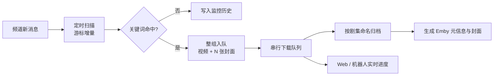
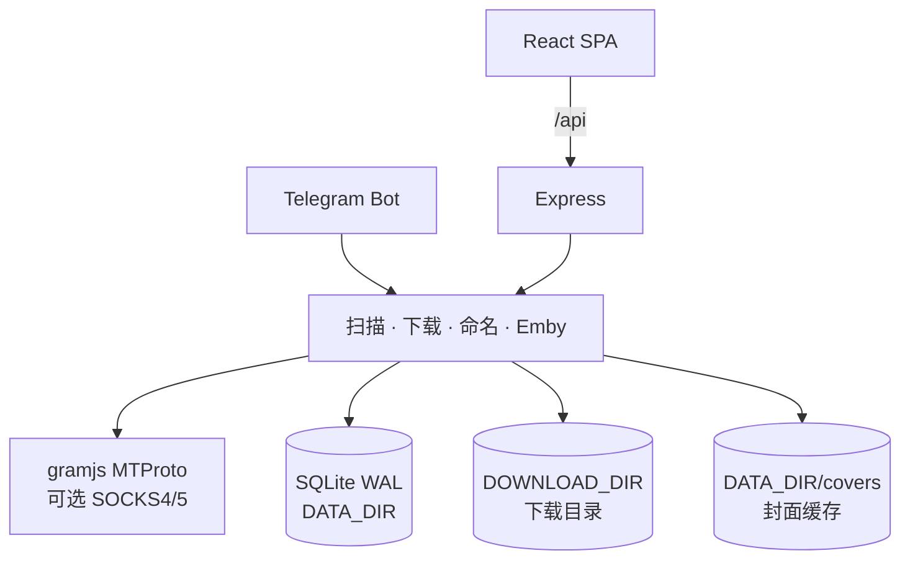

# tgsub 项目文档

> 这是 tgsub 的**完整技术文档**，涵盖功能细节、工作原理、全部配置项、HTTP 接口、开发自检与常见问题。
>
> 只想要「怎么部署起来用」→ 看 [README.md](README.md)，里面有精简版说明与开箱即用的
> Docker Compose 部署步骤（直接从 Docker Hub 拉镜像，无需 clone 仓库）。
>
> 本文档内容以 [README.md](README.md) 指向为准，两处若有出入，以 README 的部署章节为最新。

**Telegram 频道关键词订阅下载器** —— 定时扫描指定频道，命中关键词后把整条消息（含相册整组）的文件自动下载到本地，按剧集命名并生成 Emby 可直接读取的元信息。自带 Web 管理界面与 Telegram 机器人遥控，一条 `docker compose up -d` 即可长期运行。

<p>
  <a href="LICENSE"></a>
  
  
  
</p>

```
频道消息 ──▶ 定时扫描 ──▶ 关键词匹配 ──▶ 下载队列 ──▶ 剧集命名 + Emby 元信息 ──▶ 本地文件 + 管理界面
```

> 说明：本项目面向「订阅自己已加入的频道、把内容归档到本地媒体库」这一自用场景。请遵守 Telegram 服务条款与内容版权，不要用于传播违法内容。

---

## 目录

- [功能特性](#功能特性)
- [工作原理](#工作原理)
- [技术栈](#技术栈)
- [快速开始](#快速开始)
  - [方式一：Docker Compose 拉取 Docker Hub 镜像（推荐，免编译）](#方式一docker-compose-拉取-docker-hub-镜像推荐免编译)
  - [方式二：Docker Compose 本地构建](#方式二docker-compose-本地构建)
  - [方式三：本地运行](#方式三本地运行)
  - [首次配置](#首次配置)
- [配置说明](#配置说明)
- [Telegram 机器人](#telegram-机器人)
- [HTTP 接口](#http-接口)
- [数据、备份与迁移](#数据备份与迁移)
- [目录结构](#目录结构)
- [开发与自检](#开发与自检)
- [常见问题](#常见问题)
- [已知限制](#已知限制)
- [安全提示](#安全提示)
- [License](#license)

---

## 功能特性

### 抓取与订阅

- **频道管理**：支持 `@username`、`t.me` 链接、频道数字 ID、`t.me/+` 邀请链接（尝试自动加入）。
- **关键词订阅**：一个订阅可含多个关键词，三种匹配方式（包含 / 完整词 / 正则），可限定只在指定频道生效。
- **定时扫描**：全局间隔（默认 15 分钟），基于每个频道的游标增量拉取，不会重复处理历史消息。
- **整条消息下载**：命中相册中任意一条，就把同一 `groupedId` 的所有文件一起下载——以「消息」为单位，不是以文件为单位。
- **监控历史**：每次扫描实际查看过的消息全部留痕（命中 / 过滤 / 未命中 / 空消息），可按频道、状态筛选、全文搜索，一键跳转原消息，用来排查「为什么这条没下载」。
  - 同一条消息重复扫到只累加「扫描次数」并刷新「最近扫描时间」，不堆重复行。
  - 增量不足时会回看频道最近 20 条（留痕不重复入队），频道安静时页面也不会空着。
- **按链接直接下载**：`手动下载`页粘贴 `t.me` 链接即可抓取（公开/私有频道、相册整组均可），私有频道的 `t.me/c/<内部ID>/<消息ID>` 链接同样支持；监控历史每条记录也有「下载」按钮，机器人收到链接同样立即开始。
- **分页与清空**：监控历史、下载记录都可切换每页条数（20 / 50 / 100 / 200，或手动输入 5–500，按页面记住上次选择），底部是「首页 / 上一页 / 页码跳转 / 下一页 / 末页」的翻页条（不是无限加载）；「清空」按钮带范围选择——监控历史可只清未命中、下载记录可只清已结束，还能顺带删除磁盘上的原文件。

### 下载与队列

- **串行队列**：媒体常位于独立数据中心，gramjs 每次下载都要「导出授权 + 切 DC」，并发会互相打断成 0 字节，因此下载固定串行（设置里的并发数当前恒为 1）。
- **失败重试**：单任务自动重试一次，仍失败则标记失败；支持单条重试与「重试所有失败任务」。
- **进度明细**：每条任务显示总大小、已下载量、实时速度、剩余时间，以及开始/完成的具体日期时间（下载中每秒刷新，速度取 250ms 采样做指数平滑，数字不跳）。
- **队列管控**：每条任务带「暂停 / 停止 / 继续 / 插队」。
  - 暂停 / 停止会在下一个数据块写完后立即中断，已下载字节保留展示；
  - 继续把任务排到队首，当前任务下完即开始；
  - 插队提到队首，若有任务正在下载会先让它让位、稍后自动续上；
  - gramjs 不支持断点续传，继续/让位后都从 0 重新下载。
- **文件过滤**：可按最小 / 最大文件大小跳过不需要的内容；**视频不受过滤影响**（设了 30MB 上限也不会把整集正片挡掉）。
- **半截文件处理**：中断残留就地覆盖，不会产生 `xxx (2).mp4`；服务启动时清理 0 字节残留。

### 命名与 Emby 元信息

- **剧名与集数双来源**：先看正文，再看 Telegram 给的原始文件名。
  - 正文里有《剧名》就用它：`《美人局》第4集 …` → `美人局/美人局S01E04.mp4`；
  - 正文没有书名号，但写了集数（`妈妈我爱你 EP1-10`）时，把集数标记抹掉剩下的就是剧名；
  - 正文也认不出时，从原始文件名里推：`2048真实故事改编 - 妈妈我爱你 第1集 - AI短剧.mp4` → 剧名「妈妈我爱你」、第 1 集。
  - 抹完只剩「连载中 全系列完整版」这类宣传语时不当剧名用，退回兜底命名。
- **集数标记**：认得 `第4集`、`第1-10集`、`第1、2集`、`第一集`、`第十二集`（中文数字）、`EP1`、`EP1-10`、`S01E01`、`S01E01-E10`；
  优先级是「文件名自带集号 > 正文声明的集数按原文件名顺序对应 > 从首集顺延」。
- **一个链接多个视频按原文件名排序**：相册的消息顺序（id 递增）不一定等于作者上传的真实顺序，
  转发、补发、批量上传都会打乱。所以一条消息里有多个视频时，先看原始文件名里的序号
  （`01.mp4`、`2 - 片段.mp4`、`标题_03.mp4`），按它排出先后，再套正文声明的集数；
  正文没写集数时序号直接当集号（`01.mp4` → `S01E01`）。
  `2048真实故事.mp4`、`1080p.mp4`、`VID_20240101_1203.mp4` 这类数字不当序号；
  序号有缺失或重复时整体退回消息顺序，不猜一半留一半。
- **逐集编号**：相册里 10 条消息各带一集时，产出 `S01E01` ~ `S01E10`，
  剧集文件夹名只留剧名（`妈妈我爱你`），不再带 `EP1-10` 这类后缀。
- **一个文件含多集**：只有一条消息、一个视频，而正文或文件名声明了集数区间时，
  用范围名 `剧名S01E01-E10.mp4`，Emby 会认成第 1-10 集。
- **不重复加序号**：文件名里已经带出 `S01E01` 这类集号时不会再追加 `-01` 序号后缀（集号重复没意义），
  只有认不出集号、一条消息里塞了多个视频时才用 `剧名-01.mp4` 区分。
- **边下边生成元信息**：视频落盘后在剧集目录写出 Emby 可直接读取的文件，扫描即出海报、简介、集数。
- **历史文件自动改名**：升级后启动时会把旧的兜底命名（`妈妈我爱你 EP1-10-01.mp4`）改成剧集命名
  （`妈妈我爱你S01E01.mp4`），文件夹一并改名，NFO 里的季集与剧名同步重写。

- **认不出标题时一个链接一个文件夹**：正文里没有《剧名》这类标题、但带视频的消息，单独建一个文件夹，
  文件夹与文件同名（取正文首行，去掉链接 / @提及 / #标签，最长 50 字）；同一条消息多个视频加 `-01`、`-02`，
  两条不同链接撞名时后一条补 `-<消息id>`。纯文档 / 音乐 / 图片消息不受影响，仍走路径模板。
  可在设置里关掉。
- **封面与缩略图默认「模糊填充」**：比例和目标规格不一致时，画面完整居中保留，
  空出来的边角用同一张图的放大虚化版 + 压暗填满（见 `tg/coverimage.ts` 的 `writeBlurFill`），不黑边也不裁切。
  截帧仍用 ffmpeg 随机截 6 帧，为该集写 `<剧名S01E04>-thumb.jpg`（最长边不超 1280）再交给 `writeBlurFill` 出图；
  剧集目录的 poster / landscape / fanart 取自第一集、其余集只补缺不覆盖（1.2.0 起）。

```text
美人局/
  美人局S01E01.mp4        正片
  美人局S01E01.nfo        episodedetails：标题 / 季集 / 简介 / 标签 / 原消息链接
  美人局S01E01-thumb.jpg  这一集的随机截图（每集各不相同）
  美人局S01E02.mp4
  美人局S01E02-thumb.jpg
  tvshow.nfo              剧集信息（Emby 剧集库读这个）
  poster.jpg              竖版海报 1000×1500（取自第一集）
  landscape.jpg           横版图 1920×1080（取自第一集）
  fanart.jpg              背景图 1920×1080（取自第一集）
```

```text
妈妈我爱你/                       ← 相册 10 集，正文写「EP1-10」，文件名里写着「第N集」
  妈妈我爱你S01E01.mp4
  妈妈我爱你S01E02.mp4
  ...
  妈妈我爱你S01E10.mp4
  妈妈我爱你S01E01.nfo            每集一份
  tvshow.nfo
```

```text
妈妈我爱你/
  妈妈我爱你S01E01-E10.mp4        ← 单个视频本身就是 1-10 集的合集
```

```text
老板今天又发飙了，速看 完整版/          ← 认不出标题时，文件夹名就是正文
  老板今天又发飙了，速看 完整版.mp4
  老板今天又发飙了，速看 完整版.nfo
  tvshow.nfo
  poster.jpg  landscape.jpg  fanart.jpg  ← 由视频随机截帧生成
```

- 三张剧集封面用「模糊填充」出图：竖版槽位（poster 2:3）优先竖版帧、横版槽位（landscape / fanart 16:9）优先横版帧，朝向一致时虚化面积最小、观感最好；
  朝向一致就裁满，整段视频只有一种朝向时另一个朝向留黑边保住画面。
- 缩放依赖可选的 `sharp`，装不上时退化为原图复制，不影响下载。
- 监控历史里的悬停预览（`data/covers/`）只服务于界面回看，取自消息缩略图，与 Emby 封面无关。

### Emby 入库通知

下载完成的最后一件事是通知 Emby：把文件路径 POST 给 `/Library/Media/Updated`，Emby 只对这条路径做增量扫描，
新集几十秒内出现在媒体库里 —— 不必等它的定时任务，也不用去后台手点「扫描媒体库」。

- **配置位置**：「Emby 入库」独立页面（1.2.0 起从设置页拆出，侧边栏直达）。地址 / API Key / 路径映射与 Emby 自身的看板配置互不影响，关掉开关即完全停止。
- **路径映射必须有**：容器里是 `/downloads`，Emby 看到的是宿主目录（群晖 `/volume1/...`）。
  不映射时 Emby 照样返回 204，只是静默忽略 —— 媒体库里始终不出新集，这是最容易误判成「通知没生效」的情况。
- **合批**：相邻几集通常连着下完，攒 2.5 秒合并成一次请求（单次最多 50 条路径），只触发一次增量扫描。
- **失败不牵连下载**：网络抖动或 Emby 正在重启时重试一次并记 warn 日志，下载任务本身仍然标记成功。
- **兜底与补推**：页面上的「让 Emby 全库扫描」用于补历史文件；「补推路径」可对单个老剧集目录补一次通知。
- **密钥安全**：API Key 与 session / bot token 一样用 `SESSION_SECRET` 加密落盘，`/api/settings` 只回掩码与是否已配置。

### 元数据编辑

- **按文件夹聚合的目录树**：一个文件夹 = 一条记录，首级显示剧集信息（`tvshow.nfo` + 剧集封面），
  点左侧箭头展开后，子级逐条列出该目录里的每个视频（单集信息）。文件夹 / 单集两种层级都能编辑、
  换图、生成 NFO，点顶部「单集 / 剧集(tvshow)」可切换编辑目标。
- **不只是下载的文件**：元数据页支持「手动添加」服务器上的本地视频文件或视频目录（服务端目录浏览），
  登记后与项目下载的文件共用同一套编辑逻辑，同样能生成 NFO、抽帧做封面。
  路径写入 `media_sources` 表，允许操作的范围限定在下载目录与已登记来源内，其它路径一律拒绝。
- **手动目录按剧集文件夹展开**：添加一个上级目录（如 `D:\短剧`）时，会自动遍历并按里面的剧集文件夹拆开显示，
  每一剧各成一条，而不是把所有视频平铺成一条；`剧名/Season 01/` 这种季目录结构会归到剧名目录下。
  剧集条目下方标注了「来自 xxx」的来源路径。
- **手动来源可删除**：手动来源的剧集条目右侧有删除按钮，点开二次确认后移除登记，
  只移除登记关系，磁盘上的视频、NFO 与封面都不会被删除。
- **每一项都能删（1.2.1 起）**：目录树的剧集目录行、展开后的单集视频行都有删除按钮，
  点开先出预览（会删哪些视频 / NFO / 封面图、哪些文件保留、会连带清掉几条下载记录），确认后才执行。
  - **删除磁盘文件（purge）**：视频 + 它的 NFO + `<base>-*.jpg` 缩略图 + 剧集级 `tvshow.nfo` 与五张封面一起删；
    删空了的目录（含季目录）会一并收走，字幕等其它文件保留并在预览里单独列出。
  - **仅从列表移除（unlink）**：磁盘文件原封不动，只是不再显示与管理。写一条 `media_excluded` 隐藏登记，
    因此文件仍被上级目录来源覆盖也不会再冒出来；在「添加」对话框的「已隐藏的项目」里可以一键恢复。
  - 两种模式都会同步清掉指向这些文件的 `downloads` 记录、以及落在删除范围内的 `media_sources` 来源登记。
  - purge 模式下删掉的视频会通知 Emby（`UpdateType=Deleted`），让 Emby 把这一条从库里摘掉。
  - 删除范围受 `isAllowedPath` 约束：只有下载目录内、或已登记来源（含其子目录）里的路径能删，其余一律 403 拒绝。
- **一键生成**：选中文件夹或视频点「一键生成」，自动按文件名解析剧名 / 季 / 集，为每个视频写单集 NFO、
  补一份 `tvshow.nfo`，目录里没有封面时用 ffmpeg 随机截帧补齐横版 / 竖版封面。
- **表单改 NFO 不破坏手写内容**：保存时只替换目标标签，`<uniqueid>`、注释、自定义标签原样保留；
  检测到嵌套标签（如 `<actor>`）时会禁用表单，只能用原文编辑，避免误伤。
- **ffmpeg 截帧当封面**：播放器拖到任意时间点截图，或一键抽 8 张候选帧挑选；目标尺寸按图片类型自动缩放，
  缩放方式可选「留黑边（默认）/ 裁剪铺满 / 拉伸」——比例不对时默认补黑边保住整张图，不裁掉画面。
  ffmpeg 来自内置的静态二进制，也可在设置里指定自己的路径；设置页会显示实际生效的路径、来源与版本号。
- **手动框选画面**：换封面时（上传图片 / 视频截帧 / 消息原图）都能在画面上拖框，选框比例锁定该图片类型的比例，
  框外用半透明遮罩标出「会被裁掉的部分」，支持拖角缩放与整体移动；也可以一键「用整张图」。
  服务端按原图尺寸换算成像素再裁剪，不经过浏览器压缩。
- **图片来源四种**：视频截帧、上传本地图片、消息原图（下载时用的那 3 张）、复制目录里已有的图；
  剧集级与单集级（`剧名S01E04-poster.jpg`）都能设置，改完在 Emby 里「刷新元数据 → 替换现有图片」即可生效。

### 亮色 / 暗色主题

- 顶部工具栏有「亮色 / 暗色」切换按钮，选择记在浏览器 `localStorage`，刷新后保持。
- 首次打开跟随系统（`prefers-color-scheme`），并在 React 挂载前用内联脚本定好主题，避免刷新时闪一下默认深色。
- 全部配色走 CSS 变量（`web/src/index.css` 的 `:root` / `html.dark` 两套），Tailwind 侧用 `darkMode: "class"`，
  颜色写成 `rgb(var(--x) / <alpha-value>)` 形式，`/10`、`/50` 这类透明度修饰符照常可用。
  语义约定：数字越小越显眼（`slate-100` 最强 → `slate-700` 最弱），`white` 是主题自适应的对比色
  （深色主题=纯白，浅色主题=深色文字），`ok / warn / err / info` 是状态色。

### 管理界面

概览统计、频道列表、订阅关键词、监控历史、手动下载、下载记录、**日志**、设置（含在线登录 Telegram）。
React 18 + Vite + TailwindCSS，无 UI 框架，玻璃质感 + 亮色/暗色双主题，桌面与移动端均可用。

### 日志页面

服务运行日志内置在 Web 界面的「日志」页，排障时不必 SSH 进容器：

- **级别筛选**：全部 / 错误 / 警告 / 信息 / 调试 / 追踪，每级带计数。
- **关键词搜索**：同时匹配日志正文与结构化附加字段（`err.code`、`dcId`、`dc` 等）。
- **自动刷新**：5 秒一次，仅第一页生效；**下载 / 清空**（二次确认）/ **详情展开**（查看完整字段与堆栈）。
- **三路输出**：`stdout`（`docker compose logs`）、磁盘 `data/logs/app.log`（10MB 轮转）、内存环形缓冲（最近 2000 条，重启后从文件尾部回灌）。
- 后端实现见 `server/src/lib/logstore.ts`（环形缓冲 + 落盘 + 查询）与 `server/src/routes/logs.ts`（查询 / 统计 / 下载 / 清空 / 回灌）。

### Telegram 机器人

配一个自己的 bot，手机上发消息就能扫描、加频道、改订阅、看队列、按链接下载；定时扫描发现新内容还会主动推送摘要。
机器人用独立 bot token 授权，与账号 session 互不影响。

### 运维与安全

- **扫码登录**：手机 Telegram 扫一下即可，**无需申请 api_id / api_hash**（内置 tdl 自建应用凭证 15055931，设备指纹自动对齐）。
- **session 加密落盘**：AES-256-GCM 加密后存 SQLite，重启进程/重建容器无需重新登录。
- **单实例锁**：同一机器重复启动会被拒绝，避免同一 authKey 双连导致 `AUTH_KEY_DUPLICATED` 作废。
- **登录失效自愈**：`AUTH_KEY_UNREGISTERED` 等「服务器已作废」类错误不再做无谓重试，界面直接给出「彻底重置并重新登录」入口（`POST /api/auth/reset`，只清 session，不动频道/订阅/下载记录）。
- **重连节流加固**：gramjs 的 `_switchDC()` 会重建 `_sender` 对象，节流回调随之丢失、退化成 1 秒激进重连，进而双连触发 `AUTH_KEY_DUPLICATED`。项目对该方法做了包装，切换后重新装上退避节流（`hardenDcSwitch`）。
- **扫码前清理 + 落库后验证**：开始扫码前先 `resetSessionForRelogin()` 清空旧 session 与备份；扫码落库后用新 session 独立重连验证一次，验证失败即标记失效而不是留下半残状态。
- **生产就绪**：Docker 多阶段构建、入口脚本自动修正挂载目录属主后降权运行、健康检查、数据卷持久化、可选 HTTP Basic 认证、结构化日志（pino）。

---

## 工作原理





关键设计：

1. **增量为王**：每个频道记录 `last_scanned_id`，只拉新消息；首轮回溯条数可配（默认 40）。
2. **以消息为单位**：相册按 `groupedId` 聚合，代表 ID 取组内最小 `message_id`（`t.me/<频道>/<id>` 打开就是第一条），跨批次被游标切开时沿用已有记录。
3. **去重键**：频道内按 `message_id + 文件名`，另有「目标路径」去重，避免两个任务抢写同一个文件。
4. **串行下载的原因**：并发实测会把相册里 2/3 张图打断成 0 字节，串行总耗时几乎相同但不会留坏文件；下载分「先封面、后正片」两个阶段，避免切 DC 干扰小图。
5. **限流退避**：遇到 `FLOOD_WAIT` 自动按 1 → 2 → 4 … 分钟退避（上限 30 分钟）后重试，不中断长期任务。

---

## 技术栈

| 层 | 选型 |
| --- | --- |
| 后端 | Node.js 22 + TypeScript + Express 4 |
| Telegram | [gramjs](https://github.com/gram-js/gramjs)（MTProto，支持 SOCKS4/5 代理、扫码登录、bot 双模式） |
| 存储 | SQLite（better-sqlite3，WAL 模式） |
| 前端 | React 18 + Vite 6 + TailwindCSS 3（无 UI 框架） |
| 图像 / 视频 | sharp（可选，封面裁剪）、内置 ffmpeg 静态二进制（截帧；媒体探测用 `ffmpeg -i` 解析，不带 ffprobe） |
| 日志 | pino（结构化 JSON） |
| 部署 | Docker 多阶段构建 + docker compose（单容器，Express 同时托管前端） |

---

## 快速开始

### 前置要求

- 一台能（通过代理）访问 Telegram 的机器：Linux / macOS / Windows 均可
- Docker 部署：Docker 20.10+ 与 docker compose v2
- 本地运行：Node.js ≥ 20（推荐 22）、Python 3 与 C++ 构建工具（`better-sqlite3` 原生模块）

### 方式一：Docker Compose 拉取 Docker Hub 镜像（推荐，免编译）

> **只想部署起来用？** [README.md](README.md) 的「快速部署」章节给了一份**开箱即用、不需要 clone 仓库**
> 的精简流程：只要一个 `docker-compose.yml` 文件 + `docker compose up -d`，镜像直接从
> `rdevils7/tgsub:latest` 拉取。本节是同一套方案的完整版（含配置项对照、镜像标签、
> 迁移步骤与 docker run 备选）。

项目每次推送到 `main` 或打 `v*` 标签，GitHub Actions 会自动构建 **amd64 + arm64** 双架构镜像并发布到
**Docker Hub**（`rdevils7/tgsub`）与 GitHub Container Registry（`ghcr.io/rdevils7/tgsub`）。
服务器上不用装 Node、不用编译，也**不需要 clone 仓库**——
把仓库里的 `docker-compose.yml` 内容复制到服务器（或用 `curl` 从 raw.githubusercontent.com 下载同一份文件）即可。

> 两个仓库内容完全一致，**国内优先用 Docker Hub**，拉不动再换 GHCR。

> compose 文件里**全部使用真实值，不做 `${}` 变量插值**，也**不读取 `.env`**。
> 要改镜像版本、端口、目录、认证，直接编辑 compose 里对应的那一行。

**持久化目录（compose 里已配好，两个目录可分别指向不同磁盘）**

| 宿主机目录 | 容器内路径 | 存放内容 | 说明 |
| --- | --- | --- | --- |
| `./data` | `/data` | SQLite 数据库 `tgsub.db`、加密后的 Telegram session、会话密钥 `.session-secret`、封面缓存 `covers/`、临时截图 `frames/`、运行日志 | **数据持久化目录**。换容器、重装镜像都不丢；备份它即可恢复全部配置与记录 |
| `./downloads` | `/downloads` | 实际下载的媒体文件：视频 / 图片 / nfo / 封面，按 `{date}/{channel}/{name}` 归档 | **下载目录**。体积大，可单独挂到另一块大容量磁盘 |

想换位置，直接改 compose 里 `volumes:` 的两条：

```yaml
    volumes:
      - /opt/tgsub/data:/data        # 数据持久化目录
      - /mnt/nas/tgsub:/downloads     # 下载目录（可指向 NAS / 大容量盘）
```

**部署步骤（不需要 clone 仓库）**

```bash
mkdir -p tgsub && cd tgsub

# 建目录；属主问题由镜像入口脚本自动修正（见下方「挂载目录权限」）
mkdir -p data downloads

# 准备 compose 文件：把仓库里的 docker-compose.yml 复制过来即可
curl -fsSL -o docker-compose.yml \
  https://raw.githubusercontent.com/RDevils7/tgsub/main/docker-compose.yml
# 网络受限的环境：直接照抄 README.md「快速部署」章节里的 yaml 内容新建文件

docker compose up -d                # 默认就是拉 rdevils7/tgsub:latest
docker compose logs -f
```

启动后访问 `http://<服务器IP>:6789`。

### 挂载目录权限（NAS 反复重启的根因）

容器内应用以 `node`(1000) 运行，需要往 `/data`、`/downloads` 里写文件。而 NAS 的 Docker 面板
（包括群晖 Container Manager、威联通 Container Station 等）创建绑定挂载时，宿主机目录会被
自动建为 `root:root` —— 于是第一次写 `/data/.session-secret` 就 `EACCES`，进程崩溃、
被 `restart: unless-stopped` 反复拉起，表现为容器不停重启。

三道防线：

| 层 | 做法 |
| --- | --- |
| 镜像 | `docker-entrypoint.sh`：容器以 root 启动时把两个目录属主改成 `PUID:PGID`，再 `setpriv` 降权运行 node |
| 应用 | `env.ts`：启动前用探针文件实测目录可写性，不通就打印「哪个目录不可写 / 当前 uid / 怎么改」的指引，而不是抛裸 `EACCES` 堆栈 |
| 运维 | `PUID`/`PGID` 环境变量（默认 `1000:1000`）可指定运行账号；NAS 上改成自己账号的 uid/gid，下载的文件就直接属于该账号 |

补充说明：

- 入口脚本默认只改目录本身的属主（秒级完成）；历史文件属主不对时设 `CHOWN_RECURSE=1` 递归修正。
- 属主改不动（SMB/CIFS 共享、只读挂载）时脚本退回以 root 运行，保证「能启动」优先。
- compose 里**不要**加 `init: true`：镜像 ENTRYPOINT 已用 tini 做 PID 1，叠加会出现
  「Tini is not running as PID 1」警告。

常用运维命令：

```bash
docker compose pull                 # 拉取最新镜像
docker compose up -d                # 用新镜像重建容器（数据保留）
docker compose logs -f --tail=200
docker compose down                 # 停止容器，数据保留在 ./data 与 ./downloads
```

> 如果不用 compose，也可以直接 `docker run`：
>
> ```bash
> docker pull rdevils7/tgsub:latest
> docker run -d --name tgsub -p 6789:6789 \
>   -v "$(pwd)/data:/data" \
>   -v "$(pwd)/downloads:/downloads" \
>   -e DATA_DIR=/data -e DOWNLOAD_DIR=/downloads -e TZ=Asia/Shanghai \
>   --restart unless-stopped rdevils7/tgsub:latest
> ```

**可用标签**

| 标签 | 含义 |
| --- | --- |
| `latest` | 最新一次 `v*` 发布构建的镜像 |
| `v1.2.2` | 打 `v1.2.2` 标签时产生的固定版本（建议生产环境锁定） |

> 只发布 `latest` 与 `v<版本号>` 两个标签：push 到 `main` 只跑测试、不推镜像，
> 不再产生 `main` / `sha-xxx` / `1.0` / `1.0.4` 等派生标签。

```bash
# 锁定版本部署：把 compose 里 image: 一行改成 rdevils7/tgsub:v1.2.2
docker compose up -d
```

> **镜像仓库是公开的**，任何人都能 `docker pull`；如果你的 fork 想保持私有，需要在
> GitHub 仓库 `Settings → Packages` 里把可见性改成 Private，拉取前先
> `docker login ghcr.io -u <用户名>`（密码用 PAT，勾选 `read:packages`）。

### 方式二：Docker Compose 本地构建

想改代码、或需要自定义镜像时用这个（会在本机跑一遍依赖安装 + 前端打包，耗时较长）。
compose 文件是 `docker-compose.build.yml`，持久化目录与方式一完全一致：

```bash
git clone https://github.com/RDevils7/tgsub.git
cd tgsub

mkdir -p data downloads
sudo chown -R 1000:1000 data downloads   # Linux 必需：容器内以 node(1000) 运行

docker compose -f docker-compose.build.yml up -d --build
docker compose -f docker-compose.build.yml logs -f
```

打开 `http://<服务器IP>:6789` 即可。容器内数据目录固定为 `/data`，下载目录固定为 `/downloads`，
分别映射到宿主机 `./data` 与 `./downloads`（可在 `.env` 里改）。

> 国内构建慢：把 `docker-compose.build.yml` 里 `build.args.NPM_REGISTRY` 改成 `https://registry.npmmirror.com`。
> 若 `better-sqlite3` 预编译包下载失败，Dockerfile 会自动回退源码编译（镜像内置工具链）。

常用命令：

```bash
docker compose ps
docker compose restart          # 优雅重启（SIGTERM，会先断开 Telegram）
docker compose logs -f --tail=200
docker compose down             # 停止，数据保留在 ./data 与 ./downloads
```

### 方式三：本地运行

```bash
npm install                     # 工作区安装 server + web 依赖
npm run build                   # 构建前端静态资源与后端 dist
npm start                       # 生产模式，默认 http://127.0.0.1:6789
```

开发模式（前后端热更新，Vite 在 5173 自动代理 `/api`）：

```bash
npm run dev
```

本地运行时数据默认写入 `./data`（下载文件在 `./data/downloads`），可用 `DATA_DIR`、`DOWNLOAD_DIR`、`DB_FILE` 覆盖。

> **Windows 用户注意**：直接关终端或 `taskkill` 不会触发 SIGTERM，Telegram 连接被硬切断可能让 session 失效。
> 请用内置优雅退出接口，等端口释放后再启动新进程：
>
> ```bash
> curl -X POST http://127.0.0.1:6789/api/shutdown
> node server/dist/index.js
> ```

### 首次配置

#### 1. 配置代理

国内网络直连不上 Telegram，先在「设置 → 网络与代理」填代理（支持 SOCKS4 / SOCKS5 / SOCKS5H / HTTP / HTTPS），点「联网测试」确认 Telegram API 那一行是通的：

| 部署形态 | 代理地址写法 | 说明 |
| --- | --- | --- |
| 本机直接跑 `node server/dist/index.js` | `socks5://127.0.0.1:7890` | 代理在本机 |
| 代理在局域网另一台机器 / 旁路由 | `socks5://192.168.5.2:7890` | 填局域网 IP |
| Docker 容器访问宿主机代理 | `socks5://host.docker.internal:7890` | Linux 需在 compose 加 `extra_hosts: ["host.docker.internal:host-gateway"]` |

两个常见坑：

1. **端口别猜**：Clash 混合端口通常是 **7890**（同时支持 HTTP 与 SOCKS5），V2Ray 是 1080 / 10808。
   填之前先验证：`curl -x socks5h://IP:PORT https://api.telegram.org -o /dev/null -w "%{http_code}"`，有响应即通。
2. **容器里的 `127.0.0.1` 是容器自己**，不是宿主机；必须用局域网 IP 或 `host.docker.internal`。

#### 2. 扫码登录（推荐，完全不需要 api_id / api_hash）

「设置 → Telegram 账号 → 扫码登录」，用手机扫描二维码：

> 手机 Telegram → 设置 → 设备 → 链接桌面设备 → 扫描

二维码每 30 秒自动刷新，手机确认后自动完成登录；若账号开启两步验证，页面会提示输入密码。
session 用 AES-256-GCM 加密后写入数据库，重启无需重新登录。

内置凭证是 **tdl 自建应用标识**（`api_id=15055931`，与 [tdl](https://github.com/iyear/tdl) 使用的 AppBuiltin 一致），
不需要访问 my.telegram.org，也不会把账号信息交给任何第三方。

> `1.0.1` 起默认不再使用 Telegram Desktop 官方客户端凭证（`api_id=2040`）——
> 那等于冒充官方桌面客户端做自动化，会招致账号级处置（全部会话被重置、机器人被冻结）。
> 老版本升级时 `builtin_app` 会被自动迁移到 tdl（一次性迁移，之后手动改回不会被覆盖）。

#### 3. 可选：切换为自建应用凭证

能正常访问 my.telegram.org 时，建议在「API 凭证与网络」切换为**自定义 API**，填入自己的 `api_id` / `api_hash`，
账号信任度高于公开内置凭证：

> my.telegram.org → API development tools → 创建应用。
> 登录用手机号 + 验证码，**验证码发到你已登录的 Telegram 客户端里，不是短信**。

#### 4. 添加频道与订阅

- **添加频道**：「频道」页粘贴 `@channel` 或 `https://t.me/channel`；私有频道可以粘贴 `https://t.me/c/<内部ID>/<消息ID>` 链接或直接填数字 ID（需账号已加入该频道），也可用 `t.me/+` 邀请链接。
- **创建订阅**：「订阅关键词」页填关键词、选匹配方式与生效频道；名称可留空，保存时用第一个关键词命名。
- **等待或手动扫描**：默认每 15 分钟自动扫描，也可在概览页点「立即扫描」。

#### 5. 可选：接入 Telegram 机器人

见 [Telegram 机器人](#telegram-机器人)。

---

## 配置说明

### 环境变量

| 变量 | 默认值 | 说明 |
| --- | --- | --- |
| `PORT` | `6789` | 监听端口 |
| `HOST` | `0.0.0.0` | 监听地址 |
| `DATA_DIR` | `./data` | 数据目录（数据库、session、封面缓存、密钥）；Docker 里为 `/data` |
| `DOWNLOAD_DIR` | `$DATA_DIR/downloads` | 下载根目录；Docker 里为 `/downloads`，与数据目录分开挂载 |
| `DB_FILE` | `$DATA_DIR/tgsub.db` | SQLite 文件路径 |
| `WEB_DIST` | `./web/dist` | 前端静态资源目录 |
| `SESSION_SECRET` | 自动生成 | 加密 session 的密钥（≥16 位）；更换后需重新登录 |
| `BASIC_AUTH_USER` / `BASIC_AUTH_PASS` | 空 | 同时设置后启用 HTTP Basic 认证 |
| `LOG_LEVEL` | `info` | `debug` / `info` / `warn` / `error` |
| `TZ` | `Asia/Shanghai` | 时区，影响日志与按天分目录 |

> **compose 不读 `.env`** —— 仓库里的两份 compose 全部使用真实值，不做变量插值。
> 要改镜像版本、宿主机端口、两个持久化目录、认证信息，直接编辑 compose 对应的那一行。
> `.env` 只在本地直接运行 `node server/dist/index.js` 时生效（程序用 dotenv 自动加载根目录的 `.env`）。

### 界面设置项

以下配置存在数据库里，可在「设置」页修改，无需重启：

| 项 | 默认 | 说明 |
| --- | --- | --- |
| 凭证模式 | 内置 | 内置官方凭证 / 自定义 `api_id` + `api_hash` |
| 代理地址 | 空 | `socks5://`、`http://`、`socks4://` |
| 扫描间隔 | 15 分钟 | 自动扫描周期 |
| 首次回溯条数 | 40 | 新频道首轮回看多少条 |
| 单批拉取条数 | 100 | 每次请求的 messages 数量 |
| 并发下载数 | 3 | **当前实现恒为 1（串行）**，保留设置项 |
| 最小 / 最大文件大小 | 0 / 0 | 0 表示不限制；视频不受此限制 |
| 自动扫描 | 开 | 关闭后只能手动扫描 |
| 存储路径模板 | `{date}/{channel}/{name}` | 见下 |
| 生成 Emby 元信息 | 开 | 写出 nfo 与三张封面 |
| 认不出标题一链接一文件夹 | 开 | 没有《剧名》的视频按正文首行建文件夹 |
| 视频截帧生成封面 | 开 | 每集随机截帧生成缩略图，剧集封面取自第一集 |
| Emby 入库通知 | 关 | 下载完成后提交 `/Library/Media/Updated`，Emby 立刻增量扫描 |
| Emby 地址 | 空 | 例如 `http://192.168.1.10:8096`，不写协议按 http，末尾 `/web` 自动去掉 |
| Emby API Key | 空 | 管理员密钥，AES 加密落盘，接口只回末四位掩码 |
| Emby 路径映射 | 空 | 每行「本机路径=Emby 路径」，如 `/downloads=/volume1/media/tgsub` |
| 缓存上限 | 512 MB | `data/covers` + `data/frames` 超过它就自动清理最旧的；0 = 不清理 |
| 代理地址 | 空 | `socks5://host:port`（也可 socks4 / socks5h / http / https），留空直连；Telegram 只支持 SOCKS |
| ffmpeg 路径 | 空 | 截帧用；留空自动查找内置二进制或系统 PATH。下方实时显示实际生效的路径、来源与版本 |
| 机器人 | 关 | Bot Token、允许用户、扫描通知 |
| 第三方平台 | 关 | B站 / 小红书 / YouTube 下载开关；清晰度（默认「最高（原画）」）、存放子目录、是否写 nfo；三个平台的 Cookie 加密保存（平台名后的 `?` 悬停看分步取法）；「第三方平台代理」与其下的「国内平台也走代理」（默认关） |
| 第三方平台代理 | 空 | 只给 yt-dlp 用（`--proxy`），与上面 Telegram 的代理互相独立；YouTube 与检查更新必须填 |
| yt-dlp 自动更新 | 开 | 到点去 GitHub 看新版，有就下到 `data/bin` 并切过去（先 `--version` 校验，失败回滚） |
| yt-dlp 检查间隔 | 24 | 单位小时，1–720 |
| yt-dlp 路径 | 空 | 留空自动查找（`data/bin` → 镜像内置 `/usr/local/bin/yt-dlp` → PATH）；卡片上显示实际路径、来源、版本与最新版本 |

路径模板变量：`{date}`（按天分目录）、`{channel}`、`{name}`、`{id}`。
带《剧名》的剧集不走模板，直接落在 `<下载根>/<剧名>/`。

---

## 第三方平台下载（B站 / 小红书 / YouTube，1.0.5 – 1.2.2）

**为什么用 yt-dlp 而不是自己写接口**：这几个平台的播放地址都要签名（B站 `w_rid`、
小红书 `x-s`、YouTube `nsig`），算法是逆向出来的，平台一改就失效。yt-dlp 有社区持续跟版，
我们只负责喂 Cookie、读进度，并让它自己保持最新。

**抖音为什么被摘掉（1.2.1）**：yt-dlp 的 `DouyinIE` 调 `aweme/v1/web/aweme/detail/`，
接口要 `a_bogus` / `X-Bogus` / `msToken` / `__ac_signature` 一整套签名，yt-dlp 生成不出来
（源码留有 TODO「Run verification challenge code to generate signature cookies」）。
它那句 `Fresh cookies (not necessarily logged in) are needed` 是**误导性文案** ——
源码只在接口没返回 `aweme_detail` 时抛这句，**压根不检查 Cookie**；
实测带完整 Cookie 与完全不带 Cookie，报错一模一样。把签名链路全部走通
（`abogus` + `signWebUrl` + `__ac_signature`）之后，抖音返回 HTTP 200 但 body 为空，
响应头带 `x-vc-bdturing-parameters`（解出 `code:100000, type:verify, subtype:slide`）= 要求
**滑动验证码**，脚本过不去。留着这个平台只会让人以为是 Cookie 的问题反复重填，
所以整块移除：链接不再被识别、Cookie 加密数据由迁移清掉、队列里的遗留任务作废。

**代码结构**

| 文件 | 职责 |
| --- | --- |
| `server/src/platform/detect.ts` | 纯函数：`extractUrls`（从 App 分享口令里捞链接，兼容 `<https://…>`、紧贴中文、裸域名）→ 域名识别、ID 提取（BV / av / ep、小红书 explore、YouTube `v`/`shorts`/`embed`/`youtu.be`）、批量拆链接、去重键 |
| `server/src/platform/ytdlp.ts` | 定位二进制（手填 → `data/bin` → 镜像内置 → PATH）、`--version` 探测、Cookie → Netscape、`probePlatform`（`--dump-single-json`）、`downloadPlatform`（spawn + 进度模板 + `--print-to-file after_move:filepath`）、代理参数、YouTube JS runtime 判断、错误中文化、`withRawDetail`（把 yt-dlp 原始报错附在中文提示后面） |
| `server/src/platform/cookie.ts` | 纯函数：`parseCookiePairs` / `summarizeCookie` / `describeCookie` / `humanAge`，给「状态可见」用 |
| `server/src/platform/updater.ts` | GitHub Release 查询、按平台选资产、流式下载、`--version` 校验后原子替换、`data/bin` 优先、定时检查 |
| `server/src/platform/jobs.ts` | 解析后写 `downloads`（`source='platform'`）、目录规划、去重与失败复用、合集展开与「只下第一个 / 全部下载」的令牌 |
| `server/src/platform/cover.ts` | 下载平台官方封面 → 按 Emby 规格裁成 `poster.jpg` / `landscape.jpg` / `fanart.jpg` / `<标题>-thumb.jpg` |
| `server/src/lib/netprobe.ts` | `downloadFile()`：走同一套代理握手，跟随 3xx，body 流式落盘（更新二进制用） |
| `server/src/routes/platform.ts` | `GET /api/platform/status`、`POST /probe`、`POST /task`、`POST /refresh`、`POST /update` |
| `server/src/tg/downloader.ts` | `run()` 开头按 `row.source` 分流到 `runPlatform()`，其余（暂停/停止/重试/收尾）完全复用 |

**关键决策**

- **任务复用 downloads 表**：`channel_id` 指向保留频道「第三方链接」（`ensurePlatformChannel()`，`enabled=0` 不参与扫描），
  列表、统计、暂停/停止/重试、Emby 收尾全部现成。
- **进度**：`--progress-template "download:@@TGSUB %(progress.downloaded_bytes)s %(progress.total_bytes)s %(progress.total_bytes_estimate)s %(progress.speed)s"`，
  yt-dlp 自带进度条格式随版本变，自定义模板才稳定。
- **中断**：暂停/停止调用 `AbortController.abort()` → SIGTERM，2 秒后 SIGKILL；随后清理 `.part` / `.ytdl` 残片。
- **Cookie**：与 session 同级加密（`setPlatformCookie` / `getPlatformCookie`），不进 AppSettings，
  接口只回「N 项，首项 <name>」。传空字符串 = 清除，传掩码 = 不变。
  `normalizeCookie`（1.1.2）先把四种粘法统一成 `k=v; k2=v2`：普通串 / `Cookie:` 前缀 / JSON 导出
  （Cookie-Editor 的 `[{name,value}]` 或 `{k:v}`）/ Netscape cookies.txt（`#HttpOnly_` 前缀剥掉），
  空值丢弃。前端 `PlatformPanel.tsx` 里有一份等价实现（两边没有共享模块，改一处必须改两处）。
  `cookieToNetscape` 按平台写多个域名：YouTube `.youtube.com` + `.google.com`
  （`SID` / `SAPISID` 实际种在 google.com），漏域名的典型表现是「Cookie 填了却仍要求登录」。
  `COOKIE_REQUIRED` 现在只剩三组：B站 `SESSDATA` + `bili_jct`、小红书 `web_session` + `a1`、
  YouTube `SID` / `SAPISID` 系列。
- **扩展名**：由 yt-dlp 决定（mkv/webm 都可能），下载完成后回填 `save_name` / `file_name`。
- **目录**：`<platform_dir>/<平台>/<作者>/<标题> [ID]/`，每条视频一个目录，避免 `tvshow.nfo` 互相覆盖。
- **分享口令**：不能用「按空白切词」——App 复制出来的是整段文案，链接常被 `<>` 包着、紧贴中文。
  `URL_RE` 按「域名 + 路径允许字符集」扫，中文天然成为边界，末尾标点由 `cleanUrlText` 剥掉；
  小红书短链同时支持 `xhslink.com` 与 `xhslink.cn`（App 现在默认给后者）。
- **入口一致**：手动下载页（前端 `splitLinks`，同一套正则）、`POST /api/platform/task|probe`、
  机器人私聊（`splitPlatformLinks` + `enqueuePlatformLinks`，一次最多 5 条）三条路都吃整段口令。
- **默认画质**：`platform_quality` 默认 `best`（`bv*+ba/b`，视频音频分离后合并）。
  老库里若存过旧默认值 `1080`，启动时由 `migration_platform_quality_v106` 迁成 `best`，用户自选的 720/480 不动。
- **代理分离**：`platform_proxy` 只传给 yt-dlp 子进程（`--proxy`），不动 Telegram 的 `proxy_url`；
  `parseProxy` 解析失败时**不加参数**，避免脏值把下载搞挂。
- **国内平台默认直连（1.1.2）**：B站 的 upos CDN 把海外代理 IP 判成 `HTTP Error 567`
  （解析成功、只有传分片被拒），所以 `platformArgs()` 只对 YouTube 追加 `--proxy`；
  新增 `platform_proxy_domestic`（默认 false），服务器在海外又要下国内平台时才打开。
  `platformUsesProxy()` 供报错文案判断「这次到底带没带代理」，567 的提示据此分两种说法，
  避免让用户去关一个根本没开的开关。前端「第三方平台代理」下面多了同名复选框，状态接口回 `proxyDomestic`。
- **下载与合并的稳定性（1.1.1）**：`--retries` / `--fragment-retries` 由 3 提到 10，
  加 `--retry-sleep 3`，`--socket-timeout` 提到 30 —— 代理掐长连接时报
  `[SSL: UNEXPECTED_EOF_WHILE_READING] ... Giving up after 3 retries` 的主因是重试预算太小。
  合并容器由写死的 `mp4` 改成 `mp4/mkv`（`MERGE_CONTAINERS`）：YouTube 的 VP9/AV1 + Opus 组合
  塞不进 mp4（ffmpeg: `Could not find tag for codec opus`），交给 yt-dlp 按编码挑，
  不兼容自动落 mkv；能 mp4 时仍优先 mp4。`explainYtdlpError` 新增 TLS 中断、ffmpeg 合并失败
  （从 ffmpeg 输出里挑 `Could not find tag` 等关键行，指出具体编码）、磁盘满、无写权限四类翻译，
  不再把 `Postprocessing: Stream #1:0 -> #0:1 (copy)` 当错误抛给用户。
- **元数据（1.1.0）**：`--dump-single-json` 里的字段直接映射到 nfo —— 标题、简介（`plot`）、UP主（`studio` + `tag`）、
  发布日期（`aired` / `premiered` / `year`）、原链接（`uniqueid type="platform"`）、分区（`categories` → `genre`）、
  时长（`duration` → `runtime`）、播放量与点赞（Emby 没有对应字段，追加在简介尾部的「播放 12.3 万 · 点赞 4567 · 时长 12:34」一行）。
  小红书常常没有正文，此时用「标题，来自 UP主」兜底，避免 Emby 详情页一片空白。
  `uniqueid type="tgsub"` 保证 Emby 不会拿「UP主+标题」去联网乱刮。
- **官方封面 + 模糊填充（1.1.0 / 1.2.0）**：`probePlatform` 拿到的 `thumbnail` 存进 `emby_json.cover`，下载完成后由 `cover.ts` 取回；
  图床要 Referer（按平台给主页地址），走 `platform_proxy` 同一个代理。官方图宽 < 640px 撑不起海报时直接判「没有图」回退截帧；
  其余情况按 Emby 规格重裁，比例不符用 `writeBlurFill` 模糊填充（不黑边不裁切）。裁剪用 sharp（镜像里没有就原图落地）。
- **合集 / 多P（1.1.0）**：探测用 `--flat-playlist --playlist-end 200`，单条视频时它不改变结果，
  只有多P / 播放列表才返回 `_type: playlist`，因此**一次解析就能判断要不要问用户**。
  未指定 `mode` 时 `POST /api/platform/task` 不下任务，返回 `{ needsChoice: true, choice: { token, count, firstTitle … } }`；
  前端弹窗、机器人发两个内联按钮（`cmd:pg <token> one|all`），二次提交带 `mode` 或 `token`。
  展开时第一条复用已解析的完整信息，其余用 flat 条目（标题/作者/封面）直接入队，不再逐条解析 —— 200 条也不会卡住。
  超过 200 条只取前 200，界面上会写明。
- **YouTube 的 JS 运行时**：`--js-runtimes node` 是 yt-dlp 2025.10.22 才有的参数，老版本传了会直接报未知参数，
  所以先用 `versionRank()` 比较版本，够了才加；镜像自带 Node，不需要额外装 deno。
- **原始报错附带（1.2.1）**：`withRawDetail(message, raw)` 把 yt-dlp 原始 stderr 里的关键行
  （挑含 error / failed / forbidden / required / not found 的片段，截断 220 字）附在中文提示后面，
  界面上既有人话又有原始证据，排查时不用再去翻日志。

**自更新设计（1.0.6）**

| 环节 | 做法 |
| --- | --- |
| 查版本 | `GET api.github.com/repos/yt-dlp/yt-dlp/releases/latest` 取 `tag_name`，JSON 解析失败时退化成正则 |
| 选资产 | `yt-dlp.exe` / `yt-dlp_linux_aarch64` / `yt-dlp_linux_armv7l` / `yt-dlp_macos` / `yt-dlp` |
| 下载 | `downloadFile()` 流式写 `data/bin/yt-dlp.download`，超时 45s（空闲计时）、上限 128MB |
| 校验 | 先 `--version`，拿不到版本号就删除临时文件、**保留旧版本** |
| 替换 | 旧文件改名 `.bak` → 新文件改名到位 → chmod 755 → 删 `.bak`；任一步失败自动回滚 |
| 生效 | `clearYtdlpCache()` 后重新探测；`data/bin` 在候选列表里排在内置二进制之前 |
| 定时 | `startYtdlpAutoUpdate()`：启动 90s 后首检，之后每小时 tick 判断是否到 `ytdlp_check_hours` |
| 状态 | `ytdlp_check_at` / `ytdlp_latest` / `ytdlp_updated_at` / `ytdlp_check_error` 落库，重启后界面仍有记录 |

**镜像**：`Dockerfile` 按 `TARGETARCH` 下载 `yt-dlp_linux` / `yt-dlp_linux_aarch64` 到 `/usr/local/bin/yt-dlp`，
用 node 的 fetch 下载（不额外装 curl），失败即构建失败；`--build-arg INSTALL_YTDLP=0` 可跳过。
镜像里的那份是「兜底」，实际生效的可能是 `data/bin` 里自动更新下来的那份。

**自检**：`platformChecks()` 38 项（真实分享口令、链接识别含 YouTube 四种形态、冒充域名、中文标点、
去重、Cookie 四种粘法与体检、Cookie 文件多域名、画质映射、错误文案（YouTube 两类 + TLS 中断 + ffmpeg 合并 +
B站 567 两种说法 + 缺登录态提示）、抖音链接不再被识别、版本比较、资产名、代理参数），
全部是纯函数，不依赖网络与二进制。

---

## Telegram 机器人

在「设置 → Telegram 机器人」里配置，之后用手机就能遥控，不用开网页：

1. Telegram 里找 [@BotFather](https://t.me/BotFather)，发 `/newbot`，按提示起名，拿到 `9184902176:AAH...` 形式的 token；
2. 把 token 填进「Bot Token」，勾选「启用机器人控制」，点「保存并连接」——状态显示「在线 · @你的bot」即成功；
3. 给机器人发 `/id`，它回复你的数字 ID；把这个 ID 填进「允许的用户」（逗号分隔可加多个），再保存一次；
4. 之后直接发命令：

| 命令 | 作用 |
| --- | --- |
| `/status` | 运行状态，附带「立即扫描 / 频道 / 订阅 / 暂停」按钮 |
| `/scan`、`/scan 美人局` | 扫描全部频道，或只扫指定频道（也可跟频道 ID） |
| `/channels`、`/addch @xxx`、`/rmch 3` | 查看、添加、删除频道 |
| `/subs`、`/sub 关键词1,关键词2`、`/rmsub 4` | 查看、新建、删除订阅 |
| `/dl https://t.me/频道名/123` | 按链接直接下载这条消息（直接发链接也可以；`/dl` 同样接受平台口令） |
| `/tasks`、`/queue`、`/retry [all]` | 最近任务、下载队列、重试失败任务 |
| `/pause`、`/resume` | 暂停 / 恢复自动扫描 |
| `/stats`、`/help` | 累计统计、命令说明 |

除了 Telegram 消息链接，**把 App 里「复制链接」的整段分享口令直接发过来也会开始下载**（B站 `<>` 包裹、
小红书长文案与 `xhslink.cn` 都认），一次最多 5 条；全部失败且原因相同时只回一条，避免刷屏。

**1.2.2 起机器人更好用：**
- **转发即下载**：把频道消息**转发**给机器人，它会从 `fwd_from` 取原始频道与消息 ID 直接下载；来源频道不在列表里会自动加入（默认停用，不参与定时扫描）。
- **图片下载开关（默认关）**：默认只下视频 / 文件，纯图片消息不下；菜单点「🖼 图片下载」或发 `/imagedl` 开启后，链接 / 转发里的纯图片也一起下。开关按用户分别记忆。
- **完成卡片通知**：一条消息（含相册多集）全部落盘后弹一张完成卡片（频道名 + 缩略图 + 文件预览，用 t.me 链接渲染成频道帖子样式），多视频只通知一次；仅通知主动发起的下载（`matched_keyword IS NULL`），定时扫描命中的订阅不刷屏。
- 主按钮区新增「📥 下载列表」，图片开关切换按钮也在常用按钮里。

安全设计：白名单为空时机器人对所有人只回复「你的 ID 是多少」，不执行任何操作；指令仅在私聊生效，被拉进群也不响应。

---

## HTTP 接口

前端与机器人共用同一套 REST 接口，默认无鉴权（公网部署请开 Basic Auth 或放在反向代理之后）。

> 元数据接口用 `key` 定位目标，而不是数据库 ID —— `key` 是绝对路径的 base64url 编码。
> 这样「项目下载的文件」与「手动添加的本地文件 / 目录」可以共用同一套编辑逻辑。
> `key` 可操作的范围限定在下载目录与已登记的媒体来源内，越界路径一律返回 403。

| 方法 | 路径 | 说明 |
| --- | --- | --- |
| GET | `/api/health` | 健康检查（容器健康探针用） |
| GET | `/api/auth/state` | 登录状态 / 账号信息 |
| POST | `/api/auth/qr/start`、`/api/auth/qr/password`、`/api/auth/qr/cancel` | 扫码登录：开始、两步验证密码、取消 |
| GET | `/api/auth/qr/state` | 轮询扫码状态（二维码、已扫描、成功） |
| POST | `/api/auth/send-code`、`/api/auth/sign-in`、`/api/auth/password` | 手机号 + 验证码登录（备选方式） |
| POST | `/api/auth/session`、`/api/auth/logout`、`/api/auth/retry` | 导入 StringSession、退出、重试连接 |
| POST | `/api/auth/reset` | 彻底重置登录状态（清 session 与备份，可直接重新扫码；不影响其他数据） |
| GET / POST | `/api/channels` | 频道列表 / 添加频道 |
| DELETE | `/api/channels/:id` | 删除频道 |
| POST | `/api/channels/:id/scan` | 立即扫描单个频道 |
| GET / POST / DELETE | `/api/subscriptions`、`/api/subscriptions/:id` | 订阅规则增删查 |
| GET | `/api/downloads` | 下载列表（`status`、`channelId`、`q`、`limit`、`offset`） |
| POST | `/api/downloads/link` | 按 `t.me` 链接或 `channelId + messageId` 直接下载 |
| POST | `/api/downloads/:id/retry`、`/api/downloads/retry-failed` | 重试单条 / 全部失败 |
| POST | `/api/downloads/:id/pause`、`stop`、`resume`、`jump` | 队列管控：暂停 / 停止 / 继续 / 插队 |
| GET | `/api/downloads/:id/meta` | 单条任务的实时进度（含速度、剩余时间） |
| GET | `/api/downloads/:id/file` | 下载文件（仅已完成任务） |
| DELETE | `/api/downloads/:id?purge=1` | 删除单条记录，`purge=1` 同时删除文件 |
| DELETE | `/api/downloads?scope=finished\|all&purge=1` | 批量清空：`finished` 只清已结束的，`all` 保留正在下载的任务 |
| GET | `/api/messages` | 监控历史（`kind`、`channelId`、`q`、`limit`/`offset`，`limit` 上限 1000） |
| GET | `/api/messages/:id/preview` | 悬停预览：完整正文 + 3 张封面 |
| GET | `/api/messages/cover/:file` | 封面图（带文件名白名单校验，防目录穿越） |
| DELETE | `/api/messages?scope=all\|miss` | 清空监控历史，`scope=miss` 只清未命中的记录 |
| GET | `/api/metadata/items` | 可编辑的媒体列表，按**文件夹**聚合（`q`、`limit`、`offset`） |
| GET | `/api/metadata/sources`、POST、`DELETE /:id` | 手动添加的媒体来源（本地视频文件 / 视频目录） |
| GET | `/api/metadata/delete/preview?key=&mode=` | 删除预览：会删哪些文件、保留哪些、会连带清掉哪些记录（`mode=purge\|unlink`） |
| POST | `/api/metadata/delete` | 执行删除（body：`key` + `mode`）；`purge` 连磁盘文件一起删，`unlink` 只移出列表 |
| GET | `/api/metadata/excluded`、POST `/excluded/restore` | 被「仅从列表移除」隐藏的条目 / 取消隐藏 |
| GET | `/api/metadata/browse?path=` | 服务端目录浏览（列子目录与视频文件，供「手动添加」对话框用） |
| GET | `/api/metadata/detail?key=` | 元数据详情：NFO 字段、图片清单、视频探测信息、ffmpeg 状态 |
| POST | `/api/metadata/generate/nfo` | 一键生成 NFO：按当前目标写单集 NFO + `tvshow.nfo`（tgsub 下载的记录复用 `emby_json` 补全，尽量不空着） |
| POST | `/api/metadata/generate/images` | 一键生成图片：缺封面时用 ffmpeg 随机截帧生成横版/竖版封面 |
| PUT | `/api/metadata/meta` | 按表单保存单集 / 剧集 NFO（只替换目标标签） |
| GET / PUT | `/api/metadata/nfo` | 读取 / 覆盖 NFO 原文（`key` + `kind=episode\|show`） |
| POST | `/api/metadata/frame` | 用 ffmpeg 截取 `at` 秒那一帧写成指定图片（可带 `crop` 归一化框选） |
| POST | `/api/metadata/frame/preview` | 取 `at` 秒的原始画面，供页面框选用 |
| POST | `/api/metadata/frames` | 均匀抽一组候选帧，供页面挑选 |
| POST | `/api/metadata/image` | 上传图片（二进制 body，`key` / `name` / `scope` / `fit` / `crop` 查询参数） |
| POST | `/api/metadata/image/copy`、`image/from-cover` | 复制已有图片 / 用消息原图替换 |
| DELETE | `/api/metadata/image?key=&scope=&name=` | 删除某张图片 |
| GET | `/api/metadata/video?key=` | 视频流（支持 Range，供页面拖进度条选帧） |
| GET | `/api/metadata/extras?key=&file=` | 目录里的其它图片（只读，带后缀白名单） |
| GET | `/api/metadata/tools/status` | ffmpeg / sharp 可用性（`refresh=1` 强制重新探测） |
| GET / PUT | `/api/settings` | 读取 / 保存界面设置 |
| GET | `/api/emby/status` | Emby 入库状态：是否启用、配置是否完整、最近通知记录 |
| POST | `/api/emby/test` | 测试 Emby 连接（可带未保存的 `url` / `apiKey`，返回服务器名与版本） |
| POST | `/api/emby/refresh` | 让 Emby 立刻全库扫描（兜底用） |
| POST | `/api/emby/notify` | 手动补推一个路径（相对路径按下载目录解析） |
| GET | `/api/network` | 当前代理解析结果、支持的协议、可供探测的站点 |
| POST | `/api/network/test` | 联网测试：经当前（或传入的）代理探测 Telegram / Google / GitHub / 百度，返回状态码与耗时 |
| GET | `/api/ffmpeg` | ffmpeg 实际路径、来源与版本（`?refresh=1` 强制重新检测） |
| POST | `/api/bot/test` | 用 Bot API 的 `getMe` 校验 token（可传未保存的 `token` 与 `proxyUrl`） |
| GET | `/api/cache/status` | 缓存占用：covers / frames 各自的字节数与文件数、上限、超限字节、上次清理 |
| POST | `/api/cache/trim` | 按当前上限立刻清理一次（忽略「最近 10 分钟不动」的保护） |
| POST | `/api/cache/clear` | 一键清空 covers 与 frames，返回删除数、释放空间与剩余占用 |
| GET | `/api/settings/stats` | 概览统计（总数、今日、队列、频道数等） |
| GET | `/api/scan/state`、POST `/api/scan` | 扫描状态 / 触发扫描 |
| GET | `/api/bot`、POST `/api/bot/start`、`stop`、`restart` | 机器人状态与开关 |
| GET | `/api/logs` | 日志查询（`level`、`q` 关键词、`limit`、`offset`；返回 `items` / `total` / `counts` / `fileSize`） |
| GET | `/api/logs/stats` | 各级别日志条数与日志文件大小 |
| GET | `/api/logs/download` | 下载完整日志文件（`tgsub-<时间戳>.log`） |
| GET | `/api/logs/files` | 日志目录文件清单 |
| DELETE | `/api/logs` | 清空内存缓冲并截断日志文件 |
| POST | `/api/logs/reload` | 从磁盘文件重新回灌到内存缓冲 |
| POST | `/api/shutdown` | 优雅退出（先断开 Telegram 再退出进程） |

---

## 数据、备份与迁移

Docker 部署时目录被拆成两处（可在 `.env` 里改）：

| 宿主机目录（compose 默认） | 容器内路径 | 内容 |
| --- | --- | --- |
| `./data` | `/data` | `tgsub.db`（+ `-wal`/`-shm`）：频道、订阅、下载记录、监控历史、设置、加密 session；`.session-secret` 自动生成的密钥；`covers/` 悬停预览与下载共用的封面缓存；`frames/` 截帧临时文件；`app.log` 运行日志 |
| `./downloads` | `/downloads` | 实际下载的文件（按 `{date}/{channel}/{name}` 模板或剧集目录归档），含视频、图片、nfo、封面 |

本地运行时两者都在 `data/` 下：`data/` 为数据目录，`data/downloads/` 为下载目录（由 `DOWNLOAD_DIR` 控制）。

- **备份**：打包数据目录（Docker 部署即 `./data`）即可恢复全部配置与记录；下载文件在 `./downloads`，可按需单独备份。建议先 `POST /api/shutdown` 或 `docker compose stop`，让 SQLite 的 WAL 落盘。
- **恢复**：还原数据目录并保持 `SESSION_SECRET`（或 `.session-secret`）不变，否则 session 解不开，需要重新扫码。
- **容量**：单个 4K 影片可能几十 GB，下载目录务必放在空间充足的分区；Docker 部署时把 compose 里 `volumes:` 的下载目录那一项指向大容量磁盘（甚至 NAS）即可，数据目录单独留在本机。
- **迁移到新目录布局**（从旧版 `./data/downloads` 改成独立下载目录）：
  ```bash
  docker compose down
  mkdir -p downloads && mv data/downloads/* downloads/ && rmdir data/downloads
  sudo chown -R 1000:1000 data downloads
  docker compose up -d
  ```

---

## 目录结构

```text
tgsub/
├── server/
│   ├── src/
│   │   ├── index.ts            # 启动、中间件、静态资源、优雅关闭、单实例锁
│   │   ├── env.ts              # 环境变量与数据目录
│   │   ├── db.ts               # schema、迁移、设置读写、session 加解密
│   │   ├── logger.ts           # pino 初始化（stdout + 文件 + 内存缓冲三路输出）
│   │   ├── lib/logstore.ts     # 日志环形缓冲（2000 条）+ 落盘轮转（10MB）+ 查询解析
│   │   ├── match.ts            # 关键词匹配引擎（包含 / 完整词 / 正则）
│   │   ├── types.ts            # 共享类型与默认设置
│   │   ├── tg/
│   │   │   ├── client.ts       # MTProto 客户端、扫码登录、频道解析、重连退避
│   │   │   ├── scanner.ts      # 增量扫描、相册聚合、消息留痕
│   │   │   ├── enqueue.ts      # 命中后按组入队（命名、去重、Emby 元信息）
│   │   │   ├── downloader.ts   # 串行下载队列、实时进度、重试、暂停/停止/插队
│   │   │   ├── direct.ts       # 按链接 / 频道+消息 ID 直接下载
│   │   │   ├── media.ts        # 媒体信息解析、路径生成
│   │   │   ├── entity.ts       # 频道实体标识（-100 标记形式）与消息链接
│   │   │   ├── naming.ts       # 剧集命名策略（剧名 / 季集 / 封面挑图）
│   │   │   ├── legacy.ts       # 历史剧集文件名修正（去掉多余的 -NN 序号）
│   │   │   ├── mediatree.ts    # 媒体目录树：下载文件 + 手动来源按文件夹聚合
│   │   │   ├── mediapath.ts    # 媒体路径纯函数：视频后缀、递归找视频、副产物命名（不碰数据库）
│   │   │   ├── mediamanage.ts  # 删除管理：生成删除计划（视频+NFO+封面）、执行删除并同步数据库
│   │   │   ├── covers.ts       # 封面缓存（预览与下载共用同一组图）
│   │   │   ├── emby.ts         # nfo 生成、三张封面裁剪合成
│   │   │   ├── nfo.ts          # NFO 解析与就地改写（只替换目标标签）
│   │   │   ├── ffmpeg.ts       # ffmpeg 定位、媒体探测（ffmpeg -i 解析）、截帧
│   │   │   ├── bot.ts          # Telegram 机器人命令层与推送
│   │   │   └── notify.ts       # 通知
│   │   └── routes/             # auth / channels / subscriptions / downloads / messages / metadata / emby / logs / settings / system
│   └── dist/                   # 构建产物（不提交）
├── web/
│   └── src/
│       ├── pages/              # 概览、频道、订阅、监控历史、手动下载、下载记录、元数据、日志、设置
│       ├── components/         # UI 基础组件、图标、Toast
│       ├── hooks/useTheme.ts   # 亮色 / 暗色主题（localStorage 持久化）
│       ├── api.ts / types.ts / utils.ts
│       └── index.css           # 主题 CSS 变量（:root 浅色 / html.dark 深色）
├── scripts/                    # 自检与诊断脚本（见下）
├── data/                       # 运行时数据（不提交）：数据库、session、封面缓存、日志
├── downloads/                  # 运行时下载目录（不提交）：视频 / 图片 / nfo / 封面
├── .github/workflows/docker.yml # CI：构建镜像并发布到 GHCR + Docker Hub
├── Dockerfile                  # 四阶段构建
├── docker-compose.yml          # 拉取 Docker Hub 镜像部署（默认，数据 / 下载目录分开挂载）
├── docker-compose.build.yml    # 本地构建镜像后部署
├── .env.example
├── README.md                   # 精简版说明与快速部署（面向使用者）
└── PROJECT_DOC.md              # 本文档：完整技术文档（面向开发者）
```

---

## 开发与自检

```bash
npm install
npm run dev            # API :6789 + Vite :5173（/api 自动代理）
npm run build          # 构建 web/dist 与 server/dist
npm run typecheck      # 前后端类型检查
npm run selftest       # 核心逻辑自检（关键词匹配、相册解析、路径安全、命名与 Emby）
npm run test:delete    # 元数据删除集成自检（临时数据目录 + 临时文件系统，不碰真实数据）
```

其它脚本（都在 `scripts/`，多数不需要联网）：

| 脚本 | 用途 |
| --- | --- |
| `npx tsx scripts/test-bot.ts` | 机器人命令层自检（临时数据目录，不连 Telegram） |
| `npx tsx scripts/test-media-delete.ts` | 元数据删除集成自检：删目录 / 删单集 / 只移出列表的副作用 |
| `npx tsx scripts/test-covers.ts` | 封面缓存与「预览=下载」一致性自检 |
| `node scripts/e2e-manual.mjs` | 手动下载接口端到端（需已登录、可联网） |
| `node scripts/e2e-bot.mjs` | 机器人端到端 |
| `node scripts/diag-session.js` | 解密本地 session，打印 DC / 地址 / authKey 指纹并试连（服务运行时会拒绝执行） |
| `bash scripts/watch-ci.sh <run_id>` | 轮询 GitHub Actions run 直到结束，打印各 job 状态 |
| `node scripts/check-workflow.cjs` | 校验 CI workflow 的 YAML 结构、表达式配对与关键字段 |

### 镜像发布（CI/CD）

`.github/workflows/docker.yml` 在每次推送 `main`、打 `v*` 标签、提 PR 时自动运行：

1. **test 任务**：在 `linux/amd64` 上构建镜像 → 启动容器 → 轮询 `/api/health` → 请求首页，
   任一步失败就不发布（PR 只跑这一步）；同时验证 NAS 场景（root 属主挂载目录）与内置 ffmpeg 可用；
2. **publish 任务**：test 通过后，用 buildx 同时构建 `linux/amd64` 与 `linux/arm64`
   （arm64 走 QEMU 模拟），推送到 `ghcr.io/rdevils7/tgsub` 与 Docker Hub `rdevils7/tgsub`，
   标签见[「可用标签」](#方式一docker-compose-拉取-docker-hub-镜像推荐免编译)。

**GHCR** 用仓库内置的 `GITHUB_TOKEN` 登录，无需额外配置密钥；首次推送后如果包是私有的，
去仓库 `Settings → Packages` 把 `tgsub` 改成 Public 即可让任何人 `docker pull`。

**Docker Hub** 需要两个仓库 Secret（在 `Settings → Secrets and variables → Actions` 里添加）：

| Secret 名 | 值 |
| --- | --- |
| `DOCKERHUB_USERNAME` | Docker Hub 用户名（小写），例如 `rdevils7` |
| `DOCKERHUB_TOKEN` | Docker Hub 的 **Access Token**（不是账号密码），在 Account settings → Personal access tokens 生成，权限 Read & Write |

> 没配这两个 Secret 也不会让流水线失败 —— CI 会跳过 Docker Hub 登录，
> 只发布到 GHCR 并打一条 `::notice::` 提示日志。

> **关于 package-lock.json**：lock 是在 Windows 上生成的，缺 Linux 平台的原生可选依赖
> （`@rollup/rollup-linux-x64-gnu`、`@esbuild/linux-x64` 等二进制包），直接 `npm ci`
> 会报 "Cannot find module @rollup/rollup-linux-x64-gnu"（npm/cli#4828）。
> 因此镜像内按 `package.json` 重新解析依赖树，lock 仅用于本地 Windows 开发。

校验镜像能否匿名拉取：

```bash
bash scripts/check-ghcr.sh                              # 检查 latest
GHCR_PROXY=http://127.0.0.1:7897 bash scripts/check-ghcr.sh ghcr.io/rdevils7/tgsub v1.0.6
```

手动触发或指定版本发布：

```bash
# 手动触发一次构建（GitHub 页面 Actions → Docker 镜像 → Run workflow）
git tag v1.0.6 && git push origin v1.0.6    # 发布 v1.0.5 / latest 两个标签
```

本地想验证镜像（需要本机装了 Docker）：

```bash
docker build -t tgsub:local .
docker run -d --name tgsub -p 6789:6789 -v "$(pwd)/data:/data" tgsub:local
curl http://127.0.0.1:6789/api/health
```

---

## 常见问题

**在 my.telegram.org 申请 api_id 提示 `Too many attempts. Please try again later.`**
这是**出口 IP 的风控限流**，不是账号被封。机房 / 代理 IP（日本、香港、新加坡等热门节点）被大量用户申请过，很容易命中阈值。

1. **别反复点 Create application**——每次点击都会重置冷却计时，越点越久。
2. 换一个冷门地区节点（欧洲小国、中东、南美），用无痕窗口重新登录。
3. 用手机移动数据 + 手机上的代理申请，运营商 IP 风控等级更低，通常最有效。
4. 最后手段：等 24 小时自然解除。

另外先回 my.telegram.org 首页看应用列表——建过的话直接复用已有 `api_id` / `api_hash`，不用新建。填表时 URL 可留空，平台选 **Desktop**。

**元数据页点「抽帧」提示未找到 ffmpeg**
项目依赖里已经带了 `@ffmpeg-installer/ffmpeg` 的静态二进制，正常安装无需额外配置。
若提示找不到，按顺序检查：`node_modules/@ffmpeg-installer` 是否完整（`npm ci` 可修复）；Docker 部署时是否用了自定义镜像把 devDependencies 之外的东西裁掉；
再不行到「设置 → Emby 媒体库 → ffmpeg 路径」手动填一个绝对路径，保存后回元数据页点右上角刷新即可。

> **关于 ffprobe**：镜像里**不再内置** `@ffprobe-installer`（它单独就占 75MB，是镜像体积最大的一层，
> 也是从慢速镜像站拉取时卡在 99% 的直接原因）。媒体探测（时长 / 分辨率 / 编码 / 码率 / 帧率）
> 改由 `server/src/tg/ffmpeg.ts` 的 `parseFfmpegProbe()` 解析 `ffmpeg -i` 的 stderr 输出，
> 字段与 ffprobe 完全一致。若用户自备 ffprobe，程序仍会优先使用它。

**重启后提示未登录 / 每次重启都要重新扫码**
正常情况下**只需扫码一次**：session 加密写入数据库（另有一份备份），重启进程、重建容器都会自动复用。为此有五层保护：
单实例锁、失效后退避重试两轮、判定失效只标记不删库（设置页有「重试连接」）、主记录损坏时回滚到备份、扫码落库后用新 session 独立重连验证一次。
仍然失效时按顺序排查：去「日志」页看最后的错误码与 authKey 指纹（`dc5/xxxxxxxxxxxx`）→ 确认没有别的进程用过同一 session → 确认 `data/.session-secret` 没被删除或替换。

**操作时提示 `AUTH_KEY_UNREGISTERED` / 点「重新链接」和「重新扫码」都没用**
本地 session 在服务器端已不可用（授权被撤销、在其他设备「终止其他会话」、或同一 authKey 被并发使用）。
这类错误**重试和直接重扫都不会恢复**：服务器已把该 authKey 作废，带着旧 session 去扫码会让新 key 当场一起作废（`AUTH_KEY_DUPLICATED`），看起来就是「扫码也没用」。
设置页会显示红色失效卡片并按错误码给出指引，处理方式：

1. 点「**彻底重置并重新登录**」（`POST /api/auth/reset`）—— 清掉本地 session、备份与登录状态，**不影响频道、订阅、下载记录**。
2. 重新扫码。这一步已内置防护：扫码前先清理旧 session，扫码落库后用新 session 独立重连验证，验证通过才算成功。
3. 若仍失败，去「日志」页搜 `AUTH_KEY` 看错误码，并搜「已切换数据中心并恢复重连节流」确认 DC 切换后节流是否恢复。

**操作时提示 `AUTH_KEY_DUPLICATED`**
同一 authKey 在多处并发连接，服务器会**永久作废**该 key。除按上一条「彻底重置并重新登录」外，
务必确认没有第二个容器 / 第二个进程 / 一份被复制走的 `data/` 在用同一个 session —— 单实例锁只能拦住同一台机器上的重复启动。

**扫码登录失败 / 二维码加载不出来**
先确认代理已保存且可用。二维码 30 秒自动轮换，一直卡在「等待扫描…」时检查手机是否为同一账号、入口是否为「设置 → 设备 → 链接桌面设备」。
连续多次生成会重建连接，不要在页面上反复点击；实在不行先「彻底重置并重新登录」再扫。

**扫描报 `FLOOD_WAIT_X`**
Telegram 限流。降低「单批拉取条数」、拉长扫描间隔，或等提示的秒数；下载任务遇到限流会自动退避重试。

**频道添加失败 / `CHANNEL_PRIVATE`**
私有频道需先用自己的账号加入，可直接粘贴 `t.me/+xxxx` 邀请链接让程序尝试加入，
也可以粘贴 `t.me/c/<内部ID>/<消息ID>` 链接或直接填数字频道 ID。

**私有频道下载报 `Could not find the input entity ... className: PeerUser`**
频道 ID 必须用 Telegram 的标记形式（`-100` 开头）去解析，裸号会被当成用户 ID。
程序内部统一走 `-100` 标记形式，正常情况下不会出现这个报错；若手动改过数据库里的 `channels.tg_id`，
把它改回未标记的裸号（与 `entity.id` 一致）即可。

**登录时提示需要两步验证**
输入两步验证密码即可；也可以在「设置」里粘贴已有环境的 StringSession 直接导入。

**重复下载同一文件**
同一频道内按 `message_id + 文件名` 去重，另按目标路径去重；重置频道游标（频道卡片上的刷新按钮）会让下一次扫描重新检查最近消息。

**文件名乱码 / 缺少扩展名**
优先用 Telegram 原始文件名；无文件名（如压缩图片）时按 MIME 类型推断扩展名。

**点「继续」后进度回到 0**
gramjs 的 `downloadMedia` 不支持按字节续传，暂停/停止/让位后都会从头下载，因此继续前会提示「继续后从头下载」。

**磁盘涨得快**
在设置里配好最小/最大文件大小、封面数量（默认 3 张），或给订阅限定频道；下载记录页可按状态筛选后批量删除并勾选删除文件。

**界面直接暴露公网安全吗**
默认无认证。请在 `.env` 设置 `BASIC_AUTH_USER` / `BASIC_AUTH_PASS`，并置于 HTTPS 反向代理之后。`data/` 目录含加密 session 与 bot token，**不要提交到代码仓库**。

---

## 已知限制

- 默认使用公开内置凭证，账号信任度低于自建应用，高频大量下载更容易触发限流。
- 单账号运行，不支持多账号池；频道很多时建议调大扫描间隔。
- 只处理新消息（首轮回溯可配），不做全量历史归档。
- 下载文件名在下载时确定；旧版本多带的一截 `-01` 序号会在服务启动时自动修正（数据库与磁盘文件一起改名）。
- 下载固定串行（并发数设置项暂时不生效），不支持断点续传。
- 没有 per-channel cron，只有全局扫描间隔。

---

## 安全提示

- `data/` 内含加密 session、bot token、加密密钥，请勿提交或分享；仓库的 `.gitignore` 已排除。
- 公网部署请开启 Basic Auth 或使用反向代理 + HTTPS，并限制来源 IP。
- 机器人白名单为空时不会执行任何命令，建议配置后立即填入自己的用户 ID。

---

## License

[MIT](LICENSE) © 2026 RDevils7
